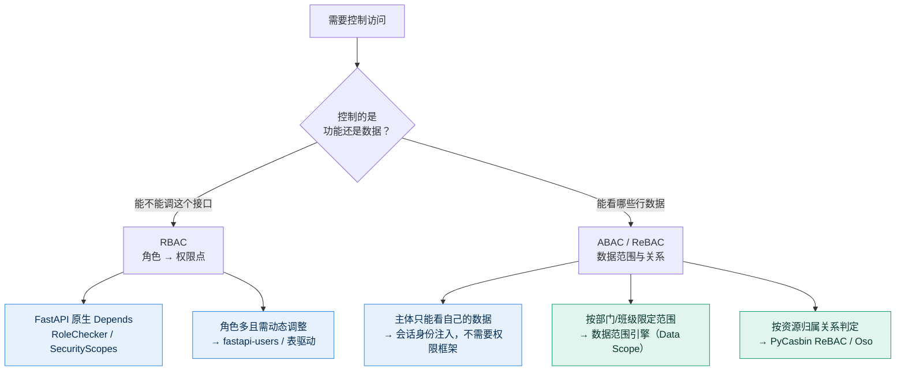

# 15 · 技术选型：FastAPI 的权限模型与 Spring Security 对应关系

> 承接 [14 · Agent 平台后端框架对比](./14-技术选型-Agent平台后端框架对比.md)。
> 常见疑问：「Spring Boot 有 RBAC 框架，FastAPI 有没有类似的？」
> 本文回答这个问题，并给出本项目应当采用哪一层权限能力。

---

## 一、先纠正问题的前提

这个问法隐含了一个假设：**授权能力是"框架提供的一个模块"**。这符合 Spring 生态的实际情况，但不适用于 FastAPI。

| | Spring Security | FastAPI |
|---|---|---|
| 授权定位 | **框架内建组件**（Container） | **依赖注入模式**（Pattern） |
| 提供方式 | 引入 starter，配置类 + 注解 | 官方**不内置**，用 `Depends` 自行组装 |
| 能力边界 | 由框架定义，扩展点清晰 | 由你的依赖树定义，无边界 |
| 心智模型 | 「框架负责鉴权，我在配置里声明规则」 | 「鉴权是业务逻辑的一部分，我在路由上组合它」 |

**结论：FastAPI 没有一个和 Spring Security 一一对位的"授权框架"，但 Spring Security 的每一项授权能力，FastAPI 都有一个成本相近的实现方式——它不是 jar 包，而是一段依赖函数。**

这个差异本身不是缺点。FastAPI 官方文档的理念是：**授权是业务语义，不应该被框架的抽象层吃掉。** 代价是你需要自己想清楚"谁能对什么做什么"，收益是权限逻辑与业务逻辑在同一处可读。

---

## 二、能力对应表

| Spring Security | FastAPI 对应物 | 成熟度 |
|---|---|---|
| `FilterChainProxy` / `antMatchers` 路径级规则 | `APIRouter(dependencies=[...])` | 原生支持 |
| `@PreAuthorize("hasRole('ADMIN')")` | 参数化的 `Depends(RoleChecker([...]))` 依赖工厂 | 原生支持，官方文档自带模式 |
| `hasAuthority()` / 细粒度权限码 | `OAuth2PasswordBearer(scopes=[...])` + `SecurityScopes` | 原生支持 |
| `SecurityContext` / `Principal` | `Depends(get_current_user)` | 原生支持 |
| `UserDetailsService` | `fastapi-users` | 第三方，成熟 |
| `AuthenticationProvider` / 多认证源 | `AuthX` | 第三方，成熟 |
| `Voter` / `AccessDecisionManager` 策略外置 | `PyCasbin`（`model.conf` + `policy`） | 第三方，成熟且跨语言 |
| ACL 行级权限 | `fastapi-permissions` | 第三方，特定场景 |
| 独立策略服务（OPA 风格） | `Oso` / `Permify` / `Cerbos` | 第三方，重 |

---

## 三、方案全景：三层选择

### 第 1 层 · 原生依赖注入（零依赖，覆盖 80% 场景）

FastAPI 自带的 `OAuth2PasswordBearer` + `SecurityScopes`，配合一个参数化的依赖工厂，就是 Spring Security 那套角色/权限校验的等价物：

```python
from fastapi import Depends, HTTPException, status
from typing import Annotated

def RoleChecker(allowed_roles: list[str]):
    def check_role(current_user: User = Depends(get_current_user)) -> User:
        if current_user.role not in allowed_roles:
            raise HTTPException(status_code=status.HTTP_403_FORBIDDEN, detail="权限不足")
        return current_user
    return check_role

@router.delete("/users/{user_id}")
def delete_user(user: User = Depends(RoleChecker(["admin"]))): ...
```

也可以把约束提到 router 层，等价于 Spring 的 `authorizeHttpRequests()` 路径规则：

```python
admin_router = APIRouter(prefix="/admin", dependencies=[Depends(RoleChecker(["admin"]))])
```

**优势**：权限需求在路由声明处就地可见，读代码时不需要跳到配置文件。
**劣势**：角色少时很舒服，角色与权限一多（尤其需要"运营临时加个权限"）就必须改成表驱动。

### 第 2 层 · 库方案

| 库 | 定位 | 相当于 Spring 生态的 | 注意 |
|---|---|---|---|
| `fastapi-users` | 用户注册/登录/角色完整方案 | Spring Security + `UserDetailsService` | 表结构约定较强，侵入性大 |
| `AuthX` | 认证为主，JWT/OAuth2 管理 | 过滤器链 + Token 管理 | 偏认证，授权需自行补 |
| `PyCasbin` / `fastapi-casbin-auth` | 策略外置的策略引擎 | `Voter` + 权限策略外置 | 学习成本中，支持策略热更新 |
| `casbin-fastapi-decorator` | 装饰器式 Casbin 封装 | `@PreAuthorize` | 无中间件，策略可存 DB |
| `fastapi-permissions` | 基于 ACL 的行级权限 | 无直接对应（比 RBAC 更细） | 需理解 Pyramid 式概念 |
| `fastapi-best-architecture` | 完整脚手架：RBAC + 数据权限 | 相当于 Java 侧的若依（RuoYi） | 表结构驱动，最"重"也最全 |

### 第 3 层 · 独立策略引擎

`Oso` / `Permify` / `Cerbos` / `Casdoor`：策略与代码彻底分离，跨语言统一。
**适用**：多后端服务需要统一权限、权限变更频繁且需审计。
**不适用**：单体应用——引入它等于凭空增加一套基础设施和部署依赖。

---

## 四、关键区分：你要的是哪种粒度

这是选型时最容易搞错的地方。**RBAC 只解决"能不能访问这个功能"，解决不了"能访问谁的数据"。**



---

## 五、落到本项目：阶段一不需要 RBAC

这一点比上面所有对比都重要。

回看 [10 · 阶段一 Agent 设计](./10-阶段一-校园助手Agent设计.md) 的四类能力（课表 / 成绩 / 借阅 / 提醒），权限的真实形态是：

| 问题 | 本项目实际答案 |
|---|---|
| 主体有几种角色？ | **一种**——学生 |
| 需要判断"能不能调这个接口"吗？ | 不需要，所有登录学生都能查这四类信息 |
| 真正的约束是什么？ | **"只能查自己的数据"** |
| 这在权限模型里属于哪一层？ | 数据范围（行级），**不是 RBAC** |

也就是说，本项目阶段一的核心安全约束，落在 [12 · 技术架构与数据契约](./12-阶段一-技术架构与数据契约.md) §7 那条架构约束上：

> **`student_id` 由会话身份层注入，禁止作为模型可填参数。**

在 FastAPI 里它的实现形态就是**一个依赖，不是一套权限框架**：

```python
def get_current_student(cred: HTTPAuthorizationCredentials = Depends(security)) -> str:
    payload = decode_token(cred.credentials)      # JWT 解码
    return payload["sub"]                          # student_id 来自令牌，不来自请求体

@router.get("/timetable")
def timetable(week: int | None = None,
              student_id: str = Depends(get_current_student)):  # 不可被请求参数覆盖
    return timetable_query(student_id, week)
```

**为什么这样就够了**：因为 `student_id` 根本不出现在请求参数里，攻击者无论构造什么输入都无法指向他人数据。这是**架构级防越权**——比"加一道权限校验"更可靠，因为它不依赖校验逻辑写对。

> 文档 12 里"不做爬取、学生本人授权通道"的伦理约束，与这里的架构约束是同一条线的两端：**越权风险优先用架构消除，而不是用校验拦截。**

### 什么时候才需要引入权限框架

| 阶段 | 新增主体 | 需要的权限能力 |
|---|---|---|
| 阶段一 | 学生 | **无**（会话身份注入即可） |
| 阶段二 · 办事向导 | 学生 | 无（仍为只读 + 引导） |
| 阶段三 · 学业规划 | 学生 | 无 |
| 阶段四 · 主动服务 | 学生 | 无 |
| **管理后台**（若建设） | 辅导员 / 教务办 / 图书馆 | **RBAC + 数据范围**：辅导员只能看自己班的学生 |

所以真正的结论是：**权限框架是"管理后台"这个需求带出来的，不是智能体本身带出来的。** 在阶段一阶段二投入建设权限框架，属于提前支付一个用不到的成本。

如果将来确实要做管理后台，推荐路径：

1. **先用原生 `Depends` + `RoleChecker`**（角色只有 3～4 个，够用）；
2. 角色与权限点增多、需要"不改代码调整权限"时，再迁移到 **`fastapi-users`（表驱动角色）**；
3. 出现"按班级/部门限定数据范围"时，引入**数据范围引擎**——这时用 `PyCasbin` 表达 `subject → domain → object → action` 四元关系，或直接用 `fastapi-best-architecture` 那套数据权限实现。

**注意迁移顺序**：不要一开始就上 Casbin。它的策略文件在角色只有两三种时，是纯负担。

---

## 六、对文档 14 选型结论的一处修正

本文构成对 [14](./14-技术选型-Agent平台后端框架对比.md) 的一个补充论据。

在 14 中，我给"Spring Boot"的一个理由是**企业侧生态碾压**，其中隐含了 Spring Security 的成熟度优势。但结合本文的分析：

> **"Spring Boot 自带 RBAC" 不构成选择它的理由——因为本项目现在不需要 RBAC。**

选 Spring Boot 的理由，如果成立，只能是：**你所在的信息中心就是 Java 体系，且你希望这个项目未来由他们接手维护**。如果这个前提不成立（个人简历项目、你自己写 Python 更顺、代码量在阶段一阶段二都不大），那么 Spring Boot 带来的 Spring Security 只是一份**要被配置、但用不到**的富余能力。

这不是否定 14 的结论，而是把它的适用条件说得更清楚：**14 的推荐成立于"组织约束优先"；当组织约束不存在时，FastAPI 是更经济的选择。**

---

## 七、小结

1. **FastAPI 没有 Spring Security 的对位框架，但有能力对等物**——形态是 `Depends` 依赖树，不是 starter。
2. **不要用"有没有 RBAC 框架"来判断后端选型**，这个维度对本项目权重极低。
3. **本项目阶段一的权限需求 = 会话身份注入**，一个依赖函数即可，无需权限框架。
4. **选权限框架要按粒度选**：功能级 → RBAC（原生 Depends 够用）；数据级 → ABAC/ReBAC（Casbin 等）。
5. **权限框架的上线时机是"管理后台立项时"**，不是"项目启动时"。

---

*文档版本 v1.0 ｜ 关联：[12 技术架构与数据契约](./12-阶段一-技术架构与数据契约.md) · [14 Agent 平台后端框架对比](./14-技术选型-Agent平台后端框架对比.md)*
