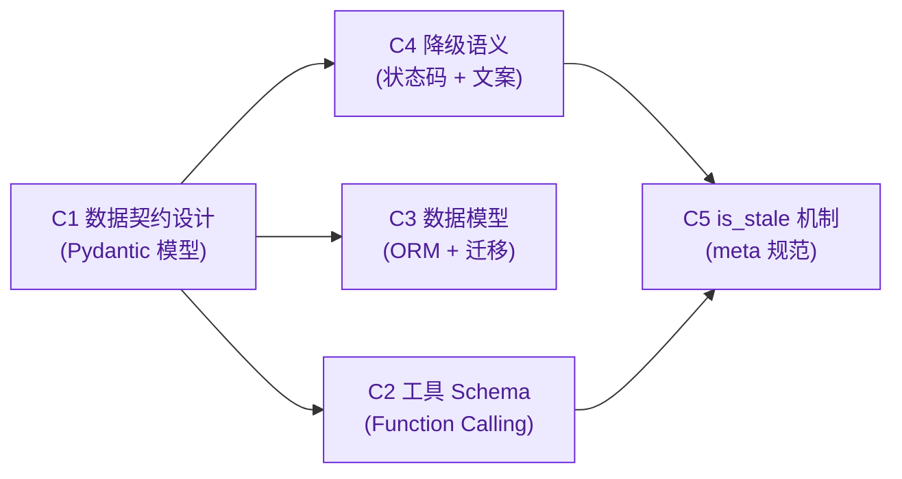
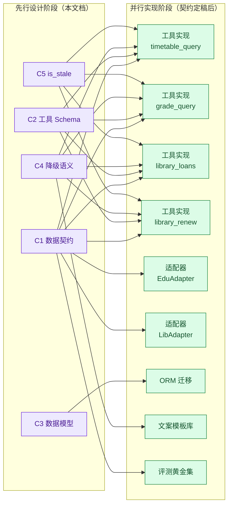
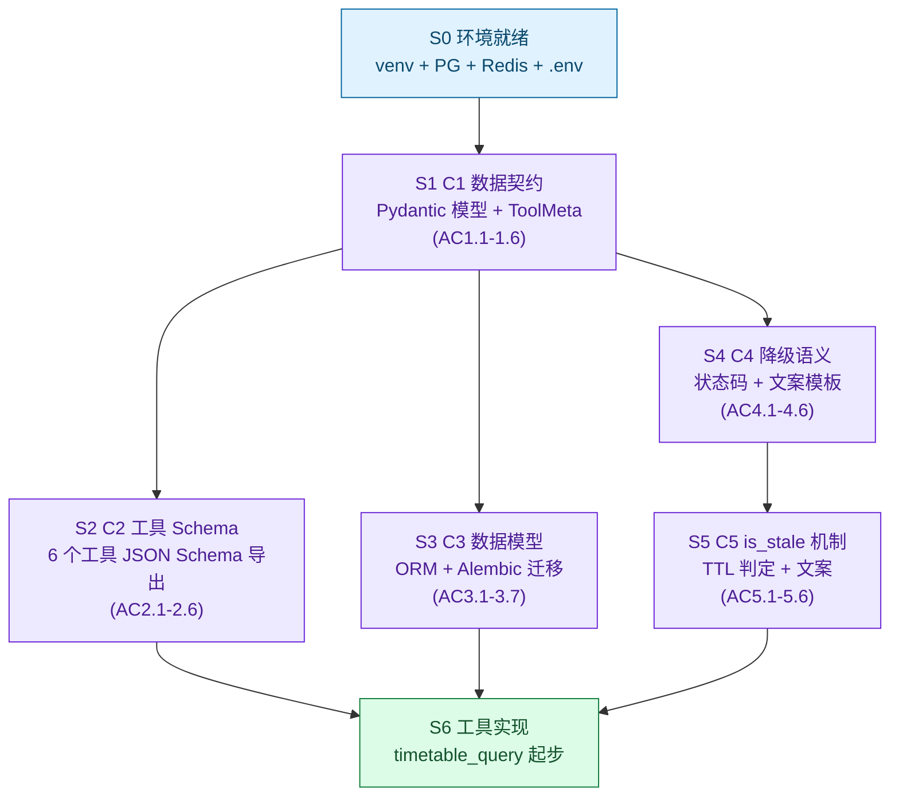

# 15 阶段一：核心设计任务实施规范

> **文档定位**：本文是阶段一**核心设计任务的工程实施规范**。文档 10/11/12/13 已完成"为什么做、做什么、边界在哪、怎么证明靠谱"的设计论证；本文档回答"**动工前必须先定下来的五份契约长什么样、怎么验收、依赖什么**"。
>
> **面向读者**：后端开发者、工具实现者、评测用例编写者。
>
> **与文档 12 的关系**：文档 12 给出的是数据契约的**概览与设计意图**；本文档是其**工程落地规范**——把 JSON Schema 落为 Pydantic 模型、把 SQL 落为 SQLAlchemy ORM、把"降级"落为枚举与文案模板、把 is_stale 落为可计算的判定规则。两份文档存在层级的递进：12 是"设计层"，15 是"实施层"。当两者出现冲突时，以 12 的设计意图为准；当实现细节缺失时，以 15 的规范补齐。

---

## 0. 五项核心设计任务总览

| # | 任务 | 产出物 | 对应文档 12 章节 |
|---|---|---|---|
| C1 | 数据契约设计 | Pydantic 模型 + JSON Schema 导出 + 适配器数据契约 | §3 工具契约、§4 内部数据模型 |
| C2 | 工具 Schema 定义 | 6 个工具的 Function Calling Schema + 前置/后置条件 | §3 工具契约 |
| C3 | 数据模型构建 | 4 张 PostgreSQL 表 + SQLAlchemy ORM + 索引/约束 | §4 内部数据模型 |
| C4 | 降级语义规范 | 5 级降级状态码 + 文案模板 + 重试策略 | §5 缓存与降级策略 |
| C5 | is_stale 标注机制 | meta 对象规范 + TTL 阈值表 + 文案模板 | §5 缓存与降级策略 |

**五项任务的依赖顺序**：



C1 是其余四项的基石：工具 Schema 的出入参类型来自 C1 的模型；ORM 模型的字段来自 C1 的契约；降级语义的状态来自 C1 的 meta 结构；is_stale 是 C1 meta 的一个字段。

---

## 1. 设计先行的必要性与理论依据

### 1.1 智能体系统的特殊性：为什么"先写代码"会失败

传统 Web 系统的接口契约在"前后端"之间，边界清晰、迭代缓慢；而 LLM 智能体的契约在"**模型与工具**"之间，且模型的行为具有**非确定性**。这使得"先写代码再补契约"的路径在智能体项目中几乎必然失败，原因有三：

**① 工具是 LLM 的"事实来源"，契约漂移直接导致幻觉。**

文档 13 §K8 已论证：数据类回答一律不经过自由生成，**所有事实性内容必须来自工具返回值**。这意味着工具的返回结构就是 LLM 的"事实上下文"。如果返回结构在开发中频繁变动（字段名改了、类型变了、嵌套层级变了），LLM 的 prompt 模板与输出侧数值校验会持续返工，且每一次返工都是一次**幻觉风险窗口**——模型可能在字段缺失时自行编造。

> **理论依据：Schema-Driven Development。** 在 LLM 工具调用体系中（OpenAI Function Calling、Anthropic Tool Use、MCP）中，工具的 JSON Schema 是模型推理的**输入约束**。Schema 不稳定 ⇒ 模型行为不稳定 ⇒ 评测不可重复。这是为什么 OpenAI、Anthropic 的官方文档都强调"工具定义应在迭代中保持稳定，仅通过 description 引导模型"。

**② 越权防护依赖契约的"不可注入性"，不能事后补。**

文档 12 §7 L4 已论证：`student_id` 必须**由会话身份层注入，不作为模型可填参数**。这是一条架构级红线，它要求**在契约设计阶段**就把 `student_id` 从"parameters"里移除（或标注为"服务端注入"），而不是在代码实现后才加一层校验。事后补的校验有两个问题：一是模型仍会在 parameters 里填入 `student_id`，只是被运行时拒绝——这会产生大量"看起来像越权"的审计噪声；二是校验逻辑分散在各工具内部，一旦某个工具漏写，越权就成立。

> **理论依据：Design by Contract（Bertrand Meyer）。** 契约式设计的核心是"**前置条件必须在接口处声明，而非在实现处检查**"。把 `student_id` 的来源约束写在 Schema 层（`description: "会话身份注入，禁止由用户输入"` 且服务端在调用前注入），就是前置条件的显式化；写在 `if` 里则是实现细节，可被绕过。

**③ 降级与溯源是"用户信任"的载体，不能临时拼装。**

文档 12 §5 的原则是"宁可说我不知道，也不给陈旧数据不带标注"。这要求**每一次工具返回**都携带 `meta.source`、`meta.synced_at`、`meta.is_stale` 三个字段。如果这不是契约层强制，而是由各工具开发者自行决定是否加，必然出现"有些工具有 meta、有些没有"的不一致——而学生一旦发现某次课表数据是陈旧的却没有标注，对整个系统的信任会崩塌。校园场景下，**信任的建立是学期级的，崩塌是瞬时的**。

> **理论依据：Data Contract 模式（Gartner, 2022）。** 数据合约要求"数据生产者在合约中声明新鲜度、来源、质量等级，数据消费者据此决定是否使用"。在本项目中，适配器是生产者，LLM 是消费者，`meta` 就是合约的载体。

### 1.2 校园场景的强约束：为什么"通用 Agent 框架"不够用

通用 Agent 框架（LangChain、AutoGen、Dify）默认的契约模型假设：工具返回的是"给模型看的结果"。但校园场景有三条**反通用假设**：

| 通用假设 | 校园现实 | 对契约的影响 |
|---|---|---|
| 工具结果可缓存任意时长 | 课表调停课高发、成绩敏感、借阅状态频变 | TTL 必须按域分级，且 is_stale 必须可计算 |
| 工具结果可进长期记忆 | 成绩明细属敏感信息，红线 R3 禁止落盘 | 契约必须区分"可记忆字段"与"仅当次会话字段" |
| 写操作失败可重试 | 续借是白名单写操作，失败不重试超 1 次 | 契约必须带幂等键 + 前置/后置条件 |

这些约束不能通过"配置框架"实现，必须在契约层固化。这也是为什么文档 14 在技术选型中虽推荐 FastAPI，但强调"工具契约、数据模型、降级语义"必须**自研固化**，而非依赖框架默认行为。

### 1.3 理论依据小结

| 理论/方法 | 对应设计任务 | 在本文档的落地 |
|---|---|---|
| Schema-Driven Development | C1 数据契约、C2 工具 Schema | Pydantic 模型 → JSON Schema 自动导出 |
| Design by Contract（前置条件显式化） | C2 工具 Schema 的 `preconditions` 字段 | student_id 注入约束、写操作确认态 |
| Data Contract 模式（新鲜度/来源/质量） | C4 降级语义、C5 is_stale 机制 | meta 三元组 + TTL 阈值表 |
| C4 模型（Context/Container/Component/Code）的"契约层" | C1 数据契约 | 作为 M3 工具层与 M4 适配层之间的接口契约 |
| Type-Driven Development（类型先行） | C3 数据模型 | SQLAlchemy ORM + Pydantic 双向映射 |

---

## 2. 预先完成设计的益处

### 2.1 对开发流程：并行化与减少返工

**益处**：五项契约一旦定稿，下游开发可并行展开，无需等待"先写一个工具再写下一个"。



具体益处：

- **工具开发者与适配器开发者可并行**：只要都遵循 C1 的数据契约，工具层拿到的是归一化后的 Pydantic 模型，无需关心适配器内部是走 SIP2 还是 OPAC。
- **评测用例可在实现前编写**：C1 的 JSON Schema 可直接作为黄金集的"期望返回结构"，文档 13 §3.3 的 300 条黄金集的"事实一致性"类用例可在工具实现前就写好骨架。
- **减少"接口对齐"会议**：契约是单一事实来源，争议时以文档为准，而非以"谁先写的代码"为准。

### 2.2 对系统稳定性：类型安全与降级可控

| 稳定性维度 | 契约如何保障 | 失败后果（无契约时） |
|---|---|---|
| 类型安全 | Pydantic v2 运行时校验 + mypy 静态检查 | 字段类型漂移导致 LLM 拿到错误数据，输出数值校验失败 |
| 幂等性 | 写工具契约强制 `idempotency_key` | 续借被重复触发，虽然可逆但产生审计噪声 |
| 越权防护 | `student_id` 注入约束写在 Schema | 提示词注入导致越权查他人成绩（P0 事故 K2） |
| 降级可控 | C4 五级降级状态码 + 文案 | 源系统超时时静默返回旧数据，学生误信（P1 事故 K3） |
| 溯源可追 | meta 三元组强制 | 数据来源不明，事故复盘无法定位 |

> **关键点**：文档 13 已把 K2（越权）、K3（陈旧数据）、K8（幻觉）列为 P0/P1 风险。这三类风险的**技术兜底全部依赖契约层**，而非运行时逻辑。契约不先行，这些风险就是"事后打补丁"，且补丁永远打不全。

### 2.3 对可维护性：单一事实来源与可演化

**单一事实来源（Single Source of Truth）**：

- 工具的 JSON Schema 来自 Pydantic 模型（`model.model_json_schema()`），**手写 JSON Schema 与代码不一致**这一经典 bug 被根除。
- ORM 模型与 Pydantic 模型共享字段定义（通过 `from_attributes=True` 映射），**数据库字段与接口字段不一致**的返工被消除。
- 降级文案模板集中管理（`backend/app/templates/degrade.yaml`），改文案不发版。

**可演化性**：

- 契约版本化：每个工具 Schema 带 `schema_version` 字段，后续阶段（二/三/四）新增字段时通过 `oneOf` 或 `optional` 兼容，不破坏阶段一的黄金集。
- TTL 与降级阈值配置化：C4/C5 的阈值通过 `backend/app/config.py` 的环境变量注入，调停课高发期可把课表 TTL 从 15min 缩到 5min 而不改代码。

---

## 3. 各项设计任务实施范围、技术要求与验收标准

> **以下五节是本文档的核心。每节结构统一：实施范围 → 技术要求 → 验收标准。**

### 3.1 C1 数据契约设计

#### 3.1.1 实施范围

数据契约覆盖**四类契约**，对应系统中的四个数据流转节点：

| 契约类型 | 生产者 | 消费者 | 产出物 |
|---|---|---|---|
| 工具入参/出参契约 | M2 编排层 | M3 工具层、LLM | Pydantic 模型 + JSON Schema |
| 适配器数据契约 | M4 适配层 | M3 工具层 | 归一化 Pydantic 模型（`TimetableItem` 等） |
| 内部持久化契约 | M3/M5/M7 | PostgreSQL | SQLAlchemy ORM 模型（见 C3） |
| 跨层传递契约 | M3 工具层 | M8 观测层 | 审计日志的 `args_digest` 结构 |

**C1 的产出是前三类，第四类（审计日志摘要结构）在 C3 中一并定义。**

#### 3.1.2 技术要求

**R1.1 Pydantic v2 模型为唯一事实来源。**

所有工具的入参、出参、适配器返回值必须用 Pydantic v2 模型定义，JSON Schema 通过 `model.model_json_schema()` 导出，**禁止手写 JSON Schema 字符串**。

**R1.2 `student_id` 不出现在 LLM 可填参数中。**

工具的入参模型中，`student_id` 字段的 `Field` 必须设置 `description="会话身份注入，禁止由用户输入"`，且在工具调用入口由编排层（M2）注入，LLM 的 Function Calling Schema 中该字段虽然存在（以保持参数完整性），但 `description` 明确标注"服务端注入"。

**R1.3 所有工具返回值必须携带 `meta` 三元组。**

```python
class ToolMeta(BaseModel):
    source: Literal["edu_system", "library_ils", "cache", "card_system", "internal"] = Field(
        description="数据来源系统标识；internal 表示内部订阅库/工单库（无外部源系统）"
    )
    synced_at: datetime = Field(description="数据同步时间（ISO 8601 含时区）")
    degrade_status: Literal["fresh", "live_ok", "stale_cache", "unavailable", "write_failed"] = Field(
        description="五级降级状态（R4.1），供渲染层选择话术模板；UNAVAILABLE/WRITE_FAILED 必须有用户可见文案"
    )
    is_stale: bool = Field(default=False, description="是否为陈旧数据（来自降级缓存）")
    # 可选扩展（C5 详述）
    stale_reason: str | None = Field(default=None, description="陈旧原因，如 source_timeout")
```

**R1.4 适配器返回值必须区分"业务结果"与"降级标记"。**

适配器返回一个包含 `data` 和 `degrade_status` 的封装结构，而非直接返回业务数据。工具层据此决定是否设置 `is_stale`。

```python
class AdapterResponse(BaseModel, Generic[T]):
    data: T | None
    degrade_status: DegradeStatus  # 见 C4
    synced_at: datetime
    source: str
```

**R1.5 敏感字段的契约约束。**

- 成绩明细模型 `GradeItem` 不得作为任何持久化模型的字段类型（红线 R3）。
- 借阅记录 `LibraryLoanItem` 的缓存 TTL ≤ 5min，由适配器在 `synced_at` 上体现。
- 工单 `HandoffTicket` 的 `retrieved_facts` 字段存的是**摘要**（`FactSummary`），不是原始成绩明细。

#### 3.1.3 验收标准

| # | 验收项 | 验收方式 | 通过标准 |
|---|---|---|---|
| AC1.1 | 所有工具的入参/出参均有 Pydantic 模型 | 代码审查 | 6 个工具 × 2（入参+出参）= 12 个模型文件 |
| AC1.2 | JSON Schema 可自动导出 | `python -c "from app.models import *; ..."` | 导出无异常，且与文档 12 §3 的字段一致 |
| AC1.3 | `student_id` 字段 description 含"会话身份注入" | grep 检查 | 6 个入参模型全部命中 |
| AC1.4 | `ToolMeta` 在所有出参模型的顶层 | mypy + 单元测试 | 缺失即编译失败 |
| AC1.5 | `GradeItem` 不出现在 ORM 模型字段中 | 静态检查 | 0 处引用 |
| AC1.6 | 适配器返回 `AdapterResponse` 封装 | 单元测试 | mock 源系统超时后返回 `degrade_status` 正确 |

---

### 3.2 C2 工具 Schema 定义

#### 3.2.1 实施范围

阶段一交付的 **6 个工具**，分三类：

| 类别 | 工具 | 边界标注 | 写操作 |
|---|---|---|---|
| 只读 | `timetable_query` | AI | 否 |
| 只读 | `grade_query` | AI（三不原则） | 否 |
| 只读 | `library_loans` | AI | 否 |
| 白名单写 | `library_renew` | AI（需二次确认） | 是 |
| 订阅管理 | `reminder_subscribe` | AI | 否（写订阅库，非业务系统写） |
| 转人工 | `handoff_create` | AI+H | 否（写工单库） |

#### 3.2.2 技术要求

**R2.1 Function Calling 兼容。**

每个工具的 Schema 必须可直接作为 OpenAI Function Calling 的 `tools` 参数传入，字段：`name`、`description`、`parameters`（JSON Schema）、`strict`（是否严格模式）。Pydantic 模型导出后由编排层包装为 `{"type": "function", "function": {...}}`。

**R2.2 单一职责与强类型。**

每个工具只做一件事，不做跨系统 JOIN，不做自然语言生成（文档 10 §3.2 M3 职责）。入参/出参全部强类型，禁止 `Any`、`dict` 裸用。

**R2.3 幂等键约束。**

写工具 `library_renew` 必须包含 `idempotency_key` 字段（`sha256(session_id + barcodes_sorted + date)`），服务端在 `reminder_dispatch` 表的 `dedup_key` 约束层去重。

**R2.4 前置/后置条件显式化。**

每个工具 Schema 附带 `preconditions`（调用前必须满足）与 `postconditions`（返回后保证成立）字段，作为 `description` 的结构化补充，供编排层的工具规划器（Tool Planner）校验。

| 工具 | 前置条件 | 后置条件 |
|---|---|---|
| `timetable_query` | `start_date <= end_date`；学号已绑定 | 返回项含 `is_changed` 标注；meta.is_stale 可信 |
| `grade_query` | 学号已绑定；用户已勾选成绩类数据同意 | 不缓存明细；返回的 `system_status` 为源系统原文 |
| `library_loans` | 学号已绑定 | 按 `due_date` 升序；`renewable` 来自 ILS 而非推断 |
| `library_renew` | 已展示新到期日并获用户确认；`idempotency_key` 有效；本会话调用 ≤10 次 | 返回每条 `ok` 状态；失败不重试超 1 次；审计留痕 |
| `reminder_subscribe` | 学号已绑定；`subject` 在枚举内 | 订阅即时生效或即时取消 |
| `handoff_create` | 必填字段齐全（见 R2.5） | 工单进入 `open` 状态；上下文完整率 100% |

**R2.5 `handoff_create` 的必填字段。**

文档 10 §8.2 已定义工单结构。契约层将其落为必填校验：缺 `hit_rules`、`agent_response_log`、`priority` 任一字段，视为不合格工单，编排层拒绝提交并回退为"软停靠"。

#### 3.2.3 验收标准

| # | 验收项 | 验收方式 | 通过标准 |
|---|---|---|---|
| AC2.1 | 6 个工具 Schema 可被 LLM 正确调用 | 集成测试（mock LLM） | 意图→工具调用匹配率 = 100%（标准意图集） |
| AC2.2 | `library_renew` 含 `idempotency_key` 且去重有效 | 单元测试 | 重复提交同一 key，第二次返回上次结果 |
| AC2.3 | 前置条件违反时拒绝调用 | 单元测试 | `start_date > end_date` 返回参数错误 |
| AC2.4 | `handoff_create` 必填字段缺失时拒绝 | 单元测试 | 缺 `hit_rules` 返回 422 |
| AC2.5 | 工具不生成自然语言 | 代码审查 | 工具函数返回结构化数据，不含 `str` 话术 |
| AC2.6 | 边界标注完整 | 文档审查 | 每个工具在文档 11 矩阵中有对应行 |

---

### 3.3 C3 数据模型构建

#### 3.3.1 实施范围

文档 12 §4 已定义 4 张 PostgreSQL 表。C3 将其落为 SQLAlchemy ORM 模型 + Alembic 迁移脚本。

| 表 | 用途 | 关键约束 |
|---|---|---|
| `reminder_subscription` | 提醒订阅 | 索引 `(student_id, enabled)`、`(subject, trigger_type)` |
| `reminder_dispatch` | 提醒发送记录（幂等+效果回流） | 唯一约束 `(dedup_key, dedup_date)`；`is_degraded` 标记降级下发 |
| `handoff_ticket` | 转人工工单 | 索引 `(status, priority, created_at)` 支持 SLA 查询 |
| `audit_log` | 审计日志（脱敏） | 索引 `(action, ts DESC)`；`args_digest` 为 JSONB 摘要 |

**不建表的（契约层声明）**：

| 数据 | 处理方式 | 契约约束 |
|---|---|---|
| 课表 | Redis 缓存 TTL 15min，key 含学号加密 | 不落 PostgreSQL |
| 成绩明细 | **不落任何持久化存储** | 仅当次会话内存 |
| 借阅记录 | Redis 缓存 TTL 5min | 不落 PostgreSQL |

#### 3.3.2 技术要求

**R3.1 ORM 与 Pydantic 双向映射。**

ORM 模型通过 `config.from_attributes=True` 可直接转为 Pydantic 模型，避免手写字段映射代码。

**R3.2 索引覆盖查询模式。**

- `reminder_subscription`：订阅查询走 `(student_id, enabled)`；触发器扫描走 `(subject, trigger_type)`。
- `reminder_dispatch`：学生时间线走 `(student_id, pushed_at DESC)`；去重走唯一约束。
- `handoff_ticket`：SLA 监控走 `(status, priority, created_at)`。
- `audit_log`：按动作类型溯源走 `(action, ts DESC)`。

**R3.3 JSONB 字段约束。**

`trigger_config`、`intent_history`、`hit_rules`、`retrieved_facts`、`args_digest` 均为 JSONB，但必须在 Pydantic 模型层定义结构（`TriggerConfig`、`HitRules` 等），不允许裸 `dict` 入库。

**R3.4 脱敏与加密。**

- `student_id` 在 `audit_log`、`handoff_ticket` 中存储时脱敏（如 `2023****56`），原值由 `security.py` 在会话上下文中保持。
- `handoff_ticket.retrieved_facts` 只存摘要（`FactSummary`），不含成绩数值。

**R3.5 Alembic 迁移可重放。**

迁移脚本必须可 `downgrade` 至前一个版本，且幂等执行不报错。

#### 3.3.3 验收标准

| # | 验收项 | 验收方式 | 通过标准 |
|---|---|---|---|
| AC3.1 | 4 张表迁移可执行 | `alembic upgrade head` | 无报错，表结构符合文档 12 §4 |
| AC3.2 | 迁移可回滚 | `alembic downgrade -1` | 回滚后表删除，可再 upgrade |
| AC3.3 | 索引存在 | `\d table_name` in psql | 6 个索引全部存在 |
| AC3.4 | 去重约束有效 | 插入重复 `dedup_key` | 第二次插入报唯一约束错误 |
| AC3.5 | ORM→Pydantic 映射 | 单元测试 | `HandoffTicket.orm → HandoffTicketOut.pydantic` 字段一致 |
| AC3.6 | 成绩明细不落库 | 渗透测试 | 查询后扫描数据库，无 `grade` 表、无 `score` 字段 |
| AC3.7 | 审计日志脱敏 | 代码审查 + 数据抽样 | `student_id` 字段值为 `2023****56` 形式 |

---

### 3.4 C4 降级语义规范

#### 3.4.1 实施范围

文档 12 §5 已定义降级流程。C4 将其落为**5 级状态码枚举 + 文案模板 + 重试策略**的规范。

#### 3.4.2 技术要求

**R4.1 五级降级状态码。**

```python
class DegradeStatus(str, Enum):
    FRESH = "fresh"                  # 缓存命中且未过期，is_stale=False
    LIVE_OK = "live_ok"              # 源系统实时调用成功
    STALE_CACHE = "stale_cache"      # 源超时，返回历史缓存，is_stale=True
    UNAVAILABLE = "unavailable"      # 源超时且无缓存，明确不可用
    WRITE_FAILED = "write_failed"    # 写操作失败（续借），不降级、不重试超1次
```

**R4.2 文案模板集中管理。**

所有降级文案在 `backend/app/templates/degrade.yaml` 集中定义，按 `degrade_status` + `tool` 索引，编排层渲染时从模板库取，**禁止在工具内硬编码文案**。

```yaml
degrade_templates:
  fresh:
    timetable_query: ""  # 无额外提示
  live_ok:
    grade_query: ""
  stale_cache:
    timetable_query: "⚠️ 数据同步于 {synced_at:%H:%M}，可能不是最新，建议以教务系统为准"
    library_loans: "⚠️ 借阅数据同步于 {synced_at:%H:%M}，可能存在延迟"
  unavailable:
    timetable_query: "教务系统暂时无法访问，你可以稍后重试，或直接登录教务系统查看"
    grade_query: "成绩系统暂时无法访问，请稍后重试或联系学院教务办"
  write_failed:
    library_renew: "续借未成功（原因：{reason}），可到流通台办理"
```

**R4.3 重试策略。**

| 场景 | 重试 | 策略 |
|---|---|---|
| 源系统超时（读） | 2 次 | 指数退避：200ms → 600ms |
| 源系统超时（写·续借） | 0 次 | 不重试，直接返回 `write_failed` |
| 缓存写入失败 | 0 次 | 记录日志，不阻塞返回 |

**R4.4 无静默失败原则。**

任何工具调用必须有明确的 `degrade_status`，**禁止返回 `None` 或空 `dict` 而不标注状态**。这是文档 11 §6"每条失败路径都有明确的兜底出口"的契约层落地。

#### 3.4.3 验收标准

| # | 验收项 | 验收方式 | 通过标准 |
|---|---|---|---|
| AC4.1 | 5 级状态码全部实现 | 单元测试 | 每级状态均有对应测试用例 |
| AC4.2 | 文案模板可配置 | 修改 yaml 后不改代码 | 文案即时生效 |
| AC4.3 | 源超时→stale_cache 路径 | mock 源超时 | 返回旧缓存 + `is_stale=True` |
| AC4.4 | 源超时且无缓存→unavailable | mock 源超时 + 清缓存 | 返回明确不可用文案 |
| AC4.5 | 续借失败不重试 | mock ILS 返回失败 | 调用计数 = 1，状态 = `write_failed` |
| AC4.6 | 无静默失败 | 代码审查 | 工具函数无 `return None` 无标注路径 |

---

### 3.5 C5 is_stale 状态标注机制设计

#### 3.5.1 实施范围

`is_stale` 是 `ToolMeta` 的一个布尔字段，但其语义需要**可计算的判定规则**与**用户可见的表述**两层规范。C5 定义这两层。

#### 3.5.2 技术要求

**R5.1 is_stale 判定规则。**

`is_stale` 由适配器在返回 `AdapterResponse` 时计算，规则为：

```
is_stale = True  当且仅当：
  (data_source == "cache") AND (now - synced_at > ttl_threshold)
  OR
  (degrade_status == "stale_cache")
```

其余情况 `is_stale = False`。

**R5.2 TTL 阈值表（配置化）。**

| 数据域 | 正常 TTL | 高发期 TTL | is_stale 触发阈值 |
|---|---|---|---|
| 课表 | 15min | 5min（调停课高发期） | > 15min（或 > 5min 高发期） |
| 成绩 | 0（不缓存明细） | 0 | N/A（实时拉取，无 is_stale） |
| 借阅 | 5min | 5min | > 5min |
| 一卡通状态 | 10min | 10min | > 10min |

阈值通过环境变量注入：

```
TTL_TIMETABLE=900      # 秒
TTL_TIMETABLE_PEAK=300 # 高发期
TTL_LIBRARY=300
TTL_CARD=600
```

**R5.3 用户可见表述。**

| is_stale | 用户可见表述 |
|---|---|
| `False` + `FRESH`/`LIVE_OK` | 不额外提示（溯源标注仍显示） |
| `True` + `STALE_CACHE` | "⚠️ 数据同步于 {synced_at}，可能不是最新，建议以{源系统名}为准" |
| `False` + `UNAVAILABLE` | "系统暂时无法访问，请稍后重试或联系{归属部门}" |
| `False` + `WRITE_FAILED` | "操作未成功（原因：{reason}），可{兜底路径}" |

**R5.4 is_stale 不影响溯源标注。**

无论 `is_stale` 为何值，溯源标注（来源系统 + 同步时间）始终展示。is_stale 是"**数据新鲜度警示**"，溯源是"**数据出处声明**"，两者独立。

#### 3.5.3 验收标准

| # | 验收项 | 验收方式 | 通过标准 |
|---|---|---|---|
| AC5.1 | 缓存命中且未过期 → `is_stale=False` | 单元测试 | 状态 = FRESH，无警示文案 |
| AC5.2 | 缓存命中但超 TTL → `is_stale=True` | 单元测试 | 状态 = STALE_CACHE，文案含 synced_at |
| AC5.3 | 实时拉取成功 → `is_stale=False` | 单元测试 | 状态 = LIVE_OK |
| AC5.4 | TTL 阈值可配置 | 修改环境变量 | 判定结果随之变化 |
| AC5.5 | 成绩查询不产生 is_stale | 代码审查 | grade_query 不读缓存，synced_at = now |
| AC5.6 | 溯源标注始终存在 | 集成测试 | 所有返回含 `meta.source` + `meta.synced_at` |

---

## 4. 技术依赖清单

> **说明**：本清单按"开发工具 → 运行时 → 框架 → 库 → 资源"分层列出，每项标注用途与对应的设计任务。安装命令以阶段一后端（FastAPI 方向）为准。

### 4.1 开发工具

| 依赖 | 版本 | 用途 | 对应任务 |
|---|---|---|---|
| Python | ≥ 3.11 | 运行时（`Literal`、`str \| None` 语法依赖） | 全部 |
| `pip` | 最新 | 包管理 | 全部 |
| `venv` | 内置 | 虚拟环境 | 全部 |
| Git | ≥ 2.40 | 版本控制 | 全部 |
| VS Code / PyCharm | 最新 | IDE（mypy/Pylance 插件） | C1/C2 |
| Docker | 最新 | 本地 PostgreSQL + Redis | C3/C4 |
| Docker Compose | 最新 | 一键拉起 PG/Redis | C3/C4 |

### 4.2 核心框架与库

| 依赖 | 版本 | 用途 | 对应任务 |
|---|---|---|---|
| `fastapi` | ≥ 0.115 | Web 框架（SSE、依赖注入、Pydantic 原生集成） | C2 |
| `uvicorn[standard]` | ≥ 0.30 | ASGI 服务器 | C2 |
| `pydantic` | ≥ 2.9 | 数据契约模型（唯一事实来源） | **C1 核心** |
| `pydantic-settings` | ≥ 2.5 | 配置管理（环境变量注入 TTL 阈值） | C5 |
| `sqlalchemy` | ≥ 2.0 | ORM | **C3 核心** |
| `alembic` | ≥ 1.13 | 数据库迁移 | C3 |
| `asyncpg` | ≥ 0.29 | PostgreSQL 异步驱动 | C3 |
| `aiosqlite` | ≥ 0.20 | 开发/测试默认 SQLite 异步驱动（零配置） | C3 |
| `pyyaml` | ≥ 6.0 | 降级文案模板 `degrade.yaml`（C4 文案集中管理） | C4 |
| `redis` | ≥ 5.0 | 缓存（课表/借阅 TTL） | C4/C5 |
| `apscheduler` | ≥ 3.10 | 提醒引擎调度（时间型触发） | C3 |
| `httpx` | ≥ 0.27 | 异步 HTTP 客户端（调用源系统、LLM） | C4 |
| `pyjwt` | ≥ 2.9 | 会话令牌（student_id 注入） | C2 |

### 4.3 LLM 与智能体相关

| 依赖 | 版本 | 用途 | 对应任务 |
|---|---|---|---|
| `openai` | ≥ 1.40 | LLM SDK（Function Calling） | C2 |
| `tenacity` | ≥ 8.5 | 重试策略（指数退避，读工具 2 次） | C4 |

> **说明**：阶段一不引入 LangChain/LangGraph。文档 14 §3.2 已论证：单 Agent + 若干工具的编排复杂度，FastAPI + 原生 Function Calling 即可，无需引入额外抽象层。LLM 调用通过 `openai` SDK 直连（兼容校内私有化模型的 OpenAI 兼容端点）。

### 4.4 观测与测试

| 依赖 | 版本 | 用途 | 对应任务 |
|---|---|---|---|
| `opentelemetry-api` | ≥ 1.27 | 全链路 Trace | C3 审计 |
| `opentelemetry-sdk` | ≥ 1.27 | Trace SDK | C3 审计 |
| `structlog` | ≥ 24.4 | 结构化日志（脱敏审计） | C3 审计 |
| `pytest` | ≥ 8.3 | 单元测试 | 全部 AC |
| `pytest-asyncio` | ≥ 0.24 | 异步测试 | C4 |
| `pytest-cov` | ≥ 5.0 | 覆盖率 | 全部 AC |
| `freezegun` | ≥ 1.5 | 时间冻结（TTL/is_stale 测试） | **C5 必需** |
| `respx` | ≥ 0.21 | httpx mock（源系统超时测试） | C4 |

### 4.5 数据库与基础设施（Docker）

| 资源 | 版本 | 用途 | 对应任务 |
|---|---|---|---|
| PostgreSQL | ≥ 16 | 事务性数据（订阅/工单/审计） | C3 |
| Redis | ≥ 7 | 缓存 + 去重 + 频控 | C4/C5 |

本地开发用 `docker-compose.yml` 一键拉起：

```yaml
# docker-compose.yml（开发环境）
services:
  postgres:
    image: postgres:16-alpine
    environment:
      POSTGRES_DB: campus_agent
      POSTGRES_PASSWORD: dev_only
    ports: ["5432:5432"]
    volumes: ["pg_data:/var/lib/postgresql/data"]
  redis:
    image: redis:7-alpine
    ports: ["6379:6379"]
volumes:
  pg_data:
```

### 4.6 环境变量清单

| 变量 | 说明 | 默认值 | 对应任务 |
|---|---|---|---|
| `DB_URL` | PostgreSQL 连接串 | `postgresql+asyncpg://.../campus_agent` | C3 |
| `REDIS_URL` | Redis 连接串 | `redis://localhost:6379/0` | C4 |
| `JWT_SECRET` | 会话令牌密钥 | 必须替换 | C2 |
| `LLM_API_BASE` / `LLM_API_KEY` | LLM 端点（校内私有化兼容 OpenAI 协议） | — | C2 |
| `EDU_API_BASE_URL` / `EDU_API_TOKEN` | 教务开放接口 | 留空走降级适配器 | C4 |
| `LIB_SIP2_HOST` / `LIB_SIP2_PORT` | 图书馆 SIP2 | — | C4 |
| `TTL_TIMETABLE` | 课表缓存秒 | 900 | C5 |
| `TTL_TIMETABLE_PEAK` | 高发期课表缓存秒 | 300 | C5 |
| `TTL_LIBRARY` | 借阅缓存秒 | 300 | C5 |
| `TTL_CARD` | 一卡通缓存秒 | 600 | C5 |

### 4.7 一键安装命令

```bash
cd backend
python -m venv .venv
# Windows
.venv\Scripts\activate
# Linux/macOS
# source .venv/bin/activate

pip install \
  "fastapi>=0.115" "uvicorn[standard]>=0.30" \
  "pydantic>=2.9" "pydantic-settings>=2.5" \
  "sqlalchemy>=2.0" "alembic>=1.13" "asyncpg>=0.29" "aiosqlite>=0.20" \
  "redis>=5.0" "apscheduler>=3.10" \
  "httpx>=0.27" "pyjwt>=2.9" "pyyaml>=6.0" \
  "openai>=1.40" "tenacity>=8.5" \
  "opentelemetry-api>=1.27" "opentelemetry-sdk>=1.27" "structlog>=24.4" \
  "pytest>=8.3" "pytest-asyncio>=0.24" "pytest-cov>=5.0" \
  "freezegun>=1.5" "respx>=0.21"
```

---

## 5. 实施顺序建议

> 契约定稿后，按依赖顺序展开实现。每步的"完成"以对应 AC 通过为准。



**S1 是硬前置**：C1 数据契约定稿前，不启动任何工具实现。这是"契约先行"原则的工程落地——若 C1 未定，S2/S3/S4/S5 的实现会在 C1 变更时返工。

---

## 6. 与现有文档的关系

| 本文档章节 | 引用/落地自 | 补充了什么 |
|---|---|---|
| §1 必要性 | 文档 13 §K2/K3/K8 风险矩阵 | 从"风险"推导到"契约先行"的理论依据 |
| §2 益处 | 文档 12 §7 护栏、文档 10 §3.2 模块职责 | 从"设计意图"推导到"并行开发/稳定性/可维护性" |
| §3.1 C1 数据契约 | 文档 12 §3 工具契约、§4 内部数据模型 | 落为 Pydantic 模型规范 + ToolMeta 强制 |
| §3.2 C2 工具 Schema | 文档 12 §3.1-3.3、文档 11 §2 边界矩阵 | 补充前置/后置条件、幂等键、必填校验 |
| §3.3 C3 数据模型 | 文档 12 §4 内部数据模型 SQL | 落为 SQLAlchemy ORM + Alembic + 索引/约束 |
| §3.4 C4 降级语义 | 文档 12 §5 缓存与降级策略 | 落为 5 级状态码枚举 + 文案模板 + 重试策略 |
| §3.5 C5 is_stale | 文档 12 §5 meta.is_stale、文档 13 §K3 | 落为可计算判定规则 + TTL 阈值表 + 文案 |
| §4 技术依赖 | 文档 14 技术选型、根 README §6 | 细化为带版本的 pip install 清单 |

---

**相关文档** → [10 阶段一主设计](./10-阶段一-校园助手Agent设计.md) ｜ [11 边界矩阵](./11-阶段一-AI可执行与人工兜底边界矩阵.md) ｜ [12 技术架构与数据契约](./12-阶段一-技术架构与数据契约.md) ｜ [13 风控合规与评测上线](./13-阶段一-风控合规与评测上线.md) ｜ [14 技术选型](./14-技术选型-Agent平台后端框架对比.md)
