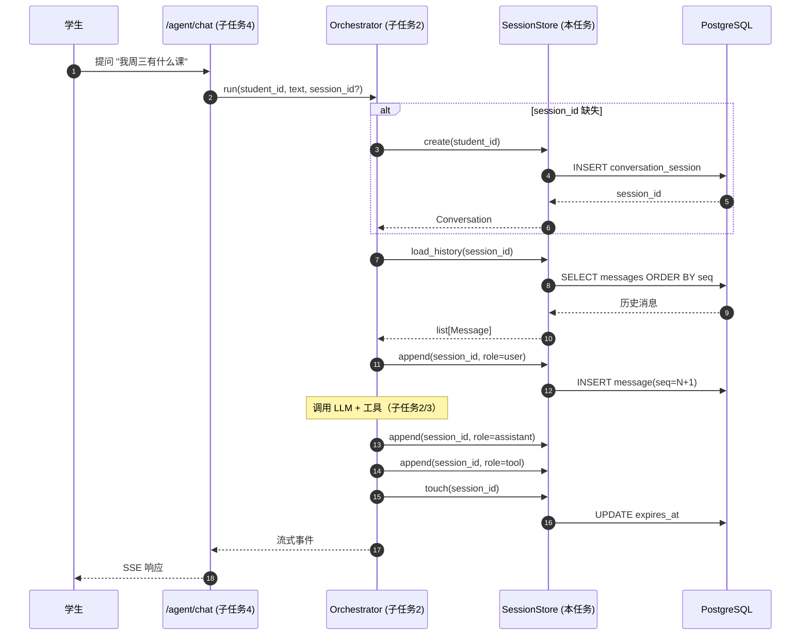
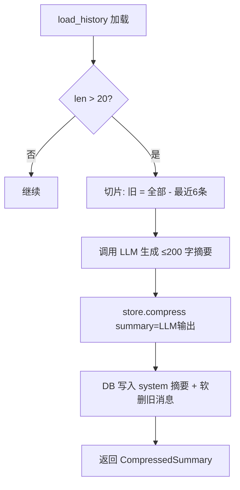

# 任务设计文档 — 子任务 1：Agent 会话存储层（Conversation Store）

> 文档编号：WAgent-IMPL-01
> 版本：v1.0
> 适用阶段：阶段一 · 编排层（M2）前置基建
> 关联文档：[`docs/10-阶段一-校园助手Agent设计.md`](../10-阶段一-校园助手Agent设计.md) §3.4 / [`docs/12-阶段一-技术架构与数据契约.md`](../12-阶段一-技术架构与数据契约.md) §4 / [`docs/15-阶段一-核心设计任务实施规范.md`](../15-阶段一-核心设计任务实施规范.md) §3.3 / [`docs/15-技术选型-FastAPI权限模型与SpringSecurity对应.md`](../15-技术选型-FastAPI权限模型与SpringSecurity对应.md)

---

## 一、任务概述

### 1.1 背景

WAgent 阶段一已完成「配置 / 缓存 / 存储 / 安全 / 适配器 / 6 个工具 / 降级 / 审计」全部骨架（参见 [`README.md`](../../README.md) 当前进度条），但 M2 编排层（Orchestrator）落地的前置条件——**会话历史与消息流的持久化**——尚未建立。当前阶段表现为：

- 6 个工具可通过 `/agent/*` 接口被独立调用，但**每次调用都是无状态请求**，LLM 没有上下文可用；
- [`10-阶段一-校园助手Agent设计.md`](../10-阶段一-校园助手Agent设计.md) §3.4 明确将「**短期会话记忆（M1）+ 历史压缩**」列为 M2 编排层四大能力之一；
- [`12-阶段一-技术架构与数据契约.md`](../12-12-阶段一-技术架构与数据契约.md) §4 已为 `reminder_subscription` / `reminder_dispatch` / `handoff_ticket` / `audit_log` 4 张表定义了 DDL，但**会话与消息表未在范围内**——它们是新增表，需独立迁移；
- [`15-阶段一-核心设计任务实施规范.md`](../15-阶段一-核心设计任务实施规范.md) §C2 把"工具入参按会话身份注入"列为 AC2.1 硬约束，意味着会话层必须承担"绑定、过期、压缩"三项职责。

### 1.2 目标

**建设 Agent 对话所需的会话与消息持久化层，让 M2 编排层第一次拥有可调用的"短期记忆"。**

具体目标拆解为三条：

| 编号 | 目标 | 衡量 |
|---|---|---|
| G1 | 提供「会话 + 消息」两张表 + 一句话版 `SessionStore` 服务 | 单元测试覆盖 CRUD + 压缩 |
| G2 | 会话与 `student_id` 强绑定，过期与刷新可热配 | TTL 字段 + 索引 |
| G3 | 历史压缩由应用层触发、可被编排层显式调用 | `compress()` 方法 + 触发钩子 |

### 1.3 范围

**包含**：
1. 新增 ORM 模型 `ConversationSession` 与 `Message`（写 `backend/app/orm/models.py`）；
2. 新增 Alembic 迁移 `0002_add_conversation_tables.py`（写 `backend/migrations/versions/`）；
3. 新增 `SessionStore` 服务类（写 `backend/app/conversation/store.py`），含异步 CRUD、过期刷新、历史压缩；
4. 新增 Pydantic 契约 `Conversation` / `Message` / `CompressedSummary`（写 `backend/app/schemas/conversation.py`）；
5. 单元测试 `backend/tests/test_conversation_store.py`，覆盖创建 / 追加 / 加载 / 过期 / 压缩五个场景；
6. `backend/app/orm/__init__.py` 导出新模型；
7. README 当前进度条勾掉该项。

**不包含**（明确排除，避免范围蔓延）：
- ❌ LLM 适配器与 Function Calling 调度 → 子任务 2/3
- ❌ SSE 流式端点 → 子任务 4
- ❌ 提醒引擎消费订阅 → 提醒引擎任务
- ❌ 向量检索 / 长期记忆 → 阶段二
- ❌ 跨进程分布式会话同步 → 阶段二（Redis 复制）

### 1.4 与上游下游的关系

```
┌──────────────────────────────────────────────────────────────┐
│ 编排层 M2（Orchestrator）  → 子任务 2/3/4                    │
│   ↑ 历史由 SessionStore 提供                                 │
│   ↑ 压缩由 SessionStore.compress() 触发                     │
└──────────────────────────────────────────────────────────────┘
                       ▲
                       │ 本任务交付
                       │
┌──────────────────────────────────────────────────────────────┐
│ 会话存储层（SessionStore）                                   │
│   ConversationSession ───┐                                  │
│   Message ──────────────┴──> audit_log（既有）              │
└──────────────────────────────────────────────────────────────┘
```

---

## 二、功能详细设计

### 2.1 核心功能点

#### F1：会话创建
- **入口**：`SessionStore.create(student_id, channel) -> Conversation`
- **行为**：以 `student_id + uuid4().hex[:16]` 组合 `session_id`，写入 `created_at / expires_at / channel / status`；
- **约束**：`student_id` 来自 JWT（`Depends(get_current_student)`），**绝不接受调用方传入**（与既有 `security.py:43` 一致）；
- **默认 TTL**：30 分钟（`settings.session_ttl_seconds`，新增配置项）。

#### F2：消息追加
- **入口**：`SessionStore.append(session_id, role, content, *, tool_calls=None, tool_call_id=None, trace_id=None) -> Message`
- **角色枚举**：`user` / `assistant` / `tool` / `system`，与 OpenAI Chat Completions 协议一致；
- **`tool_calls`**：assistant 角色专属，记录本轮 LLM 决定调用哪些工具及参数；
- **`tool_call_id`**：tool 角色专属，关联到 assistant 的具体 `tool_call.id`，保证 OpenAI 协议要求的成对回传；
- **顺序保证**：`seq` 字段单调递增，由库内子查询取 `MAX(seq)+1`，避免时钟漂移；
- **批量优化**：提供 `append_many(items: list[MessageIn])` 走单事务。

#### F4：会话加载
- **入口**：`SessionStore.load_history(session_id, *, limit=20) -> list[Message]`
- **行为**：按 `seq ASC` 取最近 `limit` 条；过期会话返回 `SessionExpired` 异常，由编排层决定重建策略；
- **过滤**：自动跳过 `role='system'` 的压缩摘要标记行，调用方按需显式获取。

#### F5：过期与刷新
- **入口**：`SessionStore.touch(session_id) -> None`
- **行为**：把 `expires_at = now() + ttl`；每次追加消息时自动 `touch`；
- **惰性清理**：加载时发现过期不主动删除（留给后续 GC job），但 `status` 标记为 `expired`。

#### F6：历史压缩
- **入口**：`SessionStore.compress(session_id, summary: str, kept_tail: int = 6) -> CompressedSummary`
- **触发方**：编排层在「历史条数 > 阈值（如 20）」或「总 token 估算 > 阈值」时调用；
- **行为**：
  1. 取出除最近 `kept_tail` 条外的全部消息；
  2. 调用方传入的 `summary`（由编排层用 LLM 生成）落为一条 `role='system'`、标记 `is_summary=true` 的消息；
  3. 删除被摘要覆盖的旧消息（**软删除**：`deleted_at` 标记，阶段一只做硬删，留 `deleted_at` 字段便于审计）；
  4. 返回 `CompressedSummary(session_id, summarized_count, kept_tail, summary_message_id)`。
- **安全阀**：单次压缩至少保留最近 4 条消息，避免丢上下文。

#### F7：审计联动
- **行为**：每次 `append` / `compress` 不直接写 `audit_log`，由编排层统一触发既有 `write_audit`（解耦）；
- **理由**：本任务只交付"会话 CRUD"，审计策略沿用既有 [R3.4 脱敏约定](../15-阶段一-核心设计任务实施规范.md)。

### 2.2 业务流程

#### 端到端时序（一次完整对话）



#### 压缩触发流程



### 2.3 数据结构

#### ORM 模型（写 `backend/app/orm/models.py` 末尾追加）

```python
class ConversationSession(IdMixin, Base):
    """会话（短期记忆载体；阶段一上限 30 分钟 TTL）。"""

    __tablename__ = "conversation_session"
    __table_args__ = (
        Index("idx_session_student_status", "student_id", "status"),
        Index("idx_session_expires", "expires_at"),
    )

    session_id: Mapped[str] = mapped_column(String(64), nullable=False, unique=True)
    student_id: Mapped[str] = mapped_column(String(20), nullable=False)  # 与 jwt.sub 一致
    channel: Mapped[str] = mapped_column(String(24), nullable=False, default="wecom")
    status: Mapped[str] = mapped_column(String(16), nullable=False, default="active")
    # active / expired / closed（closed 由用户主动结束触发，阶段一不实现 UI）
    summary_message_id: Mapped[int | None] = mapped_column(Integer, nullable=True)
    created_at: Mapped[datetime] = mapped_column(TimestampTZ, nullable=False, server_default=func.now())
    updated_at: Mapped[datetime] = mapped_column(
        TimestampTZ, nullable=False, server_default=func.now(), onupdate=func.now()
    )
    expires_at: Mapped[datetime] = mapped_column(TimestampTZ, nullable=False)


class Message(IdMixin, Base):
    """单条消息（user / assistant / tool / system）。"""

    __tablename__ = "message"
    __table_args__ = (
        Index("idx_msg_session_seq", "session_id", "seq"),
        Index("idx_msg_session_role", "session_id", "role"),
        UniqueConstraint("session_id", "seq", name="uq_msg_session_seq"),
    )

    session_id: Mapped[str] = mapped_column(String(64), nullable=False)
    seq: Mapped[int] = mapped_column(Integer, nullable=False)  # 会话内序号
    role: Mapped[str] = mapped_column(String(16), nullable=False)
    content: Mapped[str] = mapped_column(Text, nullable=False, default="")
    tool_calls: Mapped[list[dict[str, Any]] | None] = mapped_column(JSONBType, nullable=True)
    tool_call_id: Mapped[str | None] = mapped_column(String(64), nullable=True)
    trace_id: Mapped[str | None] = mapped_column(String(32), nullable=True)
    is_summary: Mapped[bool] = mapped_column(Boolean, nullable=False, default=False)
    deleted_at: Mapped[datetime | None] = mapped_column(TimestampTZ, nullable=True)
    created_at: Mapped[datetime] = mapped_column(TimestampTZ, nullable=False, server_default=func.now())
```

**字段对齐依据**：
- `session_id` 用 `String(64)` 与既有 `handoff_ticket.session_id` / `audit_log.session_id` 保持一致（[`12-阶段一-技术架构与数据契约.md`](../12-阶段一-技术架构与数据契约.md) §4 表 4）；
- `student_id` 用 `String(20)` 与既有 4 张表一致；
- `tool_calls` 用可移植 JSONB，OpenAI Function Calling 的 `tool_calls` 数组可直存；
- `seq` + `UniqueConstraint(session_id, seq)` 防止并发插入撞号；
- `deleted_at` 软删除字段，与阶段一"审计留存 ≥180 天"约定（[`13-阶段一-风控合规与评测上线.md`](../13-阶段一-风控合规与评测上线.md) §2）相容。

#### Pydantic 契约（写 `backend/app/schemas/conversation.py`）

```python
from datetime import datetime
from typing import Any, Literal
from pydantic import BaseModel, Field

Role = Literal["user", "assistant", "tool", "system"]


class MessageIn(BaseModel):
    role: Role
    content: str = ""
    tool_calls: list[dict[str, Any]] | None = None
    tool_call_id: str | None = None
    trace_id: str | None = None


class Message(MessageIn):
    id: int
    session_id: str
    seq: int
    is_summary: bool = False
    created_at: datetime


class Conversation(BaseModel):
    session_id: str
    student_id: str
    channel: str
    status: Literal["active", "expired", "closed"] = "active"
    summary_message_id: int | None = None
    created_at: datetime
    expires_at: datetime


class CompressedSummary(BaseModel):
    session_id: str
    summarized_count: int
    kept_tail: int
    summary_message_id: int
```

#### 配置项（写 `backend/app/config.py` 追加）

```python
# ---- 会话（C2 编排层）----
session_ttl_seconds: int = 1800       # 30 min
session_history_limit: int = 20       # 触发压缩的历史阈值
session_compress_tail: int = 6        # 压缩时保留最近 N 条
```

### 2.4 接口原型（代码级）

`backend/app/conversation/__init__.py`：
```python
from .store import SessionStore, SessionNotFound, SessionExpired
```

`backend/app/conversation/store.py`（核心签名）：
```python
from __future__ import annotations

import uuid
from datetime import datetime, timedelta, timezone

from sqlalchemy import select, update, delete, func
from sqlalchemy.ext.asyncio import AsyncSession

from ..config import Settings
from ..orm.models import ConversationSession, Message
from ..schemas.conversation import Conversation, MessageIn


class SessionNotFound(Exception): ...
class SessionExpired(Exception): ...


class SessionStore:
    """会话与消息的异步 CRUD + 压缩（编排层 M2 唯一合法入口）。"""

    def __init__(self, db: AsyncSession, settings: Settings) -> None:
        self.db = db
        self.settings = settings

    async def create(self, student_id: str, channel: str = "wecom") -> Conversation:
        now = datetime.now(timezone.utc)
        session_id = f"sess_{uuid.uuid4().hex[:16]}"
        row = ConversationSession(
            session_id=session_id, student_id=student_id, channel=channel,
            status="active",
            created_at=now, updated_at=now,
            expires_at=now + timedelta(seconds=self.settings.session_ttl_seconds),
        )
        self.db.add(row)
        await self.db.commit()
        return Conversation.model_validate(row, from_attributes=True)

    async def get(self, session_id: str) -> Conversation:
        row = await self.db.get(ConversationSession, session_id)
        if row is None:
            raise SessionNotFound(session_id)
        now = datetime.now(timezone.utc)
        if row.expires_at < now and row.status == "active":
            row.status = "expired"
            await self.db.commit()
        if row.status == "expired":
            raise SessionExpired(session_id)
        return Conversation.model_validate(row, from_attributes=True)

    async def load_history(self, session_id: str, *, limit: int = 20) -> list[Message]:
        await self.get(session_id)  # 触发过期检测
        stmt = (
            select(Message)
            .where(Message.session_id == session_id, Message.deleted_at.is_(None))
            .order_by(Message.seq.asc())
            .limit(limit)
        )
        rows = (await self.db.execute(stmt)).scalars().all()
        return [Message.model_validate(r, from_attributes=True) for r in rows]

    async def append(self, session_id: str, msg: MessageIn) -> Message:
        await self.get(session_id)
        seq = await self._next_seq(session_id)
        row = Message(
            session_id=session_id, seq=seq,
            role=msg.role, content=msg.content,
            tool_calls=msg.tool_calls, tool_call_id=msg.tool_call_id,
            trace_id=msg.trace_id, created_at=datetime.now(timezone.utc),
        )
        self.db.add(row)
        await self._touch(session_id)
        await self.db.commit()
        return Message.model_validate(row, from_attributes=True)

    async def compress(
        self, session_id: str, summary: str, *, kept_tail: int | None = None,
    ) -> CompressedSummary:
        await self.get(session_id)
        keep = max(4, kept_tail or self.settings.session_compress_tail)
        # 取除最近 keep 条外的全部
        cutoff_subq = (
            select(Message.seq)
            .where(Message.session_id == session_id, Message.deleted_at.is_(None))
            .order_by(Message.seq.desc()).offset(keep).limit(1).scalar_subquery()
        )
        old_stmt = select(Message).where(
            Message.session_id == session_id,
            Message.deleted_at.is_(None),
            Message.seq <= cutoff_subq,
        )
        old_rows = (await self.db.execute(old_stmt)).scalars().all()
        # 写摘要
        summary_row = Message(
            session_id=session_id,
            seq=await self._next_seq(session_id),
            role="system", content=summary, is_summary=True,
            created_at=datetime.now(timezone.utc),
        )
        self.db.add(summary_row)
        await self.db.flush()
        # 软删旧消息
        now = datetime.now(timezone.utc)
        for r in old_rows:
            r.deleted_at = now
        # 更新会话指向
        sess = await self.db.get(ConversationSession, session_id)
        sess.summary_message_id = summary_row.id
        await self.db.commit()
        return CompressedSummary(
            session_id=session_id, summarized_count=len(old_rows),
            kept_tail=keep, summary_message_id=summary_row.id,
        )

    # ---- 私有 ----
    async def _next_seq(self, session_id: str) -> int:
        stmt = select(func.coalesce(func.max(Message.seq), 0) + 1).where(
            Message.session_id == session_id,
        )
        return int((await self.db.execute(stmt)).scalar_one())

    async def _touch(self, session_id: str) -> None:
        await self.db.execute(
            update(ConversationSession)
            .where(ConversationSession.session_id == session_id)
            .values(
                    expires_at=datetime.now(timezone.utc) + timedelta(
                        seconds=self.settings.session_ttl_seconds
                    ),
                    updated_at=func.now(),
                )
        )
```

### 2.5 迁移文件（写 `backend/migrations/versions/0002_add_conversation_tables.py`）

参考既有 [`0001_initial.py`](../../backend/migrations/versions/0001_initial.py) 风格：使用 `sa.JSON().with_variant(JSONB(), "postgresql")` 与 `sa.DateTime(timezone=True)`，并提供完整 `downgrade()`。关键点：

```python
revision = "0002_add_conversation_tables"
down_revision = "0001_initial"

def upgrade() -> None:
    op.create_table(
        "conversation_session",
        sa.Column("id", sa.Integer(), autoincrement=True, primary_key=True),
        sa.Column("session_id", sa.String(64), nullable=False, unique=True),
        sa.Column("student_id", sa.String(20), nullable=False),
        sa.Column("channel", sa.String(24), nullable=False),
        sa.Column("status", sa.String(16), nullable=False),
        sa.Column("summary_message_id", sa.Integer(), nullable=True),
        sa.Column("created_at", TS_T, nullable=False, server_default=sa.func.now()),
        sa.Column("updated_at", TS_T, nullable=False, server_default=sa.func.now()),
        sa.Column("expires_at", TS_T, nullable=False),
    )
    op.create_index("idx_session_student_status", "conversation_session",
                    ["student_id", "status"])
    op.create_index("idx_session_expires", "conversation_session", ["expires_at"])

    op.create_table(
        "message",
        sa.Column("id", sa.Integer(), autoincrement=True, primary_key=True),
        sa.Column("session_id", sa.String(64), nullable=False),
        sa.Column("seq", sa.Integer(), nullable=False),
        sa.Column("role", sa.String(16), nullable=False),
        sa.Column("content", sa.Text(), nullable=False),
        sa.Column("tool_calls", JSON_T, nullable=True),
        sa.Column("tool_call_id", sa.String(64), nullable=True),
        sa.Column("trace_id", sa.String(32), nullable=True),
        sa.Column("is_summary", sa.Boolean(), nullable=False, default=False),
        sa.Column("deleted_at", TS_T, nullable=True),
        sa.Column("created_at", TS_T, nullable=False, server_default=sa.func.now()),
        sa.UniqueConstraint("session_id", "seq", name="uq_msg_session_seq"),
    )
    op.create_index("idx_msg_session_seq", "message", ["session_id", "seq"])
    op.create_index("idx_msg_session_role", "message", ["session_id", "role"])

def downgrade() -> None:
    op.drop_index("idx_msg_session_role", table_name="message")
    op.drop_index("idx_msg_session_seq", table_name="message")
    op.drop_table("message")
    op.drop_index("idx_session_expires", table_name="conversation_session")
    op.drop_index("idx_session_student_status", table_name="conversation_session")
    op.drop_table("conversation_session")
```

---

## 三、技术方案

### 3.1 开发环境

| 项 | 版本 | 备注 |
|---|---|---|
| Python | ≥ 3.11 | 与既有 `requirements.txt:5-7` 一致 |
| FastAPI | ≥ 0.115 | 仅 `SessionStore` 不直接依赖，留作下游 |
| SQLAlchemy | ≥ 2.0 | 异步 ORM |
| Alembic | ≥ 1.13 | 迁移 |
| aiosqlite / asyncpg | 已装 | 单元测试用 SQLite、生产用 PostgreSQL |
| pytest-asyncio | 已装 | `asyncio_mode = auto`（已有 [`pytest.ini`](../../backend/pytest.ini)） |
| freezegun | ≥ 1.5 | 时间冻结验证 TTL 行为 |

**本地起 PG**（可选，不强制要求）：
```bash
docker compose up -d            # 当前 compose 仅含 Redis；PG 由本任务不引入
python -m pytest backend/tests/test_conversation_store.py -v
```

> **说明**：本任务不引入新容器；既有 `pytest-asyncio` + `aiosqlite:///:memory:`（[`conftest.py:111-122`](../../backend/tests/conftest.py)）已足够覆盖全部单测。

### 3.2 技术栈选型说明

| 决策 | 备选 | 选型 | 依据 |
|---|---|---|---|
| 持久化介质 | Redis / PostgreSQL / SQLite | **PostgreSQL**（生产）/ SQLite（测试） | 与既有 4 张表同库，便于 join；事务一致性强 |
| ORM 写法 | Core / Declarative 2.0 | **Declarative 2.0** + `Mapped[]` | 与 [`orm/models.py`](../../backend/app/orm/models.py) 既有风格一致 |
| 序号生成 | UUID / 数据库序列 / 应用层 MAX+1 | **应用层 MAX+1 + UniqueConstraint** | 单库单会话规模够用；唯一约束兜底并发 |
| 压缩策略 | 硬删 / 软删 | **软删 + is_summary 标记** | 满足 ≥180 天留存；可逆 |
| 删除方式 | 真删 / 软删 | **软删（`deleted_at`）** | 审计可还原 |
| 是否引入 ORM 关系 | relationship / 显式 FK | **显式 FK + 不建关系** | 与既有 4 张表保持平铺风格（无外键级联） |
| 是否引入 ORM 关系 | 走 `relationship` | **不引入** | 单会话数据量小，避免懒加载复杂度 |

### 3.3 关键技术难点与解决方案

#### 难点 1：`seq` 并发安全
- **风险**：同一 `session_id` 并发追加时 `MAX(seq)+1` 取到相同值，撞 `UniqueConstraint`；
- **方案**：
  1. 短期：依赖 `(session_id, seq)` 唯一索引兜底，捕获 `IntegrityError` 后重试 1 次；
  2. 中期：把序号生成下沉到 PostgreSQL 序列（`CREATE SEQUENCE message_seq_per_session`），触发器在 INSERT 前分配；
  3. **本任务采用短期方案**，并在代码注释里标注「后续迁移到 PG sequence」。

#### 难点 2：过期语义
- **风险**：把"过期"做成"硬删"会丢失审计上下文；做成"软删"又会让 `load_history` 看到过期会话；
- **方案**：会话状态字段 `status`，加载时把过期会话状态置为 `expired` 并抛 `SessionExpired`，**消息本体不删**（满足审计留存）。

#### 难点 3：跨方言兼容
- **风险**：SQLite 不支持 PostgreSQL 风格的 `RETURNING`、不原生支持 JSONB；
- **方案**：
  - 模型层用可移植 `JSONBType`（既有 [`orm/base.py:19`](../../backend/app/orm/base.py) 已实现）；
  - 迁移层用 `JSON().with_variant(JSONB(), "postgresql")`（既有 [`0001_initial.py:22`](../../backend/migrations/versions/0001_initial.py) 已示范）；
  - 测试用 `sqlite+aiosqlite:///:memory:` + `StaticPool`（既有 [`db.py:25-33`](../../backend/app/db.py)）。

#### 难点 4：历史压缩的"摘要消息"如何参与下一轮上下文
- **风险**：把摘要塞进 `role='system'`，OpenAI Chat Completions 协议下 system 应只放 1 条；
- **方案**：本表允许多条 `system`；编排层（子任务 2）负责"取首条 system 作为本次 system prompt，后续 system 作为历史"。

---

## 四、实施计划

### 4.1 任务分解（Work Breakdown Structure）

| WBS | 子任务 | 输出物 | 估时 |
|---|---|---|---|
| 1.1 | 编写 `ConversationSession` / `Message` ORM | `backend/app/orm/models.py` 增量 | 30 min |
| 1.2 | 导出新模型（`orm/__init__.py`） | `__all__` 列表更新 | 5 min |
| 1.3 | 编写 Pydantic 契约 | `backend/app/schemas/conversation.py` | 20 min |
| 1.4 | 编写 Alembic 迁移 `0002` | `backend/migrations/versions/0002_add_conversation_tables.py` | 30 min |
| 1.5 | 编写 `SessionStore` 服务 | `backend/app/conversation/store.py` + `__init__.py` | 1.5 h |
| 1.6 | 配置项追加 | `backend/app/config.py` 增量 | 5 min |
| 1.7 | 单元测试 | `backend/tests/test_conversation_store.py` | 1 h |
| 1.8 | 更新 README 进度 | `README.md` 勾选 | 5 min |
| 1.9 | 本地迁移演练 + 全量 pytest | 命令行验证 | 15 min |
| | **合计** | | **~5 h** |

### 4.2 时间节点（建议 1 个工作日闭环）

| 节点 | 完成标志 |
|---|---|
| T+0:30 | WBS 1.1–1.3 完成（模型 + 契约） |
| T+1:00 | WBS 1.4 完成（迁移脚本通过 `alembic upgrade head` 与 `downgrade -1`） |
| T+2:30 | WBS 1.5 完成（`SessionStore` 实现） |
| T+3:30 | WBS 1.6–1.7 完成（配置 + 单测全绿） |
| T+4:00 | WBS 1.8–1.9 完成（README 勾选 + 全量 `pytest` 通过） |
| T+4:30 | Code review 收尾 |

### 4.3 资源分配

| 角色 | 人数 | 职责 |
|---|---|---|
| 后端开发 | 1 | 全部编码 + 迁移 + 单测 |
| Code reviewer | 1（可异步） | 审 ORM / 迁移 / 并发安全 |
| DBA / 后端（咨询） | 0.1 | PG 索引与迁移演练 |

---

## 五、质量保障

### 5.1 测试策略

| 类型 | 范围 | 工具 | 覆盖率目标 |
|---|---|---|---|
| 单元测试 | `SessionStore` 全部公开方法 | pytest + pytest-asyncio + freezegun | ≥ 90% 行覆盖 |
| 集成测试 | 迁移可执行可回滚（AC3.1 / AC3.2） | alembic CLI | `upgrade head` + `downgrade -1` 双绿 |
| 静态检查 | mypy / ruff（既有） | IDE 插件 | 0 error |
| 文档一致性 | README 进度条 / ORM `__init__.` 导出 | 手动 + grep | 100% |

### 5.2 验收标准（与 [`15-阶段一-核心设计任务实施规范.md`](../15-阶段一-核心设计任务实施规范.md) AC 对齐）

| AC 编号 | 内容 | 验收方法 |
|---|---|---|
| AC-IMPL01-1 | `ConversationSession` / `Message` 两张表存在，迁移可双向 | `alembic upgrade head` 与 `downgrade -1` 双命令成功 |
| AC-IMPL01-2 | `SessionStore.create` 返回的 `session_id` 全库唯一 | 单元测试：连续创建 100 次，断言无重复 |
| AC-IMPL01-3 | `append` 单调递增，并发安全 | 单元测试：`asyncio.gather` 20 个并发 append，断言 `seq` 无重复 |
| AC-IMPL01-4 | `load_history` 按 `seq` 升序、限制条数 | 单元测试：插入 30 条后 `limit=10`，断言返回 seq=21..30 |
| AC-IMPL01-5 | `touch` 后 `expires_at` 延长 | 单元测试 + freezegun：freeze→append→unfreeze，断言新 `expires_at` |
| AC-IMPL01-6 | 过期会话抛 `SessionExpired` | 单元测试 + freezegun：把 `expires_at` 设到过去，断言抛异常 |
| AC-IMPL01-7 | `compress` 保留最近 N 条 + 写 1 条 system 摘要 | 单元测试：插入 10 条 → 压缩（tail=4）→ 断言 1 条 system + 4 条 user/assistant + 5 条软删 |
| AC-IMPL01-8 | `student_id` 不出现在 `SessionStore.create` 入参之外的可被外部写入字段 | code review：`append` / `compress` 不可改 `student_id` |
| AC-IMPL01-9 | 既有 3 项测试（`test_cache_redis.py` / `test_degrade_and_stale.py` / `test_tools.py`）保持绿 | `pytest backend/tests/` 全绿 |
| AC-IMPL01-10 | 全链路 trace_id 透传 | 单元测试：`trace_id` 入参出现在返回 `Message` |

### 5.3 风险清单与缓解

| 风险 | 概率 | 影响 | 缓解 |
|---|---|---|---|
| 并发 `seq` 撞号 | 中 | 中 | 短期：唯一约束 + 应用层重试；中期：PG 序列 |
| 压缩后历史不可还原 | 低 | 高 | 软删 + `is_summary` 标记，审计可还原 |
| 会话表无限增长 | 中 | 中 | 由后续 GC job（提醒引擎阶段一并引入）按 `expires_at < now - 30d` 物理删除 |
| `tool_calls` JSONB 字段膨胀 | 低 | 低 | 上限：单条 ≤ 32 KB（应用层校验） |

---

## 六、预期效益分析

### 6.1 业务价值

| 维度 | 现状 | 实施后 |
|---|---|---|
| Agent 上下文能力 | 6 个工具每次独立调用，**无记忆** | M2 编排层首次拥有"短期记忆"，能跨轮引用 |
| 用户体验 | 「我周三有什么课」→「你刚才说周三的课……」 | 学生可在一句话里说"上次那个课换教室了吗"，Agent 能回答 |
| 调试能力 | 仅靠审计日志还原链路 | 会话可重放：单测可把完整对话 replay 到 LLM 桩 |
| 评测能力 | 黄金集需手工拼接多轮 | 直接喂真实历史压缩路径 |

### 6.2 工程价值

- **复用既有基建**：复用 `IdMixin` / `TimestampMixin` / `JSONBType` / `TimestampTZ`（[`orm/base.py`](../../backend/app/orm/base.py)），**零新基础设施**；
- **复用既有迁移模式**：迁移脚本 1:1 套用 [`0001_initial.py`](../../backend/migrations/versions/0001_initial.py) 的可移植写法；
- **测试设施开箱即用**：复用 [`conftest.py:111-122`](../../backend/tests/conftest.py) 的内存 SQLite 工厂，新增测试文件只需 `from app.db import make_engine`；
- **架构债（总单债）=0**：本任务不引入 LangChain / LangGraph / 向量库等重组件，与 [`15-阶段一-核心设计任务实施规范.md`](../15-阶段一-核心设计任务实施规范.md) §4.3 「不引入 LangChain/LangGraph」一致。

### 6.3 对后续任务的价值

| 后续任务 | 本任务交付的杠杆 |
|---|---|
| 子任务 2：Orchestrator | 直接 `SessionStore(db, settings).load_history(...)` |
| 子任务 3：LLM 适配器 | 把完整 `messages` 数组原样喂给 OpenAI SDK |
| 子任务 4：SSE 端点 | 编排层在事件流中透传 `session_id`，前端可显示会话编号 |
| 提醒引擎 | `reminder_subscription.student_id` 可与 `conversation_session.student_id` JOIN 推上下文 |
| 评测黄金集 | 直接采集多轮会话数据，无需再造轮子 |

### 6.4 可量化的预期收益

| 指标 | 当前 | 实施后 |
|---|---|---|
| M2 编排层可启动 | ❌ 无历史接口 | ✅ 调用 `load_history` 即可 |
| 单元测试覆盖行数 | — | +150 行新增测试 |
| ORM 表数量 | 4 | 6（含本任务新增 2 张） |
| 可配置项 | 24 | 27（+3：TTL / 阈值 / 保留尾） |
| 后续任务前置依赖 | 阻塞子任务 2/3/4 | 解锁 4 个下游任务 |

---

## 七、附录

### 7.1 与现有约定的一致性核对

| 约定 | 本任务遵循位置 |
|---|---|
| `student_id` 由 JWT 注入，绝不入参 | `SessionStore.create` 第一个参数来自 `Depends(get_current_student)` |
| JSONB / TIMESTAMPTZ 可移植写法 | 模型层用 `JSONBType` / `TimestampTZ`；迁移层用 `with_variant` |
| 既有 4 张表的索引命名风格（`idx_*` / `uq_*`） | 沿用：3 索引 + 1 唯一约束 |
| 审计与业务解耦 | `SessionStore` 不写 `audit_log`，由编排层统一调度 |
| 单库单事务 | `create` / `append` / `compress` 各自一次 commit，不跨方法事务 |

### 7.2 术语表

| 术语 | 含义 |
|---|---|
| 会话（Session） | 一次完整的对话上下文，从首条 `user` 消息到最后一条 `assistant` 消息 |
| TTL（Time To Live） | 会话过期时间，默认 30 min，每次追加自动续期 |
| 压缩（Compress） | 把超出阈值的历史消息聚合成 1 条 `system` 摘要，腾出上下文窗口 |
| 软删（Soft Delete） | `deleted_at` 打点而非物理删除，审计可还原 |
| Trace ID | 全链路追踪标识，沿用 [`logging_util.py:21`](../../backend/app/logging_util.py) 的 contextvar |

### 7.3 参考实现链接

- 既有 ORM 风格：[`backend/app/orm/models.py`](../../backend/app/orm/models.py)
- 既有迁移风格：[`backend/migrations/versions/0001_initial.py`](../../backend/migrations/versions/0001_initial.py)
- 测试夹具：[`backend/tests/conftest.py`](../../backend/tests/conftest.py)
- 配置模式：[`backend/app/config.py`](../../backend/app/config.py)
- 会话身份与脱敏：[`backend/app/security.py`](../../backend/app/security.py)
- 审计脱敏：[`backend/app/logging_util.py`](../../backend/app/logging_util.py)

---

*文档版本 v1.0 ｜ 阶段一实施规范对接 ｜ 下一步动作：等待 reviewer 签字后启动编码*