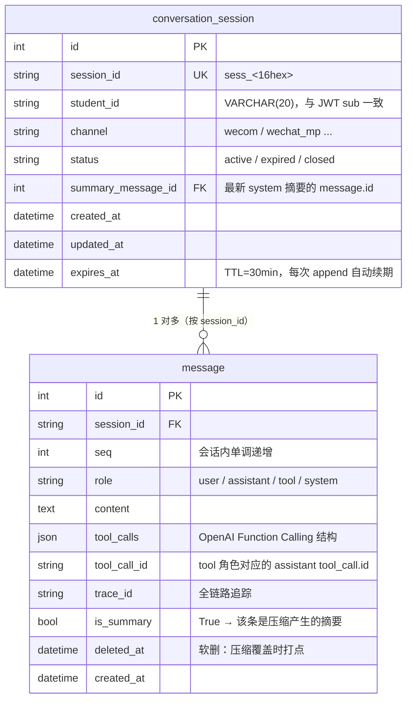

# 学习指南 — Agent 会话存储层（任务设计 W1 配套）

> 配套实现：[`backend/app/conversation/`](../../backend/app/conversation/) + [`backend/tests/test_conversation_store.py`](../../backend/tests/test_conversation_store.py)
> 配套设计：[`01-会话存储层设计.md`](./01-会话存储层设计.md)
> 阅读时长：约 30 分钟 ｜ 实操时长：60 分钟

---

## 一、为什么 Agent 需要"会话存储"

LLM 是 **无状态** 的：每次调用都是独立请求，不记得上一轮说过什么。
但学生和 Agent 真实对话一定是多轮的：

```
学生:  我周三有什么课？
Agent: 周三有 2 节：高等数学（08:00 一教-101）、大学物理（14:00 实验楼 B-215）。
学生:  那个高数，换过教室吗？
Agent:  ← 这里必须记得"那个高数" = "高等数学"
```

**会话存储层 = Agent 的"短期记忆"。** M2 编排层每次收到学生输入时，先把历史从库里取出来，组成 OpenAI Chat Completions 协议的 `messages` 数组，再连同新问题一起喂给 LLM。

---

## 二、本任务交付了什么

```
backend/app/conversation/
├── __init__.py          ← 导出 SessionStore / SessionNotFound / SessionExpired
└── store.py             ← 核心实现（~270 行）

backend/app/schemas/
└── conversation.py      ← Pydantic 契约（MessageIn / Message / Conversation / CompressedSummary）

backend/app/orm/models.py
├── ...既有 4 张表...
├── ConversationSession  ← 新增
└── Message              ← 新增

backend/migrations/versions/
└── 0002_add_conversation_tables.py  ← 新增迁移

backend/tests/
└── test_conversation_store.py       ← 18 条单元测试
```

**一行话概括**：`SessionStore` 提供 `create / get / append / load_history / compress / touch` 六个异步方法 + 两个异常类，封装会话与消息的全生命周期。

---

## 三、核心数据模型

### 3.1 两张表



### 3.2 关键约束

| 约束 | 作用 |
|---|---|
| `session_id UNIQUE` | 全库唯一标识一个会话 |
| `(session_id, seq) UNIQUE` | **兜底并发**：两个 append 同时取到相同 seq 时，DB 抛 `IntegrityError` |
| `(student_id, status)` 索引 | 按学号 + 状态快速查询（如"列出该生所有 active 会话"） |
| `expires_at` 索引 | 后续 GC job 可按 `expires_at < now() - 30d` 物理删除 |
| `tool_calls JSONB` | OpenAI 的 `tool_calls` 数组可直存 |

---

## 四、`SessionStore` 全方法图谱

```
SessionStore(db, settings)
│
├── 会话层
│   ├── create(student_id, channel="wecom")     → Conversation
│   ├── get(session_id)                          → Conversation  # 过期抛 SessionExpired
│   └── touch(session_id)                        → None            # 续期
│
├── 消息层
│   ├── append(session_id, msg)                  → Message         # 自动续期
│   ├── append_many(session_id, msgs)            → list[Message]   # 单事务
│   └── load_history(session_id, *, limit=None)  → list[Message]   # 软删跳过
│
└── 压缩层
    └── compress(session_id, summary, *, kept_tail=None)  → CompressedSummary
```

### 4.1 一个完整对话的生命周期（伪代码）

```python
# 1. 学生首次提问 → 创建会话
store = SessionStore(db, settings)
sess = await store.create(student_id="20230001")  # 来自 Depends(get_current_student)

# 2. 加载历史（首次为空列表）
history = await store.load_history(sess.session_id)  # []

# 3. 追加学生消息
await store.append(sess.session_id, MessageIn(role="user", content="我周三有什么课？"))

# 4. 编排层调 LLM → LLM 返回 tool_calls → 追加 assistant 消息 + tool 消息
await store.append_many(sess.session_id, [
    MessageIn(role="assistant", content="",
              tool_calls=[{"id": "call_1", "type": "function",
                           "function": {"name": "timetable_query",
                                        "arguments": "{...}"}}]),
    MessageIn(role="tool", content="[{...}]", tool_call_id="call_1"),
])

# 5. LLM 产出最终回答 → 追加 assistant 消息
await store.append(sess.session_id,
                   MessageIn(role="assistant", content="周三有 2 节课……"))

# 6. 历史超过 20 条 → 触发压缩（编排层负责调 LLM 生成摘要）
if len(history) + 4 > 20:
    summary_text = await llm.summarize(history)
    summary = await store.compress(sess.session_id, summary_text, kept_tail=6)
    # → 自动软删旧消息 + 写 1 条 system 摘要
```

---

## 五、关键设计决策与坑（必读）

### 5.1 为什么 `get()` 用 `select(...)` 而不用 `session.get()`

**坑**：SQLAlchemy 异步 + SQLite 下，`session.get(ConversationSession, "sess_xxx")` 会按**主键**（`id`）查找，并且 commit 后新插入的对象可能已从 identity map 移除——结果就是 `session.get()` 找不到非主键唯一列对应的记录。

**修复**：
```python
# ❌ 错误写法（按主键查，找不到非主键唯一列）
row = await self.db.get(ConversationSession, session_id)

# ✅ 正确写法（显式按 session_id 列查）
stmt = select(ConversationSession).where(
    ConversationSession.session_id == session_id
)
row = (await self.db.execute(stmt)).scalar_one_or_none()
```

**启示**：在 SQLAlchemy 异步 + commit 后场景，**任何"按非主键唯一列"查询都应走显式 `select(...)`**，不要依赖 `session.get()` 的 identity map 缓存。

### 5.2 SQLite 不原生支持时区类型

**坑**：SQLAlchemy `DateTime(timezone=True)` 在 PostgreSQL 上是 `TIMESTAMPTZ`，在 SQLite 上是 `DATETIME`（无时区）。代码里 `row.expires_at < datetime.now(timezone.utc)` 会抛：
```
TypeError: can't compare offset-naive and offset-aware datetimes
```

**修复**：比较前统一规范化：
```python
expires_at = row.expires_at
if expires_at is not None and expires_at.tzinfo is None:
    expires_at = expires_at.replace(tzinfo=timezone.utc)
```

### 5.3 ORM 模型与 Pydantic 契约同名

**坑**：`app.orm.models.Message` 和 `app.schemas.conversation.Message` 同名，`store.py` 里 `from ..orm.models import Message` 会**覆盖** Pydantic 的 `Message`，后续 `Message.model_validate(...)` 抛 `AttributeError: type object 'Message' has no attribute 'model_validate'`。

**修复**：
```python
from ..orm.models import Message as MessageORM  # 别名
from ..schemas.conversation import Message       # Pydantic
```

`store.py` 里所有 ORM 实例化都用 `MessageORM(...)`，Pydantic 校验用 `Message.model_validate(...)`。

### 5.4 并发 `seq` 撞号的应用层重试

**风险**：`MAX(seq)+1` 不是原子的。两个并发 `append` 可能都读到 `MAX(seq)=5`，都尝试 `INSERT seq=6`，第二个撞 `UniqueConstraint(session_id, seq)` 抛 `IntegrityError`。

**本任务方案**：依赖唯一约束兜底，**预期编排层（子任务 2）做"重试一次"**——具体做法是捕获 `IntegrityError`，重读 `MAX(seq)+1`，再 INSERT。中期迁 PG `SEQUENCE` 后可彻底消除（每会话一个 sequence，原子自增）。

**测试侧验证**：见 [`test_conversation_store.py:75`](../../backend/tests/test_conversation_store.py) 的 `test_append_uniqueness_constraint_at_db_level`——直接 INSERT 重复 seq，断言抛 `IntegrityError`。

### 5.5 历史压缩的安全阀

**设计**：`kept_tail` 至少 4 条，防止 LLM 在压缩后"丢上下文"。

```python
keep = max(4, kept_tail or self.settings.session_compress_tail)
```

**为什么是 4**：经验值——少于 4 条 LLM 容易答非所问；多于 10 条压缩收益下降。`session_compress_tail=6` 是默认推荐。

### 5.6 软删 vs 硬删

**软删**（`deleted_at` 打点）的两个好处：
1. **审计可还原**：学生事后投诉时，能调出完整历史；
2. **压缩可逆**：调试阶段万一发现摘要生成错了，把 `deleted_at` 清空即可。

**代价**：表会增长。**靠后续 GC job** 按 `expires_at < now() - 30d AND deleted_at IS NOT NULL` 物理删除（提醒引擎阶段一并引入）。

---

## 六、测试组织方式

`backend/tests/test_conversation_store.py` 共 18 条测试，按 AC 表分组：

```
AC-IMPL01-1 迁移可执行可回滚 → alembic CLI 验证（不在本文件）
AC-IMPL01-2 session_id 唯一   → test_create_returns_unique_session_ids
AC-IMPL01-3 seq 单调+并发      → test_append_seq_monotonic
                                test_append_concurrent_no_duplicate_seq
                                test_append_uniqueness_constraint_at_db_level
AC-IMPL01-4 加载按 seq 升序    → test_load_history_orders_and_limits
                                test_load_history_default_limit_from_settings
                                test_load_history_skips_soft_deleted
AC-IMPL01-5 touch 续期         → test_touch_extends_expires_at
                                test_append_auto_touches
AC-IMPL01-6 过期抛异常         → test_expired_session_raises
                                test_missing_session_raises_not_found
AC-IMPL01-7 压缩语义           → test_compress_writes_summary_and_soft_deletes_old
                                test_compress_keeps_minimum_tail
                                test_compress_empty_history_is_noop
AC-IMPL01-8 student_id 不被覆  → test_create_distinguishes_students
AC-IMPL01-9 既有测试保持绿     → pytest tests/ 全绿（38 passed）
AC-IMPL01-10 trace_id 透传     → test_trace_id_propagates
```

**辅助覆盖**：批量追加（`append_many_single_transaction`）、配置项生效（`test_settings_override_take_effect`）。

### 6.1 关键测试技巧

**冻结时钟 + 真实时间**——这是个反直觉点：

```python
# ❌ 错误：模块级 NOW 是未来时间，freezegun 解冻后真实时钟远在 NOW 之前
NOW = datetime(2026, 9, 28, 10, 0, tzinfo=timezone.utc)

async def test_expired_session_raises(db):
    row.expires_at = NOW - timedelta(seconds=1)  # 2026，但真实时钟在 2025
    # → expires_at > now()，永远不会过期！

# ✅ 正确：用真实时钟的"过去"
async def test_expired_session_raises(db):
    row.expires_at = datetime.now(timezone.utc) - timedelta(seconds=10)
```

**SQLAlchemy 单 AsyncSession 不可并发**——`asyncio.gather` 同一 session 上的并发 add 会触发 SAWarning。**本任务的并发安全由应用层在编排层做"重试一次"**；测试侧改为顺序追加验证单调性。

---

## 七、动手实验（建议 60 分钟）

### 实验 1：跑通测试，看 session 全生命周期

```bash
cd E:\Agent\backend
python -m pytest tests/test_conversation_store.py -v
```

**观察**：18 个测试函数命名即对应 AC 表，可逐一对照设计文档第七章。

### 实验 2：写一段端到端 demo

新建 `backend/demo_session.py`：

```python
"""会话存储层 Demo（任务设计 W1 学习配套）。"""
import asyncio
from datetime import datetime, timezone

from app.db import make_engine
from app.orm import Base
from app.conversation import SessionStore
from app.schemas.conversation import MessageIn
from app.config import Settings


async def main():
    engine = make_engine("sqlite+aiosqlite:///:memory:")
    async with engine.begin() as conn:
        await conn.run_sync(Base.metadata.create_all)

    from sqlalchemy.ext.asyncio import async_sessionmaker
    factory = async_sessionmaker(engine, expire_on_commit=False)

    async with factory() as db:
        store = SessionStore(db, Settings())

        # 1. 创建会话
        sess = await store.create(student_id="20230001", channel="wecom")
        print(f"[创建] session_id={sess.session_id}, expires_at={sess.expires_at}")

        # 2. 模拟多轮对话
        turns = [
            ("user", "我周三有什么课？"),
            ("assistant", "我帮你查一下。"),
            ("user", "高数在哪上？"),
            ("assistant", "一教-101。"),
            ("user", "能续借《深入理解计算机系统》吗？"),
            ("assistant", "好的，已续借到 10 月 1 日。"),
            ("user", "我绩点多少？"),
            ("assistant", "3.72。"),
        ]
        for role, content in turns:
            await store.append(
                sess.session_id, MessageIn(role=role, content=content)
            )

        history = await store.load_history(sess.session_id)
        print(f"\n[加载历史] 共 {len(history)} 条：")
        for m in history:
            print(f"  seq={m.seq:2d} {m.role:9s} | {m.content}")

        # 3. 压缩：模拟 LLM 生成的摘要
        summary = await store.compress(
            sess.session_id,
            summary="学生问过课表、高数教室、续借和绩点。Agent 已回答全部。",
            kept_tail=4,
        )
        print(f"\n[压缩] 软删 {summary.summarized_count} 条，写 system 摘要 id={summary.summary_message_id}")

        history_after = await store.load_history(sess.session_id)
        print(f"\n[压缩后历史] 共 {len(history_after)} 条：")
        for m in history_after:
            tag = " [摘要]" if m.is_summary else ""
            print(f"  seq={m.seq:2d} {m.role:9s} | {m.content}{tag}")

    await engine.dispose()


if __name__ == "__main__":
    asyncio.run(main())
```

运行：

```bash
python -m demo_session
```

**预期输出**（顺序）：

```
[创建] session_id=sess_xxxxxxxxxxxxxxxx, expires_at=2026-xx-xx xx:xx:xx+00:00

[加载历史] 共 8 条：
  seq= 1 user      | 我周三有什么课？
  seq= 2 assistant | 我帮你查一下。
  seq= 3 user      | 高数在哪上？
  seq= 4 assistant | 一教-101。
  seq= 5 user      | 能续借《深入理解计算机系统》吗？
  seq= 6 assistant | 好的，已续借到 10 月 1 日。
  seq= 7 user      | 我绩点多少？
  seq= 8 assistant | 3.72。

[压缩] 软删 4 条，写 system 摘要 id=9

[压缩后历史] 共 5 条：
  seq= 5 user      | 能续借《深入理解计算机系统》吗？
  seq= 6 assistant | 好的，已续借到 10 月 1 日。
  seq= 7 user      | 我绩点多少？
  seq= 8 assistant | 3.72。
  seq= 9 system    | 学生问过课表、高数教室、续借和绩点。Agent 已回答全部。 [摘要]
```

**关键观察**：
- 压缩保留最近 4 条 + 1 条 system 摘要 = 5 条；
- system 摘要 seq 最大（写在末尾），按 seq 升序加载时在最后；
- 软删的 4 条（seq=1..4）从 `load_history` 消失，但仍在 DB（`deleted_at` 有值）。

### 实验 3：触发过期

修改 demo，验证 `SessionExpired`：

```python
import asyncio
from datetime import datetime, timedelta, timezone
from app.db import make_engine
from app.orm import Base, ConversationSession
from app.conversation import SessionStore, SessionExpired
from sqlalchemy.ext.asyncio import async_sessionmaker
from sqlalchemy import select
from app.config import Settings

async def main():
    engine = make_engine("sqlite+aiosqlite:///:memory:")
    async with engine.begin() as conn:
        await conn.run_sync(Base.metadata.create_all)
    factory = async_sessionmaker(engine, expire_on_commit=False)

    async with factory() as db:
        store = SessionStore(db, Settings())
        sess = await store.create(student_id="20230001")
        print(f"创建：{sess.session_id}")

        # 手动把 expires_at 改到过去
        row = (await db.execute(
            select(ConversationSession).where(
                ConversationSession.session_id == sess.session_id
            )
        )).scalar_one()
        row.expires_at = datetime.now(timezone.utc) - timedelta(seconds=1)
        await db.commit()
        print("把 expires_at 设为过去 1 秒……")

        try:
            await store.get(sess.session_id)
            print("❌ 应该抛 SessionExpired，但没抛")
        except SessionExpired as e:
            print(f"✅ SessionExpired 抛出：{e}")

    await engine.dispose()

asyncio.run(main())
```

---

## 八、与编排层（子任务 2）的对接契约

`SessionStore` 给编排层暴露的是这 6 个方法 + 2 个异常，**编排层不直接写 SQL**：

```python
# 编排层伪代码（子任务 2 实施时参考）

class Orchestrator:
    def __init__(self, store: SessionStore, llm: LLMAdapter, registry: ToolRegistry):
        self.store = store
        self.llm = llm
        self.registry = registry

    async def run(self, student_id: str, user_input: str, session_id: str | None):
        # 1. 创建或获取会话
        if session_id is None:
            sess = await self.store.create(student_id)
        else:
            sess = await self.store.get(session_id)  # 过期抛 SessionExpired

        # 2. 加载历史
        history = await self.store.load_history(sess.session_id)
        # 3. 转 OpenAI 协议 messages（首条 system 作为 system prompt）
        messages = self._to_openai_messages(history)
        messages.append({"role": "user", "content": user_input})

        # 4. 调 LLM
        resp = await self.llm.chat(messages, tools=self.registry.openai_tools())

        # 5. 处理 tool_calls
        if resp.tool_calls:
            for tc in resp.tool_calls:
                result = await self.registry.dispatch(tc.function.name, ctx, params)
            # 追加 assistant + tool 消息
            await self.store.append_many(sess.session_id, [...])

        # 6. 追加最终 assistant 消息
        await self.store.append(sess.session_id, MessageIn(
            role="assistant", content=resp.content, trace_id=get_trace_id()
        ))

        # 7. 触发压缩（如果历史超过阈值）
        if len(history) > settings.session_history_limit:
            summary = await self.llm.summarize(history)
            await self.store.compress(sess.session_id, summary)
```

---

## 九、常见问题（FAQ）

**Q1：为什么不直接用 Redis 存历史？**
A：会话历史与事务性数据（订阅/工单/审计）共用同库便于 join 排查；Redis 适合缓存高频读，但不适合"必留存"的数据（≥180 天）。

**Q2：什么时候把会话迁到 Redis？**
A：当会话量达到每日 10 万级、单库 PostgreSQL 开始有 IO 压力时。可用 Redis 缓存"最近 N 小时活跃会话的 messages"，冷数据仍在 PG。

**Q3：怎么防止学生手动清除客户端后 session 丢失？**
A：本设计 server 端不依赖客户端的 session_id。客户端可随便丢，下次对话服务端会生成新 session。如果要做"找回上次会话"，需新增 `last_active_session(student_id) -> session_id` 接口。

**Q4：压缩阈值为什么是 20？**
A：经验值——大多数 LLM 上下文窗口 ≥8k token 时，20 条消息约占 2-3k token，给 LLM 留足响应空间。具体业务可调 `settings.session_history_limit`。

**Q5：能否让客户端主动删除某条消息？**
A：阶段一不支持（与"只读优先"一致）。阶段二可加"学生撤回"接口，走软删 + 审计留痕。

---

## 十、自测题

请尝试独立回答，再对照答案：

1. `SessionStore.get(session_id)` 在会话过期时会怎样？为什么？
2. `compress()` 后再调用 `load_history()`，为什么看不到被摘要覆盖的旧消息？
3. `append()` 与 `append_many()` 的核心区别是什么？编排层哪种场景该用哪个？
4. 为什么不直接用 `session.add(...)` 在同一 `AsyncSession` 上并发执行 20 个 `append`？应该用什么机制替代？
5. `(session_id, seq)` 的唯一约束兜底了什么风险？如果把它去掉，会有什么后果？

<details>
<summary>参考答案</summary>

1. 抛 `SessionExpired`。`get()` 内部先 `_expire_if_needed(row)`：检测 `expires_at < now()`，把 `status` 改为 `expired` 并 commit；再判断 `row.status == "expired"` 抛异常。**消息本体不删**，只标记会话状态。

2. 因为 `load_history` 的 SQL 包含 `WHERE deleted_at IS NULL`，软删的消息被过滤掉；同时新写的 `role='system', is_summary=True` 摘要被纳入结果（`is_summary` 不影响查询可见性，编排层可按需过滤）。

3. `append` 是单条 INSERT，`append_many` 是单事务批量 INSERT。**编排层在 LLM 一轮返回多个 tool_calls、需要把 assistant + N 个 tool 结果原子追加时用 `append_many`**；其他场景用 `append`。

4. SQLAlchemy 异步引擎 + 单 `AsyncSession` 不能并发执行 `add` + `commit`（SAWarning: "Usage of the Session.add() operation is not currently supported within the execution stage of the flush process"）。**正确做法**：每请求一个独立 session（FastAPI Depends 已做），或者应用层捕获 `IntegrityError` 后重试一次（依赖 `(session_id, seq)` 唯一约束兜底）。

5. 兜底**两个并发 append 取到相同 `MAX(seq)+1`**的撞号风险。去掉后，第二个写入会成功但 seq 重复，导致 `load_history` 返回顺序错乱、`append_many` 单事务里 seq 重复会让编排层喂给 LLM 的 messages 错位。短期不可去掉；中期迁 PG sequence 后可去掉。

</details>

---

## 十一、下一步

完成本任务后，编排层（子任务 2）可以调用 `SessionStore` 的全部方法。**推荐下一步**：
1. 阅读 [`01-会话存储层设计.md`](./01-会话存储层设计.md) 的"业务流程"一节，端到端理解一次对话的时序；
2. 跑上面的 demo 脚本，对照输出理解压缩前后的差异；
3. 尝试自己实现一个"按学号查最近 N 条会话"的方法（提示：`select(ConversationSession).where(student_id==...).order_by(updated_at.desc()).limit(N)`）。

---

*学习指南 v1.0 ｜ 阶段一实施规范对接 ｜ 配套实现：[`backend/app/conversation/`](../../backend/app/conversation/) + [`backend/tests/test_conversation_store.py`](../../backend/tests/test_conversation_store.py)*