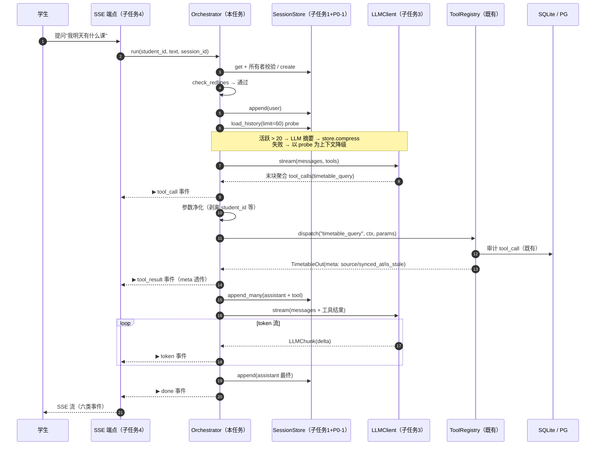

# 任务设计文档 — 子任务 2：编排核心 Orchestrator

> 文档编号：WAgent-IMPL-03
> 版本：v1.1（评审修订版）
> 适用阶段：阶段一 · 编排层（M2）核心
> 关联文档：[`01-会话存储层设计.md`](./01-会话存储层设计.md)（子任务 1，直接前置）｜ [`10-阶段一-校园助手Agent设计.md`](../10-阶段一-校园助手Agent设计.md) §3.1/3.2 ｜ [`11-阶段一-AI可执行与人工兜底边界矩阵.md`](../11-阶段一-AI可执行与人工兜底边界矩阵.md) §4 ｜ [`12-阶段一-技术架构与数据契约.md`](../12-阶段一-技术架构与数据契约.md) ｜ [`15-阶段一-核心设计任务实施规范.md`](../15-阶段一-核心设计任务实施规范.md) §2/§4.3

### 修订记录

| 版本 | 日期 | 变更 |
|---|---|---|
| v1.0 | 2026-09-29 | 初版 |
| v1.1 | 2026-09-29 | 评审修订 4 处逻辑漏洞：① F3 压缩触发条件依赖存储层缺陷实际永不触发（新增 §1.5 前置修正 P0-1，F3 重写）；② F1 新增会话所有者校验（防水平越权，P0-2）；③ F5 熔断改为"拒绝即置位 fused"，消除"拒绝后仍带完整工具表重试"的死循环窗口；④ 新增 F4b 写操作确认门禁（`library_renew` 的 `confirmed`/`idempotency_key` 服务端可信化）。新增审计动作 `budget_exhausted` / `owner_mismatch`，AC 表扩至 15 条 |

---

## 一、任务概述

### 1.1 背景：地基已就绪，缺一台发动机

阶段一后端已完成五块与编排直接相关的基建，但它们彼此尚未连通：

| 组件 | 现状 | 与编排的关系 |
|---|---|---|
| 工具层 | 6 个工具 + `ToolRegistry.dispatch`（统一"类型校验→前置条件→执行→脱敏审计"，[`tools/base.py:172`](../../backend/app/tools/base.py)） | 编排层是它目前缺失的第二个调用方（第一个是 `/agent/*` HTTP 接口） |
| 会话存储 | 子任务 1 已交付 `SessionStore`：CRUD / `load_history` / `compress` / `append_many`（[`conversation/store.py`](../../backend/app/conversation/store.py)） | 编排层是其设计文档中明确的唯一上游；**评审发现两处需前置修正的缺陷（§1.5）** |
| 护栏 | `check_redlines()` L1 关键词通道，覆盖 R1/R3/R4/R5，返回 `GuardrailResult(hit, rules, life_priority)`（[`guardrail.py:36`](../../backend/app/guardrail.py)） | 命中后"由谁中断、谁生成工单"尚未落地——正是本任务 |
| 转人工 | `handoff_create` 工具已实现，`hit_rules`/`agent_response_log`/`priority` 必填（[`schemas/handoff.py`](../../backend/app/schemas/handoff.py)） | 目前只能靠外部手工拼参调用，缺一个确定性触发方 |
| LLM | 仅 `config.py` 有 `llm_api_base`/`llm_api_key`，无任何调用代码 | 子任务 3 负责适配器实现，但**接口形状必须由编排层的需求倒推定义** |

当前的直接表现：`/agent/*` 六个接口是无状态请求-响应，学生不能对话，LLM 不在链路里，红线词靠调用方自觉。**本任务交付 `orchestrator.py`——把上面五件事串成"对话循环"的发动机**，对齐主设计文档 §3.2 对 M2 的职责定义：意图识别、工具选择、结果生成、红线拦截（阶段一由 Function Calling 承担前两项，[`10-阶段一-校园助手Agent设计.md`](../10-阶段一-校园助手Agent设计.md) §3.2 模块职责表）。

### 1.2 目标

| 编号 | 目标 | 衡量 |
|---|---|---|
| G1 | **会话压缩**：历史 > N 条时调 LLM 生成 ≤200 字摘要并替换早期消息 | 单测覆盖触发分支与"恰好 N 条不触发"边界（复用子任务 1 的 `SessionStore.compress`） |
| G2 | **工具路由**：把 LLM 返回的 `tool_calls` 翻译为 `ToolRegistry.dispatch` 调用 | 单测覆盖正常 1 轮工具调用 + `student_id` 防越权 + 会话所有者校验 |
| G3 | **迭代上限**：单轮对话最多 6 次工具调用，超限熔断且有用户可见兜底 | 单测覆盖熔断分支：第 7 批被拒、**此后不再携带工具表重试**、事件流正常收尾 |
| G4 | **红线拦截**：命中 `guardrail.py` 已定义规则立刻中断、生成转人工工单 | 单测覆盖 R1 拦截与 R5 生命优先通道 |
| G5 | **事件流协议**：`async def run(student_id, user_input, session_id) -> AsyncIterator[Event]`，六类事件（thinking / tool_call / tool_result / token / done / error） | 事件序列可被子任务 4 的 SSE 端点直接序列化转发 |
| G6 | **写操作可信化**：`library_renew` 的确认态与幂等键由服务端验证/生成，模型自填无效 | 单测覆盖"伪造 confirmed 被剥离"与"两轮确认协议放行"（§3.4 F4b） |

### 1.3 范围

**包含**：
1. 新增 `backend/app/orchestrator.py`（协议类型 + `Orchestrator` 主类，预计 ~400 行）；
2. **前置修正 §1.5 P0-1**：`conversation/store.py` 的 `load_history` 分页语义一行修正 + 既有测试断言同步修正（不改表结构、不加迁移）；
3. `backend/app/config.py` 追加编排层配置 4 项（工具预算 / 摘要字数上限 / LLM 超时 / 历史探测窗口）；
4. 新增 `backend/tests/test_orchestrator.py`，覆盖「压缩触发 / 迭代上限熔断 / 红线拦截」三个验收分支及 8 个附加场景；
5. 根 [`README.md`](../../README.md) 进度条勾选该项。

**不包含**（明确排除，避免范围蔓延）：
- ❌ LLM 适配器真实现（OpenAI SDK 直连、流式增量拼接、重试）→ **子任务 3**，本任务只定义 `LLMClient` Protocol；
- ❌ SSE 端点 / FastAPI 路由 / 前端渲染 → **子任务 4**；
- ❌ system prompt 的内容工程与话术模板库迭代 → 子任务 3/4 持续优化，本任务给出初版；
- ❌ L2 语义级护栏、输出侧审核 → 阶段二（当前 `guardrail.py` 仅 L1 输入侧通道）；
- ❌ 存储层 `get()` 的所有者校验参数化（§1.5 P0-2 由编排层落地，存储层 API 增强留作建议）；
- ❌ 长期记忆 / 向量检索 / 跨会话画像 → 阶段二。

### 1.4 与上游下游的关系

```
┌───────────────────────────────────────────────────────────────┐
│ 子任务 4：SSE 端点 /agent/chat                                  │
│   async for event in orch.run(...): → event: <type>\ndata: …  │
└───────────────────────────▲───────────────────────────────────┘
                            │ AsyncIterator[Event]
┌───────────────────────────┴───────────────────────────────────┐
│            本任务：Orchestrator（编排核心，M2）                 │
│  ┌─────────┐ ┌─────────┐ ┌──────────┐ ┌─────────┐ ┌────────┐  │
│  │F1 会话   │ │F2 红线  │ │F3 压缩    │ │F4 工具   │ │F5 熔断 │  │
│  │准备/重建 │ │拦截+工单│ │(LLM 摘要) │ │路由+写门 │ │(预算6) │  │
│  │+所有者   │ │         │ │          │ │禁(F4b)  │ │        │  │
│  │校验      │ │         │ │          │ │         │ │        │  │
│  └────┬────┘ └────┬────┘ └────┬─────┘ └────┬────┘ └───┬────┘  │
└───────┼───────────┼───────────┼────────────┼───────────┼──────┘
        ▼           ▼           ▼            ▼           │
  SessionStore   guardrail    LLMClient   ToolRegistry  │（纯计数）
  (子任务1+P0-1) check_       (Protocol→   .dispatch     │
  create/load/   redlines     子任务3实现)  (既有)       │
  compress/                                handoff_create
  append_many                              (既有,工单)
```

### 1.5 前置修正项（评审发现的既有缺陷，编码前必须完成）

本任务设计评审发现子任务 1 交付物中两处与编排层需求冲突的缺陷。它们**不是本任务新增代码，而是本任务的前置依赖**：

#### P0-1：`load_history` 分页语义与 01 文档 AC 相悖（阻塞 F3）

- **现象**：[`conversation/store.py:118-119`](../../backend/app/conversation/store.py) 的 `order_by(Message.seq.asc()).limit(n)` 返回**最早 n 条**；而 01 文档 §2.1 F4 与 AC-IMPL01-4 的语义是"**取最近 limit 条**（按 seq 升序返回）"。实现与测试（`test_load_history_orders_and_limits` 断言 `seq=1..10`）一致地偏离了设计意图。
- **对本任务的阻塞链**（两处）：
  1. **F3 压缩永不触发**：编排层若按 v1.0 设计调 `load_history()`（默认 `limit=20`），返回长度恒 ≤ 20，`len(history) > 20` 永远为假；
  2. **降级路径丢最新消息**：即便显式传更大的 `limit`，"最早 N 条"语义会把刚落库的本轮 `user` 消息截在窗口外——压缩降级时 LLM 看不到用户刚说的话。
- **修正**（一行改动 + 测试断言同步）：

```python
# store.py load_history —— 修正后（"尾部窗口"：取最近 n 条，仍按 seq 升序返回）
stmt = (
    select(MessageORM)
    .where(MessageORM.session_id == session_id, MessageORM.deleted_at.is_(None))
    .order_by(MessageORM.seq.desc())     # 先按倒序取最近 n 条
    .limit(effective_limit)
)
rows = list((await self.db.execute(stmt)).scalars().all())
rows.reverse()                            # 内存反转为时间正序（n ≤ 窗口量级，开销可忽略）
```

同步修正 `test_conversation_store.py` 两处断言：30 条插入 + `limit=10` → 应返回 `seq=21..30`（回到 01 文档 AC-IMPL01-4 原文）；`session_history_limit=7` + 15 条 → 应返回 `seq=9..15`。
- **归属**：子任务 1 的缺陷，本任务编码第一步顺手修正（含回归测试），不动表结构、不新增迁移。

#### P0-2：会话读取不校验所有者（阻塞 F1，防水平越权）

- **现象**：`SessionStore.get(session_id)` 只按 `session_id` 查找（[`conversation/store.py:78-94`](../../backend/app/conversation/store.py)），不校验 `student_id`。`session_id` 是 16 hex 随机串，仅是**路由标识，不是授权凭证**——若 API 接受客户端传入的 `session_id` 并直接加载，持有/猜到他人会话 ID 即可读写他人对话历史（水平越权）。
- **修正归属**：授权判定是编排层职责，**本任务在 F1 落地强制校验**（见 §三 F1）；存储层 `get(session_id, *, expected_student_id=None)` 参数化增强留作对子任务 1 的建议项（非阻塞）——`append` / `compress` 等所有会话操作在编排层唯一入口 `run()` 之内，先过 F1 校验即全部受保护。

---

## 二、总体设计与核心协议

### 2.1 设计原则（逐条映射既有约定）

| 编号 | 原则 | 依据 |
|---|---|---|
| P1 | **单一入口**：`run()` 是编排层唯一合法入口，所有对话必须过同一套红线/预算/审计/所有者校验 | [`10-阶段一-校园助手Agent设计.md`](../10-阶段一-校园助手Agent设计.md) §3.2 M2"红线拦截召回率 100%"——旁路入口 = 漏拦截 |
| P2 | **依赖倒置**：LLM 以 `typing.Protocol` 声明，编排层只依赖接口，单测注入 `FakeLLM`，不碰网络 | [`15-阶段一-核心设计任务实施规范.md`](../15-阶段一-核心设计任务实施规范.md) §4.3"不引入 LangChain/LangGraph，原生 Function Calling" |
| P3 | **事实与语言分离**：LLM 只负责理解意图与组织语言，**不产生事实**；一切事实取自工具返回值（含 `meta` 溯源三元组） | [`15-阶段一-核心设计任务实施规范.md`](../15-阶段一-核心设计任务实施规范.md) §1.2 校园场景反通用假设 |
| P4 | **确定性优先**：红线检查、迭代熔断、压缩触发、**写操作确认放行**全部是确定性代码路径；LLM 只出现在"被允许产生语言"的环节。授权类判定（红线、confirmed）不允许概率性组件参与 | 六条红线 R6"不确定即转人工"的工程化表达 |
| P5 | **失败显性化**：每个分支都有用户可见出口，不存在静默失败；工具失败≠对话失败（错误回填给 LLM 转述） | [`11-阶段一-AI可执行与人工兜底边界矩阵.md`](../11-阶段一-AI可执行与人工兜底边界矩阵.md) §5 自检清单"不允许静默失败" |
| P6 | **参数不可信**：LLM 生成的工具参数一律视为不可信输入——身份（`student_id`）、授权（`confirmed`）、幂等锚（`idempotency_key`）三个字段只能由服务端注入，模型传什么都会被剥离覆盖 | R1.2 的推广：会话身份注入的完整闭环 |

### 2.2 `orchestrator.py` 模块内部分区

```
backend/app/orchestrator.py
├── 协议区（可被子任务 3/4 import）
│   ├── EventType(str, Enum)        # 六类事件
│   ├── Event                        # 事件信封
│   ├── LLMChunk / ToolCallRequest   # LLM 流式块与工具调用请求
│   ├── LLMResponse                  # 单次 LLM 交互聚合结果
│   └── LLMClient(Protocol)          # 子任务 3 的实现契约
├── 常量区
│   ├── DEFAULT_SYSTEM_PROMPT        # 初版系统提示词（见 §3.10）
│   ├── REDLINE_PRIORITY / REDLINE_OWNER  # 规则→优先级/归属映射
│   ├── R5_LIFELINE_SCRIPT / BLOCKED_REPLY_TEMPLATES  # 拦截固定话术
│   ├── WRITE_GUARDED_FIELDS         # 写工具的服务端注入字段（§3.4 F4b）
│   └── RENEW_CONFIRM_KEYWORDS       # 续借确认关键词集（确定性匹配）
├── 主类 Orchestrator
│   ├── run()                        # 唯一公开方法（async generator）
│   ├── F1 _ensure_session           # 会话准备 + 过期重建 + 所有者校验
│   ├── F2 _redline_block            # 红线拦截（async generator）
│   ├── F3 _maybe_compress           # 压缩判定与执行（async generator）
│   ├── F4 _agent_loop               # 工具路由主循环（async generator）
│   ├── F4b _renew_gate              # 写操作确认门禁（纯函数 + 历史查证）
│   ├── F5 熔断状态机                # fused 标志 + 收尾请求（至多一次）
│   └── 辅助 _emit / _to_openai_message / _dispatch_one
└── 审计触发（write_audit 四类编排事件：
    redline_block / session_compress / budget_exhausted / owner_mismatch）
```

### 2.3 事件流协议

```python
class EventType(str, Enum):
    THINKING = "thinking"      # 阶段信号（前端"正在…"状态）
    TOOL_CALL = "tool_call"    # LLM 决定调用某工具
    TOOL_RESULT = "tool_result"# 工具执行结果摘要（含溯源 meta）
    TOKEN = "token"            # LLM 文本增量（真流式透传）
    DONE = "done"              # 终态：本轮对话完成
    ERROR = "error"            # 终态：编排层自身故障
```

**事件信封与负载约定**：

| type | `data` 字段 | 说明 |
|---|---|---|
| `thinking` | `{phase, detail?}`，phase ∈ `session_ready` / `compressing` / `budget_exhausted` / `finalizing` | 轻量信号，不承载业务数据 |
| `tool_call` | `{tool, call_id, args_digest, seq}` | `args_digest` 复用 [`tools/base.py:116`](../../backend/app/tools/base.py) 的 `_mask_args` 脱敏语义 |
| `tool_result` | `{tool, call_id, ok, error?, meta?, result_digest?}` | `meta` 透传工具出参的溯源三元组（`source/synced_at/degrade_status/is_stale/stale_reason`）；**只放摘要级结果**（如 `{count: 5}`），明细由 LLM 最终回答转述——事件流不搬运大 payload |
| `token` | `{delta}` | 子任务 4 直接映射为 SSE 增量 |
| `done` | `{session_id, assistant_message_id?, compressed, tool_iterations, budget_exhausted, blocked, handoff_ticket_id?}` | `blocked=true` 表示红线拦截收尾；`session_id` 必回传（新会话/所有者不匹配重建时前端需替换） |
| `error` | `{code, message}`，code ∈ `llm_unavailable` / `storage_error` / `internal` | 工具失败不是 error——那是 `tool_result(ok=false)` |

**路径事件序列**（子任务 4 的前端状态机依据）：

```
正常（1 次工具调用）：
  thinking(session_ready) → tool_call → tool_result → token×N → done

触发压缩时，头部多一段：
  thinking(session_ready) → thinking(compressing) → tool_call → … → done(compressed=true)

红线拦截（LLM 全程不参与）：
  thinking(session_ready) → tool_call(handoff_create) → tool_result → token×N → done(blocked=true, handoff_ticket_id=…)

熔断（含批级拒绝路径）：
  …tool_call/tool_result×6 → thinking(budget_exhausted) → token×N → done(budget_exhausted=true)
  注：被拒批不产生 tool_call / tool_result 事件——那些调用从未执行；
      过程可见性由回填的"未执行"tool 消息保证（LLM 会在收尾文本中说明）
```

### 2.4 LLM 依赖边界（`LLMClient` Protocol，子任务 3 的实现契约）

```python
@dataclass
class ToolCallRequest:
    """LLM 请求的一次工具调用（OpenAI tool_calls 元素的直译）。"""
    id: str
    name: str
    arguments: str          # JSON 字符串，原样保留，由编排层解析

@dataclass
class LLMChunk:
    """流式块。约定：delta 与 tool_calls 不同时出现；
    tool_calls（聚合完成态）只出现在流的最后一个块。"""
    delta: str | None = None
    tool_calls: list[ToolCallRequest] | None = None
    finish_reason: str | None = None      # "stop" | "tool_calls" | "length"

class LLMClient(Protocol):
    def stream(
        self,
        messages: list[dict],
        tools: list[dict] | None = None,
    ) -> AsyncIterator[LLMChunk]: ...
```

**为什么是 `AsyncIterator[LLMChunk]` 而不是"回调 + 聚合返回"**：Python 的 async generator 无法在 `await` 一个普通回调式调用期间 `yield` 事件；把 LLM 定义为异步流之后，token 透传只是 `async for chunk in ...: yield Event(TOKEN, ...)` 一行——**流式复杂度（OpenAI 增量分片拼接、重试、超时）全部封装在子任务 3 的适配器里**，编排层只见"token 块 + 末块聚合结果"。非流式场景（生成摘要）用同一接口，忽略 delta 只取末块即可。

---

## 三、功能详细设计

### F1 会话准备、所有者校验与过期重建

- **入口**：`run()` 第一步，`_ensure_session(student_id, session_id)`，按以下次序判定：

| 输入情形 | 判定 | 动作 |
|---|---|---|
| `session_id` 为空 | 视为新对话 | `store.create(student_id)` |
| `SessionNotFound` / `SessionExpired`（[`conversation/store.py`](../../backend/app/conversation/store.py) 惰性过期检测） | 会话不存在或已过期 | `store.create(student_id)` 重建 |
| `session.student_id != student_id`（**所有者不匹配**） | 视同不存在——**绝不加载他人历史** | `write_audit(action="owner_mismatch", args_digest={"session_id": …}, result="rejected")` 后 `store.create(student_id)` 静默新建 |

- **所有者校验的安全性设计**：不匹配时**与"会话不存在"走完全相同的路径**（新建），客户端无法从响应差异区分"ID 不存在"与"ID 属于别人"——不泄露会话存在性，天然抵抗枚举探测。校验只做一次（F1），此后 `append` / `compress` 等全部会话操作都在同一 `run()` 内、同一 `session_id` 上进行，无二次注入窗口；
- **授权模型声明**：`session_id` 是**路由标识，不是授权凭证**；授权唯一来源是 JWT `sub`（`run()` 的 `student_id` 入参，来自 [`security.py:40`](../../backend/app/security.py) `get_current_student`），`run()` 不做认证、也不接受任何身份覆盖；
- **trace_id**：入口处 `set_trace_id()`（[`logging_util.py:28`](../../backend/app/logging_util.py)），全部事件信封携带，与审计行对齐；
- 过期/重建/越权重建在 `done` 事件中统一体现为新 `session_id`，前端静默替换（阶段一不弹提示，避免噪音；越权重建同样静默——但审计已留痕）。

### F2 红线拦截与转人工工单（AI+H）

**检查点**：`run()` 中紧跟 F1，先于一切 LLM 交互与消息落库。这是"零漏拦截"的物理保证——LLM 未被调用，就不存在绕过。

**判定**：`check_redlines(user_input)` 返回 `GuardrailResult`。

**命中后的动作序列**（全部为确定性代码，不经 LLM）：

1. `store.append(user)` + `store.append(assistant=固定话术)`——被拦截的对话仍是完整会话，**可审计、可回放**；
2. 组装 `HandoffCreateParams` 并经 `registry.dispatch("handoff_create", ...)` 生成工单（复用统一审计，事件流上表现为一次普通 `tool_call/tool_result`）；
3. `write_audit(action="redline_block", ...)` 写编排层拦截审计（`tool_call`/`handoff` 两类审计已由 dispatch / 工具内部写入，本动作补齐第三类——对齐子任务 1 文档 §2.1 F7"审计由编排层统一触发"的约定）；
4. 固定话术按 ~40 字分片 yield `token` 事件，最后 `done(blocked=true, handoff_ticket_id=…)`。

**规则 → 优先级 / 归属映射**（依据 [`11-阶段一-AI可执行与人工兜底边界矩阵.md`](../11-阶段一-AI可执行与人工兜底边界矩阵.md) §4.2 SLA 表）：

| 命中规则 | priority | suggested_owner | 依据 |
|---|---|---|---|
| `R5_生命优先` | **P0** | 学生工作部 / 心理中心 | 心理危机**即时**响应 |
| `R3_敏感信息` | P1 | 现代教育技术中心（涉心理关键词时学生工作部） | 2 小时 SLA |
| `R4_不代表达诉求` | P1 | 二级学院教务办 | 成绩类 4 小时 SLA |
| `R1_终局性结论` | P2 | 二级学院教务办 | 工作时间 4 小时 |

**R5 特殊通道**（`GuardrailResult.life_priority=True`）：固定话术包含心理援助资源（校心理中心 + 24h 热线），**跳过所有后续流程**（对齐 11 §5 自检"生命优先通道是否跳过所有后续流程"）；工单 `agent_response_log` 即该话术全文。

**话术不经 LLM 的理由**：拦截要求"立刻中断"；固定模板可单测逐字断言、可审计、零延迟、零二次风险。语义级柔性拒答留给阶段二 L2 通道。

### F3 会话压缩（AI）

> v1.1 重写：v1.0 的触发条件（`load_history()` 默认加载后判 `len > 20`）因 §1.5 P0-1 缺陷实际**永不触发**——默认 `limit=20` 使返回长度恒 ≤ 20。本节为修正后的完整设计。

- **前置依赖**：§1.5 P0-1 修正完成（`load_history` 返回"最近 limit 条"）。下文所有 `load_history` 语义均指修正后行为；
- **探测与判定**：`append(user)` 之后、首轮 LLM 请求之前——

```python
probe = await self.store.load_history(
    session.session_id,
    limit=self.settings.orchestrator_history_fetch_limit,   # 默认 60，见 §3.9
)
if len(probe) > self.settings.session_history_limit:        # 20
    → 触发压缩
```

  **为什么显式传 `orchestrator_history_fetch_limit`（60）而不是默认 limit（20）**：一次查询三用——
  1. **触发判定**：60 > 20，探测窗口能看到超阈值状态（v1.0 的死条件被解除）；
  2. **摘要输入**：待压缩消息 = `probe[:-kept_tail]`（全量在握，被摘要区间无遗漏；仅当活跃数 > 60 的极端场景——压缩连续失败十余轮——最早若干条不进摘要，明示接受该取舍）；
  3. **降级上下文**：摘要 LLM 失败时直接以 `probe` 为上下文——"最近 N 条"语义保证**本轮 user 消息必然在窗口内**（P0-1 修正的价值所在）。

- **触发边界的确定性**：活跃数恰为 20 → `len(probe)=20` 不大于 20 → 不触发；21 → 触发。阈值语义与配置名严格一致，单测覆盖两个边界（§6.2 T1 / T1d）；
- **摘要生成**：调 `llm.stream(摘要 prompt + probe[:-kept_tail])`（不带 tools、不 yield token——摘要对用户不可见），prompt 约束：中文 ≤200 字、只保留意图与关键结论、**不含成绩数值与身份证明文**（R3）；
- **字数硬约束**：返回摘要超 `orchestrator_summary_max_chars`（200）时硬截断——配置双保险；
- **落库**：`store.compress(session_id, summary)`（软删旧消息 + 写 `is_summary=True` 的 system 消息，子任务 1 已实现）；随后 `write_audit(action="session_compress", args_digest={"summarized_count": …, "kept_tail": …})`；压缩成功后**重载**一次 `load_history()` 作为 LLM 上下文（此时活跃 = 摘要 + 最近 6 条 ≈ 7 条，默认 limit 足够）；
- **降级**：摘要 LLM 调用失败 → 记结构化日志、跳过压缩、以 `probe` 为上下文继续对话（正确性无损——最新消息在窗口内），`done(compressed=false)`。可用性优先；
- **链式摘要**：多轮压缩时旧摘要也在被压缩区间内，产生"摘要的摘要"——阶段一接受（会话 TTL 30 分钟，链深极浅）。

**LLM 上下文组装规则**（对齐子任务 1 文档"难点 4"的约定）：

```
[
  {system: DEFAULT_SYSTEM_PROMPT},        # 固定系统提示词，永远第一
  {system: 摘要},                          # is_summary=True 的行，紧随其后（至多 1 条活跃）
  ...其余历史消息按 seq 原序（user/assistant/tool），
]
```

### F4 工具路由（Agent Loop 主循环，AI）

**循环体**（`_agent_loop`，骨架见 §3.8）：

1. `llm.stream(messages, tools=registry.openai_tools())`；
2. 流中 delta → yield `token`；末块聚合出 `tool_calls` → 进入工具执行；无 `tool_calls`（纯文本）→ 循环自然结束；
3. **翻译**：`json.loads(call.arguments)` → dict → **先过参数净化（第 4 步 + F4b 门禁）** → `registry.dispatch(call.name, ctx, dict)`。`dispatch` 接受 dict 并自行 `model_validate`（[`tools/base.py:180`](../../backend/app/tools/base.py)）；
4. **身份注入**：`ctx = ToolContext(student_id=run 入参, services=…, session_id=…, channel=…)`。**LLM 生成参数中的 `student_id` 字段一律剥离后再交给 dispatch**——工具入参模型里的 `student_id` 由 ctx 注入覆盖（R1.2，[`15-阶段一-核心设计任务实施规范.md`](../15-阶段一-核心设计任务实施规范.md) §2.2"服务端忽略外部传入值"）。这是架构级防越权的编排侧落点；
5. **结果回填**：工具返回值 `model_dump(mode="json")` 作为 `role=tool`、`tool_call_id=call.id` 消息追加进 `messages`，进入下一轮——**OpenAI 协议要求 assistant 消息中的每个 `tool_call` 必须有配对的 tool 消息**，缺配对下一轮请求会 400；
6. **失败回填**：`ToolError` / `PreconditionError` / 参数校验失败 / `arguments` JSON 解析失败 → 不中断循环，回填 `{role: tool, content: "调用失败：<原因>"}`，让 LLM 用自然语言向用户转述降级语义（对齐 R4.4"UNAVAILABLE 必须有用户可见文案"）；工具返回 `meta.is_stale=True` 时，system prompt 已约束 LLM 必须在回答中标注"缓存数据"。**`PreconditionError` 的回填是 F4b 两轮确认协议的组成部分**（见下）；
7. **未知工具名**（LLM 幻觉）：`dispatch` 抛 `ToolError("未知工具")` → 同样回填纠错，由迭代上限兜底防循环。

**计数规则**：LLM 产生的**每个 `tool_call` 条目计 1 次**（无论执行成功、失败还是解析失败）——解析失败也计数，防"反复产出坏 JSON"死循环。红线拦截中的 `handoff_create` 是确定性代码路径，**不占预算**。

**中间消息即时落库**：每轮工具执行完立即 `store.append_many([assistant(tool_calls), tool×N])`，而非攒到结尾。代价是写放大（单轮 ≤13 条消息），换来三点：① 客户端断线时已发生的事实不丢（审计一致性）；② `GeneratorExit` 的 finally 块无需再 await（async generator 被关闭时禁止 await，见 §4.3 难点 2）；③ **F4b 的跨轮确认查证有据可依**——预览轮的 `tool_calls`（含 barcodes）必然已落库。

### F4b 写操作确认门禁（Write Gate，AI+H）

> v1.1 新增。`RENEW_SPEC` 自己就标注着"需二次确认（AI+H 的确认态在编排层落地）"（[`tools/library.py:42`](../../backend/app/tools/library.py)），而 `LibraryRenewTool.validate` 仅检查 `params.confirmed` 布尔值（[`tools/library.py:64-66`](../../backend/app/tools/library.py)）——若编排层只剥离 `student_id`，LLM 在 `arguments` 里自填 `"confirmed": true` 即可绕过"已展示新到期日并获用户确认"的前置条件。确认态必须由**服务端可验证的信号**产生，不能采信模型自述。

**适用范围**：`library_renew`（阶段一唯一写白名单成员）。`handoff_create` 由编排层确定性路径调用（F2），不经 LLM，不适用。

**参数净化清单**（`_dispatch_one` 统一执行）：

```python
WRITE_GUARDED_FIELDS = {"student_id", "confirmed", "idempotency_key"}
# 读工具：仅剥离 student_id（ctx 注入）
# 写工具（library_renew）：三个字段全部剥离，值由服务端决定：
#   student_id     ← ctx.student_id（身份）
#   confirmed      ← _renew_gate(...) 判定结果（授权）
#   idempotency_key ← make_idempotency_key(session_id, barcodes, 今天)
#                     （幂等锚，security.py:75 既有函数，服务端生成——
#                      模型伪造幂等键会导致幂等表污染与频控绕过）
```

**两轮确认协议**：

| 轮次 | 编排层动作 | 用户感受 |
|---|---|---|
| **预览轮** | 门禁强制注入 `confirmed=False` → `LibraryRenewTool.validate` 必然抛 `PreconditionError("需先展示新到期日并获用户确认")` → 按 F4-6 失败回填 → LLM 转述"需要确认"，配合 `library_loans` 展示在借清单（条码 / 当前到期日 / 可续借状态），引导用户回复确认。assistant 消息（含 `tool_calls` 与 barcodes）即时落库 | 看到"将续借以下图书……回复'确认续借'执行" |
| **执行轮**（下一次 `run()`） | `_renew_gate(user_input, history, current_barcodes)` 三重校验（下表）→ 全部满足才注入 `confirmed=True`，否则维持 `False`（工具自然再次走 PreconditionError，LLM 继续引导） | 回复"确认续借"后完成写操作 |

**执行轮三重校验**（全部确定性代码，P4 原则——授权判定不允许概率性组件）：

| # | 校验 | 实现 | 防什么 |
|---|---|---|---|
| 1 | 历史痕迹：会话尾部存在 assistant 消息，其落库的 `tool_calls` 含 `library_renew`（预览轮证据） | 扫描 `history` 尾部（最近 ~10 条）的 `Message.tool_calls` JSONB | 无中生有的确认（首轮就执行） |
| 2 | 用户显式确认：本轮 `user_input` 命中 `RENEW_CONFIRM_KEYWORDS = {"确认续借", "确定续借", "继续续借", "确认", "确定"}` | 字符串包含匹配 | 模型代替用户表达意愿（R4 同源风险） |
| 3 | 操作内容绑定：本轮 LLM 给出的 `barcodes` 与预览轮 `library_renew` 调用 `arguments` 中的条码集合**完全一致** | 解析预览轮 `tool_calls[].function.arguments` JSON 比对 | "确认 A 却执行 B"的条码偷换 |

**关键词误报的取舍**：用户语境中说"确认"但并非续借确认 → 门禁放行 → 工具执行。代价评估：预览轮必然先行（校验 1），续借本身可逆（白名单准入标准），幂等键绑定"当日 + 该批条码"重复提交无副作用——误报落在安全方向（多一次确认确认轮的体验损耗），阶段一接受；语义级确认理解留给阶段二。

**审计**：门禁注入的真实 `confirmed` 值与 `barcodes` 出现在 dispatch 既有 `tool_call` 审计行的 `args_digest`（[`tools/base.py:196`](../../backend/app/tools/base.py)）——每轮是"预览（false）"还是"执行（true）"全链路可追溯，无需新增审计动作。

### F5 迭代上限与熔断（AI，确定性保护）

> v1.1 修正：v1.0 的"批级拒绝后 `continue`"存在死循环窗口——若 `used` 尚未达 6、只是当前批过大（如 used=4 + 批 3 个），拒绝后 `used < budget` 仍成立，下一轮**仍携带完整工具表**请求 LLM，LLM 大概率再给一批 3 个 → 再拒绝 → 在"LLM↔拒绝"之间无限打转（预算只限制工具执行，不限制 LLM 调用次数）。本节为修正后的熔断状态机。

**预算**：`orchestrator_tool_budget = 6`（环境变量可调）。判定发生在**执行前**，采用**批级原子性**：

```
if used + len(batch) <= 6:  执行整批
else:                       拒绝整批（绝不截断执行一半）→ 立即置位 fused
```

拒绝整批的理由：截断执行会留下无配对 tool 消息的 `tool_call`（协议非法，见 F4-5），且破坏 LLM 的并行查询意图。

**熔断状态机（v1.1）**：

| 状态 | 进入条件 | 行为 |
|---|---|---|
| `NORMAL` | 初始 | 每轮携带 `tools=registry.openai_tools()` 请求 LLM；纯文本 → 正常收尾 |
| `FUSED` | ① 批级超限拒绝（**拒绝即熔断**）；② `used == budget`（恰好执行完） | 置位后**至多再发一次**不带 `tools` 的收尾请求 |
| 收尾请求 | `FUSED` 时的下一次（也是最后一次）LLM 请求 | `tools=None`；yield `thinking(budget_exhausted)`；产出文本 → `done(budget_exhausted=true, tool_iterations=used)`。**防御性处理**：若 LLM 仍幻觉返回 `tool_calls`，一律忽略、只取 delta 文本——收尾请求的语义是"最后一步"，不再进入循环 |
| 硬兜底 | 收尾请求本身失败 | 固定文案"查询步骤较多暂时未能完成，建议把问题拆分得更具体，或转人工"，按 ~40 字分片为 token 事件后 `done(budget_exhausted=true)` |

**消除死循环的论证**：`fused` 一旦置位永不清零，此后所有请求均不带 `tools`——"拒绝 → 下一轮带完整工具表重试"的窗口在结构上不存在。LLM 总调用次数上界 = 执行轮数（≤ 6，每轮至少消耗 1 个条目）+ 1 拒绝轮 + 1 收尾轮 ≤ 8，可被单测断言（§6.2 T2 ⑥）。

**熔断审计**：置位 `FUSED` 时 `write_audit(action="budget_exhausted", args_digest={"used": used, "rejected": len(batch)}, result="fused")`——运营据此发现"倾向死循环"的真实案例，反哺 system prompt 与工具粒度设计。

`done(budget_exhausted=true, tool_iterations=<used>)` 供前端展示"已达单轮查询上限"提示。

### F6 消息持久化与收尾

- 时序：user 消息（F3 前）→ 每轮 assistant/tool 消息（F4 内）→ 最终 assistant 消息（done 前）→ `done`；
- `done` 事件携带 `assistant_message_id`、`session_id`、统计字段；
- **error 路径**：`llm_unavailable`（主循环首请求即失败且非 FUSED 收尾场景）→ yield `error` 后尽力落库已产生的消息再终止；`storage_error` → yield `error` 终止（消息本体写不进去，审计已在 dispatch 层尽力写过）。**error 是迭代器的最后事件**，`done` 不再发出。

### 3.7 端到端流程图

**主流程**（节点按项目约定以 `AI / AI+H / H / 生命优先通道` 四色区分）：

```mermaid
flowchart TD
    START([run 入口<br/>set_trace_id]) --> ENSURE[F1 会话准备<br/>缺失/过期/所有者不匹配<br/>→ 新建+owner_mismatch审计]
    ENSURE --> GR{F2 红线检查<br/>check_redlines}
    GR -->|命中 R5| LIFE[R5 生命优先通道<br/>固定心理援助话术<br/>跳过所有后续流程]
    GR -->|命中 R1/R3/R4| BLOCK[固定拦截话术]
    GR -->|通过| APPEND[落库 user 消息]
    LIFE --> TICKET[handoff_create 工单<br/>P0 · 学生工作部/心理中心]
    BLOCK --> TICKET2[handoff_create 工单<br/>P1/P2 · 按归属映射]
    TICKET --> AUDIT[redline_block 审计]
    TICKET2 --> AUDIT
    AUDIT --> SAVE2[落 user + 拦截话术消息]
    SAVE2 --> DONE2[done blocked=true]
    APPEND --> PROBE[probe 加载最近 60 条<br/>limit=fetch_limit]
    PROBE --> CMP{活跃数 &gt; 20 条?}
    CMP -->|是| SUM[F3 LLM 生成 ≤200 字摘要<br/>store.compress + 审计<br/>失败→以 probe 为上下文降级]
    CMP -->|否| LOOP
    SUM --> LOOP[F4 Agent Loop<br/>LLM ⇄ 工具]
    LOOP --> TC{LLM 返回 tool_calls?}
    TC -->|是·批级预算够| GATE{写工具?<br/>library_renew}
    GATE -->|是| WG[F4b 写门禁<br/>剥离 confirmed/idempotency_key<br/>三重校验定 confirmed]
    GATE -->|否| DISPATCH
    WG --> DISPATCH[ToolRegistry.dispatch<br/>ctx 注入 student_id<br/>剥离模型伪造参数]
    DISPATCH --> TR[tool 消息回填<br/>即时落库 append_many]
    TR --> LOOPX[下一轮 LLM] --> LOOP
    TC -->|是·批级预算不够| FUSE1[整批拒绝+逐条回填<br/>tool"未执行"消息<br/>★拒绝即置位 fused<br/>budget_exhausted 审计]
    FUSE1 --> FUSE2[收尾请求（至多一次）<br/>不带 tools<br/>幻觉 tool_calls 一律忽略]
    TC -->|否·纯文本| STREAM[流式 yield token]
    FUSE2 --> STREAM
    FUSE2 -. LLM 也失败 .-> HARD[固定兜底文案]
    HARD --> STREAM2[yield token] --> SAVE
    STREAM --> SAVE[落库最终 assistant 消息]
    SAVE --> DONE[done]

    classDef ai fill:#dcfce7,stroke:#15803d,color:#14532d
    classDef aih fill:#fef3c7,stroke:#b45309,color:#78350f
    classDef human fill:#fee2e2,stroke:#b91c1c,color:#7f1d3d
    classDef life fill:#ffe4e6,stroke:#be123c,color:#881337
    classDef guard fill:#ede9fe,stroke:#6d28d9,color:#4c1d95
    class ENSURE,APPEND,PROBE,SUM,LOOP,DISPATCH,TR,LOOPX,FUSE1,FUSE2,STREAM,SAVE,DONE ai
    class GR,GATE,WG guard
    class TICKET,TICKET2,AUDIT,SAVE2,DONE2,BLOCK aih
    class LIFE life
```

> 人工节点（`H`）不在 `run()` 内部——工单 open 之后进入 M7 人工协同层（辅导员/业务老师工作台），由 11 §4.2 的 SLA 约束，本图不展开。F4b 的"用户确认"是 AI+H 环节：**H（用户回复确认词）** 是写的授权来源，AI 只做确定性判定与执行。

**正常路径时序**（一次带工具调用的完整对话）：



### 3.8 接口原型（代码级骨架）

```python
"""编排核心（M2）：对话循环 = 会话准备 → 红线门 → 压缩 → Agent Loop → 收尾。

事件流协议与 LLMClient Protocol 见模块 docstring 与设计文档
docs/项目文档/03-编排核心Orchestrator设计.md（v1.1）。
"""

class Orchestrator:
    """M2 编排核心。请求级实例（registry.services 内含请求级 db 会话），
    由子任务 4 的 FastAPI 依赖注入构造。"""

    def __init__(
        self,
        store: SessionStore,
        registry: ToolRegistry,
        llm: LLMClient,
        *,
        system_prompt: str = DEFAULT_SYSTEM_PROMPT,
        settings: Settings | None = None,
    ) -> None: ...

    async def run(
        self,
        student_id: str,
        user_input: str,
        session_id: str | None = None,
    ) -> AsyncIterator[Event]:
        """唯一公开入口。student_id 由 API 层 JWT 注入传入；
        session_id 为空/失效/所有者不匹配时自动新建并在 done 事件回传。"""
        trace_id = set_trace_id()
        try:
            session = await self._ensure_session(student_id, session_id)
            yield self._emit(EventType.THINKING, {"phase": "session_ready"}, session)

            # ---- F2 红线门（LLM 零参与的确定性路径）----
            gr = check_redlines(user_input)
            if gr.hit:
                async for ev in self._redline_block(student_id, session, user_input, gr):
                    yield ev
                return

            # ---- F3 历史与压缩（v1.1：显式探测窗口，防"永不触发"）----
            await self.store.append(
                session.session_id,
                MessageIn(role="user", content=user_input, trace_id=trace_id),
            )
            probe = await self.store.load_history(
                session.session_id,
                limit=self.settings.orchestrator_history_fetch_limit,   # 60
            )
            history = probe
            if len(probe) > self.settings.session_history_limit:       # 20
                async for ev in self._maybe_compress(session, probe, trace_id):
                    yield ev
                history = await self.store.load_history(session.session_id)

            # ---- F4/F5 Agent Loop（含熔断状态机）----
            messages = self._build_llm_messages(history)
            async for ev in self._agent_loop(student_id, session, messages, trace_id):
                yield ev
        except SessionExpired:
            # 双保险：ensure 之后的竞态过期 → 提示重试
            yield self._emit(EventType.ERROR, {"code": "storage_error",
                                               "message": "会话已过期，请重新发起"}, None)
        except Exception:
            logger.exception("orchestrator_failed")
            yield self._emit(EventType.ERROR, {"code": "internal",
                                               "message": "服务暂时不可用，请稍后重试"}, None)

    # ---- F1 会话准备 + 所有者校验（v1.1）----
    async def _ensure_session(self, student_id: str, session_id: str | None):
        if session_id:
            try:
                conv = await self.store.get(session_id)
            except (SessionNotFound, SessionExpired):
                conv = None                       # 落到下方新建
            if conv is not None:
                if conv.student_id != student_id:
                    # P0-2：所有者不匹配 → 视同不存在，静默重建（防存在性泄露）。
                    # 越权尝试是安全事件，必须留痕。
                    await write_audit(self.db, action="owner_mismatch",
                                      student_id=student_id, session_id=session_id,
                                      args_digest={"requested": session_id},
                                      result="rejected")
                else:
                    return conv                   # 唯一合法的"续用"路径
        return await self.store.create(student_id)  # 新建/过期重建/越权重建

    # ---- F4 核心循环（v1.1：fused 状态机，拒绝即熔断）----
    async def _agent_loop(self, student_id, session, messages, trace_id):
        ctx = ToolContext(
            student_id=student_id,
            services=self.registry.services,
            session_id=session.session_id,
            channel=session.channel,
        )
        used = 0
        fused = False                              # 熔断标志：置位后永不清零
        while True:
            if fused:
                # ---- 收尾请求：至多一次，不带 tools；幻觉 tool_calls 一律忽略 ----
                yield self._emit(EventType.THINKING, {"phase": "budget_exhausted"}, session)
                try:
                    final = None
                    async for chunk in self.llm.stream(messages, tools=None):
                        if chunk.delta:
                            yield self._emit(EventType.TOKEN, {"delta": chunk.delta}, session)
                        final = chunk
                    await self._finalize(session, final, trace_id)
                except Exception:                  # ③ 硬兜底
                    for piece in _split_script(HARD_FUSE_SCRIPT, 40):
                        yield self._emit(EventType.TOKEN, {"delta": piece}, session)
                    await self._finalize_with_text(session, HARD_FUSE_SCRIPT, trace_id)
                yield self._emit(EventType.DONE,
                                 {"budget_exhausted": True, "tool_iterations": used, ...},
                                 session)
                return
            tools = self.registry.openai_tools() if used < self.budget else None
            if tools is None:                      # used == budget → 进入收尾
                fused = True
                continue
            final = None
            async for chunk in self.llm.stream(messages, tools):
                if chunk.delta:
                    yield self._emit(EventType.TOKEN, {"delta": chunk.delta}, session)
                final = chunk
            if final and final.tool_calls:
                batch = final.tool_calls
                if used + len(batch) > self.budget:
                    # ① 批级原子拒绝 → 拒绝即置位 fused（v1.1 修正）
                    await self._reject_batch(session, messages, batch)
                    await write_audit(self.db, action="budget_exhausted",
                                      student_id=student_id,
                                      session_id=session.session_id,
                                      args_digest={"used": used, "rejected": len(batch)},
                                      result="fused")
                    fused = True
                    continue                       # 下一轮进收尾分支（不再带 tools）
                assistant_in = MessageIn(role="assistant", content=final.delta or "",
                                         tool_calls=[asdict(c) for c in batch],
                                         trace_id=trace_id)
                tool_msgs = []
                for call in batch:
                    ev_call, ev_result, result_msg = await self._dispatch_one(
                        ctx, call, trace_id)
                    yield ev_call
                    yield ev_result
                    tool_msgs.append(result_msg)
                await self.store.append_many(session.session_id,
                                             [assistant_in, *tool_msgs])
                messages += [self._to_openai(assistant_in),
                             *(self._to_openai(m) for m in tool_msgs)]
                used += len(batch)
                continue
            # 纯文本 → 正常收尾
            await self._finalize(session, final, trace_id)
            yield self._emit(EventType.DONE, {"tool_iterations": used, ...}, session)
            return

    # ---- F4b 写操作确认门禁（v1.1，_dispatch_one 内调用）----
    def _renew_gate(self, user_input: str, history: list[Message],
                    barcodes: list[str]) -> bool:
        """三重校验：预览痕迹 + 用户确认词 + 条码绑定。任一不满足 → False。"""
        preview_args = _find_last_renew_call(history)      # 扫尾部 assistant.tool_calls
        if preview_args is None:
            return False                                   # ① 无预览轮证据
        if not any(k in user_input for k in RENEW_CONFIRM_KEYWORDS):
            return False                                   # ② 用户未显式确认
        return set(preview_args.get("barcodes", [])) == set(barcodes)  # ③ 内容绑定

    # _dispatch_one 内的参数净化（v1.1）：
    #   args = json.loads(call.arguments)
    #   args.pop("student_id", None)                        # 所有工具
    #   if call.name == "library_renew":
    #       args.pop("confirmed", None)                     # 写工具守卫字段
    #       args.pop("idempotency_key", None)
    #       args["confirmed"] = self._renew_gate(user_input, history, args.get("barcodes", []))
    #       args["idempotency_key"] = make_idempotency_key(
    #           ctx.session_id, args.get("barcodes", []), date.today().isoformat())

    # ---- F2 红线拦截（节选，与 v1.0 一致）----
    async def _redline_block(self, student_id, session, user_input, gr):
        template = (R5_LIFELINE_SCRIPT if gr.life_priority
                    else BLOCKED_REPLY_TEMPLATES[gr.rules[0]])
        ticket = await self.registry.dispatch(
            "handoff_create", ctx,
            HandoffCreateParams(
                student_id=student_id,          # 服务端以 ctx 覆盖（R1.2）
                session_id=session.session_id,
                user_question=user_input,
                hit_rules=gr.rules,
                agent_response_log=template,
                suggested_owner=REDLINE_OWNER[gr.rules[0]],
                priority=REDLINE_PRIORITY[gr.rules[0]],
            ),
        )
        yield self._emit(EventType.TOOL_CALL, {"tool": "handoff_create", ...}, session)
        yield self._emit(EventType.TOOL_RESULT, {"tool": "handoff_create", "ok": True,
                                                 "meta": ticket.meta.model_dump(mode="json")}, session)
        await write_audit(db, action="redline_block", student_id=student_id,
                          session_id=session.session_id,
                          args_digest={"hit_rules": gr.rules}, result="blocked")
        await self.store.append_many(session.session_id, [
            MessageIn(role="user", content=user_input),
            MessageIn(role="assistant", content=template),
        ])
        for piece in _split_script(template, 40):     # 固定话术分片为 token 事件
            yield self._emit(EventType.TOKEN, {"delta": piece}, session)
        yield self._emit(EventType.DONE, {"session_id": session.session_id,
                                          "blocked": True,
                                          "handoff_ticket_id": ticket.id}, session)
```

> 完整实现以编码为准，骨架中的 `...` / 简化分支仅为表达职责边界。`_dispatch_one` 内含：`json.loads(arguments)` → **参数净化（剥离 `student_id`；写工具另剥离 `confirmed` / `idempotency_key` 并按 F4b 注入）** → `registry.dispatch` → 异常转 `tool("调用失败：…")` 回填消息 → 产出 `tool_call`/`tool_result` 事件对。`_reject_batch` 同步产出"未执行"回填消息并 `append_many` 落库（`GeneratorExit` 安全，见难点 2）。

### 3.9 配置项追加（`config.py`）

```python
# ---- 编排层（C2 · 子任务 2）----
orchestrator_tool_budget: int = 6               # 单轮对话工具调用上限（防 LLM 死循环）
orchestrator_summary_max_chars: int = 200       # 会话压缩摘要字数上限（硬截断）
orchestrator_llm_timeout_seconds: float = 15.0  # 单次 LLM 流式请求超时（子任务 3 消费）
orchestrator_history_fetch_limit: int = 60      # 历史探测/上下文窗口（> history_limit
                                                # 才能检测超阈值；降级时兜住最新消息）
```

### 3.10 初版 system prompt

```
你是湖南理工大学的校园助手，为学生提供课表、成绩、图书馆借阅查询与提醒订阅服务。

回答规则：
1. 只依据工具返回的数据回答，不编造任何事实；未查询到的信息就说不知道。
2. 工具结果标注 is_stale=true 或 degrade_status=stale_cache 时，必须在回答中说明
   "该数据来自缓存（同步于 <synced_at>），可能不是最新"。
3. 工具返回 unavailable 时，明确告知该服务暂时不可用，不要猜测结果。
4. 不回答"能否毕业、学籍处分、评优资格"等终局性问题——请学生咨询二级学院教务办。
5. 不查询、不推断他人信息；涉及隐私的请求一律拒绝。
6. 需要数据时直接调用工具，不要向用户复述参数或询问你已能推断的信息。
7. 身份信息（student_id）由系统自动注入，你不需要也无法填写。
8. 续借是唯一需要用户确认的操作：必须先查询在借清单，向用户完整展示将续借的
   图书条码与到期日变化，明确请用户回复"确认续借"；收到确认后再次调用续借工具，
   两次调用的图书条码必须完全一致。确认状态由系统核验，不要试图代替用户确认。
```

> 内容工程（意图澄清话术、降级话术模板）由子任务 3/4 迭代，本任务只保证注入位置与组装顺序正确。规则 8 的存在不构成安全边界——**安全边界是 F4b 门禁的确定性代码**，prompt 只是引导 LLM 配合两轮协议、减少无效往返。

---

## 四、技术方案

### 4.1 开发环境

| 项 | 版本/形态 | 备注 |
|---|---|---|
| Python | ≥ 3.11 | 既有约定 |
| 依赖增量 | **0** | 只用标准库 + 既有 structlog/SQLAlchemy——编排层不直接依赖 `openai` SDK（那是子任务 3 的事） |
| 测试 | pytest + pytest-asyncio（`asyncio_mode=auto`）+ 内存 SQLite | 复用 [`conftest.py`](../../backend/tests/conftest.py) 的 `db` / `make_services` 夹具，零新基建 |
| LLM | `FakeLLM` 桩 | 见 §6.1 |

### 4.2 选型说明

| 决策 | 备选 | 选型 | 依据 |
|---|---|---|---|
| 编排实现 | LangGraph / 手写 async generator | **手写** | [`15-阶段一-核心设计任务实施规范.md`](../15-阶段一-核心设计任务实施规范.md) §4.3：单 Agent + 6 工具的复杂度，原生 Function Calling 即可，不引入额外抽象层 |
| 输出通道 | 回调注册 / AsyncIterator 事件流 | **AsyncIterator** | SSE 天然背压；`async for` 语义即"边产出边消费"；无回调地狱 |
| LLM 接口 | 具体类直连 / Protocol | **`typing.Protocol`** | 结构化子类型：`FakeLLM` 无需显式继承即可注入；子任务 3 实现不影响编排层 |
| 计数单位 | LLM 轮次 / tool_call 条目 | **条目** | 一轮可并行多工具；按条目计数才能严格满足"最多 6 次工具调用" |
| 熔断 | 硬终止 / 软熔断 | **"拒绝即 fused"状态机 + 收尾请求至多一次 + 硬兜底** | 软熔断保留"基于已有结果作答"的体验；fused 一次性置位消除"拒绝后带完整工具表重试"的循环窗口（v1.1） |
| 消息落库时机 | 结尾一次 append_many / 每轮即时 | **每轮即时** | 断线安全 + `GeneratorExit` 禁 await 约束（见难点 2）+ F4b 跨轮确认查证依赖落库痕迹 |
| 确认判定 | LLM 语义理解 / 关键词确定性匹配 | **关键词** | 授权动作必须是用户显式信号，概率性组件不得参与（P4）；误报方向安全（见 F4b 取舍） |

### 4.3 关键技术难点与解决方案

**难点 1：流式 token 与 async generator 的融合。**
普通回调（`on_token=fn`）在 `await llm.complete(...)` 期间无法 `yield` 事件；生产者-消费者队列又引入任务编排复杂度。**方案**：把 `LLMClient` 定义为 `AsyncIterator[LLMChunk]`（§2.4），token 透传退化为 `async for` 循环体里一行 `yield`。增量拼接/重试/超时全部下沉到子任务 3。

**难点 2：客户端断线时的资源清理。**
async generator 被 `aclose()` 时会注入 `GeneratorExit`，**此时 finally 内禁止 await**（抛 `RuntimeError: async generator ignored GeneratorExit`）。**方案**：① 中间消息每轮即时落库（F4），断线时最多丢"最终 assistant 消息"一条；② finally 只做同步的结构化日志记录；③ 约定由调用方（子任务 4 端点）在 `finally` 中 `await agen.aclose()` 收尾。半成品消息不落库——宁可少一条，不留半截话术。

**难点 3：OpenAI tool_calls 协议完整性。**
协议要求 assistant 消息的每个 `tool_call` 必须有配对 tool 消息，否则后续请求 400。熔断拒绝、JSON 解析失败、未知工具名、工具异常四条路径都必须产出配对消息。**方案**：`_reject_batch` / `_error_tool_msg` 两个统一出口，任何"没执行"的 call 都回填 `{role: tool, tool_call_id: <id>, content: "未执行：<原因>"}`。

**难点 4：压缩与迭代预算的协同语义。**
压缩操作的是**跨轮历史**（会话级），预算约束的是**本轮 user_input 触发的调用**（轮级），两者互不污染：压缩在 Agent Loop 之前完成；预算计数器每轮 `run()` 归零。若不压缩（LLM 摘要失败降级），仅 token 消耗增大，无正确性影响——降级上下文 = `probe`（最近 60 条，必含本轮 user 消息，见 F3）。

**难点 5：`Services` 的请求级生命周期。**
`ToolContext.services` 里的 `db` 是请求级 `AsyncSession`（对齐 [`main.py:71`](../../backend/app/main.py) `_services` 模式）。**方案**：`Orchestrator` 设计为请求级实例，由子任务 4 在依赖注入中构造 `registry=build_registry(请求级 Services)`；单测中直接用 `make_services(db)`。

**难点 6：写操作授权的服务端可信化（v1.1 新增）。**
`confirmed` 是"用户已知情并同意"的授权断言，LLM 的 arguments 属于不可信输入——信任它等于让模型替用户做授权决定。**方案**：F4b 三重校验把"授权"锚定在三类**落库可查证的确定性事实**上（预览轮 tool_calls 痕迹 / 用户消息关键词 / 条码集合一致），幂等键同样由服务端按"会话 + 条码 + 日期"生成（[`security.py:75`](../../backend/app/security.py)）。该模式是通用模式：阶段二新增写操作（如宿舍报修提交）时，"授权字段剥离 + 服务端可验证信号注入"直接复用。

---

## 五、实施计划

### 5.1 任务分解（WBS）

> 原任务卡估时 1.5 h 为**编排核心逻辑**的编码时间；前置修正、协议类型、单测与收尾按下表另计，合计 ~3.5 h。

| WBS | 子任务 | 输出物 | 估时 |
|---|---|---|---|
| 2.0 | **前置修正 P0-1**：`load_history` 尾部窗口语义 + 既有测试断言修正 | `conversation/store.py` 一处 + `test_conversation_store.py` 两处 | 20 min |
| 2.1 | 协议类型：`EventType` / `Event` / `LLMChunk` / `LLMClient` | `orchestrator.py` 协议区 | 15 min |
| 2.2 | `run()` 骨架 + F1 会话准备（含所有者校验）+ F2 红线拦截 | 同上 | 30 min |
| 2.3 | F3 压缩（探测窗口）+ F5 熔断状态机（fused） | 同上 | 25 min |
| 2.4 | F4 工具路由主循环 + F4b 写门禁 + F6 收尾 + system prompt | 同上 | 40 min |
| 2.5 | 配置项追加 + README 进度勾选 | `config.py` / `README.md` 增量 | 5 min |
| 2.6 | 单测：三个验收分支 + 8 个附加场景（含 owner / confirmed / 拒绝循环上界） | `test_orchestrator.py` | 60 min |
| 2.7 | 全量 pytest 回归 | 命令行验证 | 10 min |

### 5.2 时间节点（建议一个工作日内闭环）

| 节点 | 完成标志 |
|---|---|
| T+0:20 | WBS 2.0 完成（`load_history` 语义修正 + 子任务 1 测试全绿） |
| T+1:10 | WBS 2.1–2.3 完成（协议 + 红线 + 压缩 + 熔断状态机可独立走查） |
| T+2:00 | WBS 2.4–2.5 完成（`run()` 全路径可跑通 FakeLLM 冒烟） |
| T+3:00 | WBS 2.6 完成（三分支 + owner + confirmed 单测全绿） |
| T+3:30 | 全量 `pytest backend/tests/` 全绿 + README 勾选 |

---

## 六、质量保障

### 6.1 测试策略（含 FakeLLM 设计）

```python
class FakeLLM:
    """脚本化桩：script 是「每次 stream() 弹出的 chunk 序列」的列表。
    记录每次收到的 messages / tools，供断言 LLM 是否被调用、看到什么。"""

    def __init__(self, script: list[list[LLMChunk]]) -> None:
        self.script = list(script)
        self.calls: list[dict] = []

    async def stream(self, messages, tools=None):     # 结构化匹配 Protocol
        self.calls.append({"messages": [dict(m) for m in messages], "tools": tools})
        for chunk in self.script.pop(0):
            yield chunk
```

夹具组装（全部复用既有设施，零新基建）：

```python
@pytest_asyncio.fixture
async def orch(db):
    settings = Settings(session_history_limit=20, orchestrator_tool_budget=6,
                        orchestrator_history_fetch_limit=60)
    store = SessionStore(db, settings)
    registry = build_registry(make_services(db))     # 6 个真工具 + 桩适配器
    return store, registry, settings
```

### 6.2 验收标准

| AC 编号 | 内容 | 验证方法（`test_orchestrator.py` 用例） |
|---|---|---|
| **AC-IMPL03-1（压缩触发）** | 活跃历史 > 20 条：探测窗口看到超阈值 → LLM 收到摘要请求 → `compress` 落库 → 后续对话上下文含摘要 | **T1**（v1.1 重写）：预插 25 条 + 本轮 user = 26 条活跃；断言 ①摘要请求的 `messages` 覆盖 `probe[:-6]`（20 条被压缩消息）②会话出现 `is_summary=True` 的 system 行 ③软删消息数 = 26−6−1(system 行) = 20 ④首次对话请求 `FakeLLM.calls[1]["messages"]` = [system prompt, 摘要, …尾部 6 条（含最新 user）] ⑤`done.compressed=True` |
| AC-IMPL03-2 | 摘要 ≤ 200 字 | T1b：FakeLLM 返回 500 字摘要 → 断言落库摘要被截断为 200 |
| AC-IMPL03-3 | 压缩失败降级不阻断，且上下文仍含最新消息 | T1c（v1.1 强化）：摘要调用抛异常 → 断言对话照常完成、`done.compressed=False`、**LLM 收到的上下文最后一条是本轮 user 消息**（P0-1 修正的价值证明） |
| AC-IMPL03-3b | 触发边界：恰好 20 条不触发 | T1d（v1.1 新增）：预插 19 条 + user = 20 活跃 → 断言无摘要调用、无 `is_summary` 行、`done.compressed=False` |
| **AC-IMPL03-4（迭代上限熔断）** | 恰好 6 次 dispatch，第 7 批被拒，**此后不再携带工具表重试**，事件流正常收尾 | **T2**：FakeLLM 无限返回 `tool_calls`（每批 3 个、每次新 id）；断言 ①`audit_log` 中 `action=tool_call` 行数 = 6 ②事件流 `tool_call` 事件数 = 6 ③收尾请求 `FakeLLM.calls[-1]["tools"] is None` ④存在 `token` 事件与 `done`（非裸 error）⑤`done.tool_iterations=6, budget_exhausted=True` ⑥（v1.1）**`len(FakeLLM.calls) == 4`**（2 执行轮 + 1 拒绝轮 + 1 收尾轮）——LLM 调用次数有界，死循环在结构上不可能 |
| AC-IMPL03-5 | 被拒批协议完整性 + 拒绝即熔断 | T2b：断言被拒批每个 `tool_call` 都有配对"未执行"tool 消息（`tool_call_id` 一一对应）；**拒绝后的下一次请求 `tools is None`**（v1.1：消除"used=4 + 批 3 个 → 拒绝 → 仍带完整工具表"的重试窗口） |
| **AC-IMPL03-6（红线拦截）** | 命中即中断：LLM 零调用、工单 open、事件流收尾 | **T3a**：输入"我的毕业资格够吗"；断言 ①`FakeLLM.calls == []`（LLM 从未被调）②`handoff_ticket` 表新增 1 行，`hit_rules` 含 `R1_终局性结论`，`status=open` ③事件流首实质事件为 `tool_call(handoff_create)` ④`done.blocked=True` 且带 `handoff_ticket_id` ⑤`audit_log` 有 `redline_block` 行 |
| AC-IMPL03-7 | R5 生命优先通道 | T3b：输入含"不想活"；断言工单 `priority=P0`、`suggested_owner=学生工作部`；token 话术含心理援助热线 |
| AC-IMPL03-8 | `student_id` 防越权 | T7：FakeLLM 返回的 `arguments` 携带伪造 `student_id` → 断言 dispatch 实际入参为 ctx 身份（审计 `args_digest` 佐证） |
| AC-IMPL03-9 | 工具失败不中断 | T5：`StubEduAdapter.fail=TimeoutError` → 断言 LLM 收到失败 tool 消息并产出含"暂时不可用"语义的回答（`degrade_status=unavailable` 路径，R4.4） |
| AC-IMPL03-10 | 正常路径事件序列 | T4：1 次工具调用 → 断言序列 = `thinking → tool_call → tool_result → token* → done`，且 `done` 为最后事件 |
| AC-IMPL03-11 | 会话过期自动重建 | T6：freezegun 把 `expires_at` 推到过去 → 断言 `done.session_id` 为新 id |
| AC-IMPL03-12 | 既有测试零回归（含 P0-1 修正后的语义） | `pytest backend/tests/` 全绿：子任务 1 测试（`limit` 断言改为"最近 N 条"后）+ 既有 3 个测试文件 |
| **AC-IMPL03-13（v1.1）** | 会话所有者校验：他人 session_id 不可读写 | T9：学生 A 跑一轮得到 `sid`；换学生 B 的 `student_id` + `sid` 再调 `run()` → 断言 ①`done.session_id ≠ sid`（静默新建）②FakeLLM 收到的 messages **不含 A 的任何历史** ③`audit_log` 有 `owner_mismatch` 行 ④A 会话的消息表无新增行（B 未写入 A 的会话） |
| **AC-IMPL03-14（v1.1）** | 写门禁：confirmed / idempotency_key 服务端可信化 | T8a（伪造剥离）：LLM 首轮传 `confirmed=true` + barcodes → 断言 dispatch 实际入参 `confirmed=False`（审计佐证）、`StubLibAdapter.renew_calls == 0`、LLM 收到 PreconditionError 回填；T8b（正常放行）：预览轮落库后，user_input="确认续借" + LLM 传相同 barcodes → 断言 `confirmed=True`、`renew_calls == 1`、`idempotency_key == make_idempotency_key(session_id, barcodes, today)`；T8c（未确认）：user_input="算了不用了" → `confirmed=False`、`renew_calls == 0`；T8d（条码偷换）：执行轮 LLM 传不同 barcodes → `confirmed=False`、`renew_calls == 0` |
| AC-IMPL03-15（v1.1） | P0-1 修正回归：`load_history` 返回"最近 N 条" | 预插 30 条 → `load_history(limit=10)` → 断言返回 `seq=21..30` 且按升序（子任务 1 测试文件同步修正后随全量回归） |

> 三个**加粗主干** AC 即任务卡要求的「压缩触发 / 迭代上限熔断 / 红线拦截」三个必测分支；T2 用 `audit_log` 计数而非桩适配器计数，因为课表工具命中缓存时不触达适配器，`calls` 计数不可靠。v1.1 新增 AC-13/14 对应评审发现的越权与写操作漏洞。

### 6.3 风险清单与缓解

| 风险 | 概率 | 影响 | 缓解 |
|---|---|---|---|
| LLM 幻觉工具名/坏 JSON 循环 | 中 | 中 | 失败回填 + 条目级预算计数（解析失败也计数）+ fused 状态机兜底 |
| 拒绝-重试死循环（v1.0 缺陷） | —（已消除） | 高 | 拒绝即置位 `fused`，此后请求永不带 tools；LLM 调用次数上界 ≤ 8 可被单测锁定 |
| 会话 ID 水平越权（v1.0 缺陷） | —（已消除） | 高 | F1 所有者校验 + 静默重建（不泄露存在性）+ `owner_mismatch` 审计 |
| 模型自填 confirmed 绕过写确认（v1.0 缺陷） | —（已消除） | 高 | F4b 三重校验 + 幂等键服务端生成；工具层 `PreconditionError` 作为最后一道闸 |
| 软熔断后 LLM 仍输出工具幻觉 | 低 | 低 | 收尾请求 `tools=None` + 防御性忽略幻觉 tool_calls（只取文本） |
| 摘要泄敏感明文 | 低 | 高 | prompt 显式约束 + ≤200 字硬截断；摘要仅落会话库（同既有审计留存约定），不进任何持久画像 |
| 确认关键词误报（语境歧义） | 低 | 低 | 误报方向安全（续借可逆 + 幂等）；语义级确认理解留阶段二 |
| 断线丢最终消息 | 中 | 低 | 中间消息即时落库；最终消息丢失仅影响展示不影响审计（dispatch 审计已写） |
| 单轮 6 次工具 + 压缩的延迟累积 | 中 | 中 | token 流式先出；预算与超时均环境变量可调，运营期免发版调参 |

---

## 七、预期效益分析

| 维度 | 现状 | 实施后 |
|---|---|---|
| 对话能力 | 6 个接口无状态直调，无 LLM | 完整对话循环：多轮上下文 + 工具调用 + 流式回答 |
| 红线执行 | `guardrail` 存在但无人调用 | 入口强制检查，LLM 零参与即可拦截，**召回率 100% 的工程保证落地** |
| 防失控 | 无 | 预算 6 + 批级原子 + "拒绝即 fused" + 硬兜底四重保护，死循环与越权写在结构上不可能 |
| 上下文成本 | — | 活跃 >20 条自动压缩为 ≤200 字摘要，token 消耗可控 |
| 越权防护 | session_id 即通行证（v1.0 缺陷） | 所有者校验 + 静默重建 + 审计留痕 |
| 子任务 3/4 | 接口形状未定 | `LLMClient` Protocol / 事件流协议双双冻结，可并行开发 |
| 审计完整性 | 仅 tool_call/handoff 两类 | +`redline_block` / `session_compress` / `budget_exhausted` / `owner_mismatch` 四类编排事件，链路全覆盖 |

**对后续任务的价值**：子任务 3 只需实现 `stream()` 一个方法（OpenAI 流式增量聚合）；子任务 4 只需把 `Event` 序列化为 `event: <type>\ndata: <json>` 帧——两个下游的接口契约本文档已冻结。F4b 的"授权字段剥离 + 服务端可验证信号注入"是阶段二新增写操作的通用模式。

---

## 八、附录

### 8.1 与现有约定的一致性核对

| 约定 | 本任务遵循位置 |
|---|---|
| `student_id` 由会话身份注入，禁止模型可填（R1.2） | `run()` 入参来自 JWT 依赖；`_dispatch_one` 剥离 LLM 伪造的 `student_id`；`ToolContext` 注入 |
| `session_id` 是路由标识，不是授权凭证 | F1 所有者校验：不匹配视同不存在，静默新建 + `owner_mismatch` 审计 |
| LLM 不产生事实（P3） | system prompt 规则 1–3；事件流 `tool_result` 只发摘要，明细由工具返回值供给 LLM |
| 六条红线 R1/R3/R4/R5 零漏拦截 | F2 检查点先于一切 LLM 交互；R5 独立通道跳过所有流程 |
| 缓存降级必须带陈旧标注 | `tool_result` 事件透传 `meta.is_stale`；system prompt 规则 2 强制转述 |
| 工单上下文完整率 100% | `hit_rules` / `agent_response_log` / `priority` 全部由确定性代码填充，不依赖 LLM 补全 |
| 写操作二次确认（`RENEW_SPEC` 前置条件） | F4b 三重校验 + `confirmed`/`idempotency_key` 服务端注入——模型自填无效 |
| 审计与业务解耦 | 编排层补 `redline_block` / `session_compress` / `budget_exhausted` / `owner_mismatch` 四类；`tool_call` / `handoff` 由既有路径写入 |
| 阶段一零写操作白名单 | 编排层自身不发起任何写工具；`library_renew` 须过 F4b 门禁 + 工具层 `confirmed` 前置双重闸 |
| 不引入 LangChain/LangGraph | 手写 async generator，依赖增量为 0 |

### 8.2 术语表

| 术语 | 含义 |
|---|---|
| Agent Loop | "LLM 请求 → tool_calls → dispatch → 结果回填 → 再请求"的循环，直到 LLM 产出纯文本 |
| 迭代上限 / 预算（budget） | 单轮对话允许的工具调用条目数，默认 6，防 LLM 死循环 |
| fused / 拒绝即熔断 | 批级超限被拒或预算恰好用尽时一次性置位的熔断标志；置位后所有 LLM 请求不再携带 tools |
| 收尾请求（finalize request） | fused 后至多一次不带 `tools` 的 LLM 请求，产出最终回答；其幻觉 tool_calls 一律忽略 |
| 批级原子性 | 一批 tool_calls 要么全部执行、要么全部拒绝（保证 OpenAI 配对协议完整） |
| 红线门（Redline Gate） | `run()` 中先于 LLM 的确定性检查点，零漏拦截的物理保证 |
| 写门禁（Write Gate） | 写工具的授权字段净化与注入机制：`confirmed` 由三重确定性校验产生，幂等键服务端生成 |
| 探测窗口（probe） | `load_history(limit=orchestrator_history_fetch_limit=60)`——触发判定 / 摘要输入 / 降级上下文一次查询三用 |
| 链式摘要 | 多次压缩时新摘要的输入包含旧摘要（阶段一 TTL 30 min，链深极浅） |

### 8.3 参考实现链接

- 调度入口：[`backend/app/tools/base.py`](../../backend/app/tools/base.py)（`dispatch` / `ToolContext` / `_mask_args`）
- 写工具前置条件（F4b 依据）：[`backend/app/tools/library.py`](../../backend/app/tools/library.py)（`LibraryRenewTool.validate` / `RENEW_SPEC`）
- 幂等键生成：[`backend/app/security.py`](../../backend/app/security.py)（`make_idempotency_key`）
- 红线规则：[`backend/app/guardrail.py`](../../backend/app/guardrail.py)
- 工单契约：[`backend/app/schemas/handoff.py`](../../backend/app/schemas/handoff.py)
- 会话存储（含 P0-1 修正点）：[`backend/app/conversation/store.py`](../../backend/app/conversation/store.py)
- 审计与 trace：[`backend/app/logging_util.py`](../../backend/app/logging_util.py)
- 配置模式：[`backend/app/config.py`](../../backend/app/config.py)
- 测试夹具：[`backend/tests/conftest.py`](../../backend/tests/conftest.py)
- 存储层既有测试（P0-1 断言修正点）：[`backend/tests/test_conversation_store.py`](../../backend/tests/test_conversation_store.py)
- SLA 与归属映射：[`docs/11-阶段一-AI可执行与人工兜底边界矩阵.md`](../11-阶段一-AI可执行与人工兜底边界矩阵.md) §4.2

---

← 上一篇：[子任务 1：会话存储层设计](./01-会话存储层设计.md)
下一篇：[子任务 3：LLM 适配器设计](./05-LLM适配器设计.md)（已交付，接口契约见本文 §2.4） ｜ 子任务 4（SSE 端点，事件协议见本文 §2.3）—— 待写

*文档版本 v1.1（评审修订：压缩触发 / 所有者校验 / 拒绝即熔断 / 写门禁）｜ 阶段一编排层核心设计 ｜ 下一步动作：reviewer 签字后按 §5.1 WBS（含 2.0 前置修正）启动编码，验收以 §6.2 十五条 AC 为准*
