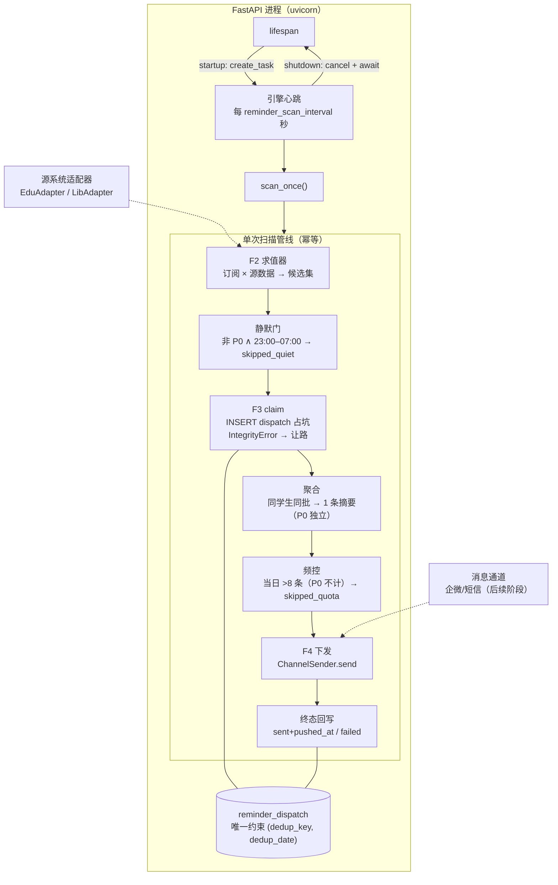

# 任务设计文档 — 子任务 5（R0）：提醒引擎

> 文档编号：WAgent-IMPL-09
> 版本：v1.0
> 适用阶段：阶段一 · 提醒引擎（M5）
> 关联文档：[`10-阶段一-校园助手Agent设计.md`](../10-阶段一-校园助手Agent设计.md) §7（提醒目录与防打扰规则，规则冻结源）｜ [`12-阶段一-技术架构与数据契约.md`](../12-阶段一-技术架构与数据契约.md) §2/§4/§6（架构与闭环时序）｜ [`15-阶段一-核心设计任务实施规范.md`](../15-阶段一-核心设计任务实施规范.md) §3.3（C3 表模型）｜ [`03-编排核心Orchestrator设计.md`](./03-编排核心Orchestrator设计.md)（lifespan 装配先例）

### 修订记录

| 版本 | 日期 | 变更 |
|---|---|---|
| v1.0 | 2026-10-19 | 初版：总体设计 + 三个决策点裁决（D1 调度 / D2 静默期 / D3 并发防重） |
| v1.1 | 2026-10-19 | R1 实现回写：dedup_key 增判别位；天粒度锚定投递时刻 08:00；对称回看窗口；WBS 重排（纯函数先行） |
| v1.2 | 2026-10-20 | R2 实现回写：`ChannelSender` 定名 `PushAdapter`（send 回执式、开发桩 degraded 回执、企微 webhook 通道、配置门控工厂）；WBS 二次重排（通道先行于心跳） |
| v1.3 | 2026-10-21 | 脏 timing 防线双层化（联调评审发现）：契约层 `TriggerConfig.timing` 词表 validator 治本（`parse_timing` 上移 schemas）；风险③缓解从"scan_once 全捕获"细化为**按订阅粒度隔离异常**（单点毒不扩散） |
| v1.4 | 2026-10-21 | D3 协议与表模型对齐（联调评审发现）：`reminder_dispatch` 落 `claimed_at` 可刷新认领锚（迁移 0003）——D3 SQL 原引用的列此前不存在，CAS 无从执行；弃用 `created_at` 当锚（不可刷新 → 双发窗口）；`status` 注释补 `claimed`/`skipped_quota` |

---

## 一、任务概述

### 1.1 背景：六工具齐备，引擎未点火

阶段一交付物中，提醒引擎是唯一"**学生不主动提问也会发生**"的能力（10 §7），
也是项目从"工具"变成"服务"的分界线。当前现状：

- 订阅入口已就绪：`reminder_subscribe` 工具可登记/修改/取消订阅，
  `reminder_subscription` 表有真实数据可写；
- 发送记录表已就绪：`reminder_dispatch` 含唯一约束 `(dedup_key, dedup_date)`
  （AC3.4 已验证）与 `status: sent/failed/degraded/skipped_quiet` 状态位；
- **触发侧完全缺失**：没有任何东西会扫订阅、算窗口、下发提醒。订阅了
  "图书到期提醒"的学生什么也收不到。

本任务（R0）先定**总体设计与三个决策点的裁决**，R1 起按 §五 WBS 分步实现。

### 1.2 目标

| 编号 | 目标 | 验证方式 |
|---|---|---|
| G1 | 调度心跳随应用生命周期启停，零新依赖 | AC-1 |
| G2 | 三类触发器的**求值模型定型**（时间窗口 / 状态对账 / 阈值快照） | AC-2/10 |
| G3 | 防打扰四闸（静默/去重/聚合/频控）与 10 §7.4 规则逐条对齐 | AC-3~7 |
| G4 | 双实例并发扫描零重复推送，无协调基础设施 | AC-8/9 |
| G5 | 下发通道抽象 + 阶段一日志桩，降级链留好表结构 | AC-11 |
| G6 | 效果回流字段（opened_at/action_taken）可更新，支撑损失规避率统计 | AC-12 |

### 1.3 范围

**做**：`app/reminder/` 新包（求值器、时机门、下发器、引擎循环）；lifespan
接线与配置；阶段一实做**时间型**两类提醒（图书到期 `library_due`、上课提醒
`course`，源数据适配器均已存在）；事件型/阈值型求值器 **Protocol 预留**；
双实例 claim 协议；日志下发桩；09/10 文档。

**不做**：企微/公众号/短信真实通道（后续阶段，接口已留）；降级链的真实
重推编排（主通道未读 6h → 次通道 → 短信——阶段一只落表结构与状态机设计）；
exam/signup_deadline/grade_publish/reservation_arrival 求值器实现（源数据
未接入，接口预留后随源接入逐个点亮）；提醒内容模板中心（先内嵌 f-string，
模板化登记为技术债）。

### 1.4 与上游下游的关系

```
reminder_subscription 表（reminder_subscribe 工具写入）
  │  每个扫描 tick
  ▼
ReminderEngine（app/reminder/engine.py，lifespan 心跳）
  ├─ 求值器 Evaluator：订阅 × 源数据 → 候选集（含窗口证据）
  ├─ 时机门 Gate：静默 → claim 去重 → 聚合 → 频控
  ├─ 下发器 ChannelSender：LoggingChannelSender（阶段一桩）
  └─ reminder_dispatch 表：claim / 终态 / 效果回流
```

---

## 二、总体设计

### 2.1 设计原则

| 原则 | 落点 |
|---|---|
| P4 确定性优先（03 §2.1） | 求值与四闸全是确定性代码路径，LLM 零参与 |
| 无静默失败（C4 R4.4） | 每个候选必有终态：sent/failed/skipped_quiet/skipped_quota |
| 幂等自愈 | 扫描 + 去重 ⇒ 错过的 tick 下一 tick 自然补上，无补偿机制 |
| 零新依赖 | 阶段一运行清单（backend/requirements.txt）不新增任何包 |
| dev/prod 同构 | 并发正确性只依赖 SQLite 与 PG 语义一致的部分（唯一约束 + CAS UPDATE） |

### 2.2 架构与数据流



### 2.3 触发求值模型（三类触发器定型）

三类触发器统一为**对账式求值**（reconciliation）：每个 tick 从**当前状态**
重新计算"此刻应发什么"，而非消费一次性事件流。这是 D2 跳过策略安全的前提。

| 触发类型 | 求值模型 | 候选判定 | 阶段一实现 |
|---|---|---|---|
| 时间型 time | **窗口命中**：`exists t ∈ timing` 使 `trigger_at(t) ∈ [now, now + horizon)` | 窗口仍有效 ⇒ 候选（同窗口内去重防重复） | ✅ library_due（T-3d/T-1d，源 LibAdapter.fetch_loans）、course（T-30min，源 EduAdapter.fetch_timetable） |
| 事件型 event | **状态 diff**：源状态（如"成绩已发布"）与"已通知水位"比对，水位落后 ⇒ 候选 | 状态持续存在 ⇒ 次晨扫描自然重放 | 🔶 Protocol 预留（grade_publish 等，源接入后点亮） |
| 阈值型 threshold | **快照比较**：`metric(source) op value` 成立 ⇒ 候选 | 条件持续成立，靠去重约束日级去重 | 🔶 Protocol 预留（超期预警等） |

```python
class ReminderEvaluator(Protocol):
    """求值器协议：订阅 + 当前时刻 → 候选集。实现随源数据接入逐个注册。"""
    subjects: frozenset[ReminderSubject]
    async def evaluate(
        self, subs: Sequence[ReminderSubscription], now: datetime
    ) -> list[ReminderCandidate]: ...
```

**窗口时间语义（R1 定版）**：`T-Nd` 天粒度时机锚定在"截止日 − N 天"的投递
时刻 08:00（`DEFAULT_REMIND_TIME`，避开静默期——若锚定 00:00，首个日间扫描
永远错过触发点，D2 的次晨重放叙事不成立）；`T-Nh/T-Nmin` 时/分粒度锚定在
事件时刻 − N（上课提醒的事件时刻 = 节次开课时刻，由调用方提供节次→时刻
映射——`TimetableItem` 本身无绝对时刻，`weeks` 周次匹配属适配器/调用方职责，
纯函数不解析自由文本）。窗口判定 `now − lookback ≤ trigger_at < now + horizon`：
`horizon` = 扫描间隔 ×2（防 tick 抖动漏窗），`lookback` 默认**对称于
`horizon`**（容忍一次错过的 tick；claim 去重保证放宽的回看不产生重复候选）。
**`dedup_date` = `trigger_at.date()`**（窗口归属日），而非扫描时刻所在日——
跨零点扫描不会分裂同一次提醒的去重身份。

**求值失败语义（C4 对齐）**：源适配器返回 `unavailable` / `stale_cache` 时，
**不产生候选**（宁可不发，不发错误数据），扫描日志记 `degraded`。用陈旧缓存
里的到期日推送"明天到期"，是典型的 P1 事故路径（K3）。

### 2.4 时机门与候选状态机

10 §7.4 防打扰表逐条落位：

| 机制 | 落点 | 关键约定 |
|---|---|---|
| 静默期 | 门 1（claim 之前） | 23:00–07:00（Asia/Shanghai，阶段一取服务器本地时）；非 P0 → 记 `skipped_quiet`（**`:quiet` 后缀 dedup_key**，见 D2）并移出候选 |
| 去重 | 门 2 = claim | `sha256(student_id\|subscription_id\|subject\|timing\|dedup_date[|discriminator])[:32]`。R1 补**判别位**：课程按开课时刻判别同日多节（否则下午课被上午课的 claim 顶掉）；借阅按日**库级去重**，同日多本书在生成器内合并为一条候选（候选 ↔ dedup 身份一一对应，杜绝同键静默丢书）。唯一约束兜底（见 D3） |
| 聚合 | 门 3（发送前渲染） | 同学生同批多条 P1/P2 合并一条摘要（"今日 2 条提醒"+明细）；**P0 永不聚合**，立即单发 |
| 频控 | 门 4（claim 之后事务内计数） | 单用户单日 ≤8 条（P0 不计）；超出 → `skipped_quota`；claim 后重计数消 TOCTOU |
| 可退订 | 既有 | `reminder_subscribe(enabled=false)` 即时生效，求值器只扫 enabled 订阅 |
| 降级链 | F4 | 阶段一表结构（channel/is_degraded）+ 状态机设计；真实重推后续阶段 |
| 免打扰例外 | 范围外 | 学校紧急通知白名单走独立通道，不属本引擎 |

候选生命周期（`reminder_dispatch.status`）：

```
(求值命中) ──门1 静默：非P0 ∧ 静默期──▶ skipped_quiet（:quiet 行，不占坑）
    │（过静默门）
    └──INSERT 占坑──▶ claimed ──发送成功──▶ sent(pushed_at)
                          ├──发送失败──▶ failed
                          └──频控超额──▶ skipped_quota
遗留自愈：claimed 超 reminder_stale_claim_seconds 未终态 → CAS 认领 → 续发
```

### 2.5 下发通道与降级链（R2 实现定版）

```python
class PushAdapter(Protocol):
    channel: str
    async def send(self, student_id: str, channel: str, content: str) -> PushReceipt: ...
    async def aclose(self) -> None: ...

@dataclass(frozen=True)
class PushReceipt:
    status: str          # "sent" / "failed" / "degraded" —— 直接映射 dispatch.status
    channel: str
    detail: str = ""     # 回执摘要/失败原因（仅元数据，不含 content）
```

- **完全对齐 edu/lib 适配器模式**：DI 构造（client + Settings）、客户端懒创建、
  `PushNotConfiguredError` 惰性校验（镜像 `SourceNotConfiguredError`，构造零副作用）、
  `aclose()` 幂等置空引用；
- **写路径不重试**（R4.3 同源约定：重试 = 重复触达风险）：传输失败返回 `failed`
  回执不抛异常，重试/换道语义归引擎降级链；
- **两个实现 + 工厂**：`DevStubPushAdapter`（记日志即回执 `degraded`——桩发送
  落 `is_degraded=true`，不冒充真实触达，无静默失败）；
  `WecomWebhookAdapter`（群机器人 text 消息，`errcode != 0` → failed 含 errmsg）；
  `build_push_adapter`：配置了 `PUSH_WECOM_WEBHOOK_URL` → 真实通道，否则桩；
- **降级链状态机（设计定型，实现后续阶段）**：`sent` 后 6h `opened_at IS NULL`
  → 扫描降级任务将其作为候选重发至 `channel` 链的下一跳（wecom → wechat_mp →
  sms_fallback），重发行 `is_degraded=true`，dedup_key 加 `|ch{N}` 后缀——
  与主发送互不挤占去重身份。P0 未读 24h 升级短信。

### 2.6 配置追加（config.py）

| 变量 | 默认 | 说明 |
|---|---|---|
| `REMINDER_ENABLED` | `false` | 引擎总开关（测试/联调显式开）；关闭时 lifespan 不启动心跳 |
| `REMINDER_SCAN_INTERVAL_SECONDS` | `300` | 扫描间隔（对齐 12 §2 "轮询兜底 5 分钟"） |
| `REMINDER_QUIET_START` / `REMINDER_QUIET_END` | `23:00` / `07:00` | 静默窗口（本地时） |
| `REMINDER_DAILY_CAP` | `8` | 单用户单日上限（P0 不计，10 §7.4） |
| `REMINDER_STALE_CLAIM_SECONDS` | `300` | claimed 遗留自愈阈值 |
| `REMINDER_HORIZON_TICKS` | `2` | 窗口前瞻 = 间隔 × N |
| `PUSH_WECOM_WEBHOOK_URL` | `None` | 企微群机器人 webhook（R2 已落地）；未配置 → 开发桩（degraded 回执） |
| `PUSH_TIMEOUT_SECONDS` | `10.0` | 推送单次超时（与源系统 2s 语义不同：外网出站） |

---

## 三、三个决策点裁决

> 裁决格式：选项 → 裁决 → 理由 → 代价与升级路径。三条裁决共享一个底层立场：
> **调度器应当愚蠢，正确性交给数据库**——心跳只负责"定期触发对账"，幂等性、
> 去重、并发安全全部下沉到 `reminder_dispatch` 的约束与状态位上。

### D1 调度方案：进程内 asyncio 循环（挂 lifespan）vs APScheduler

**裁决：进程内 asyncio 循环，挂 lifespan。不引入 APScheduler。**

| 维度 | asyncio 循环 | APScheduler |
|---|---|---|
| 依赖 | 零新增 | +1 包（3.x 维护放缓、4.x API 重写风险） |
| 与扫描模型的匹配 | 一个 `while + sleep` 心跳，天然贴合 | cron/jobstore/线程池能力全部闲置 |
| 错过 tick 的后果 | 下一 tick 对账自动补上（幂等自愈） | 需 misfire_grace_time 语义补偿 |
| 测试性 | 循环体抽为 `scan_once()` 直调 | 需起调度器或 mock job |
| 多实例 | 无感（D3 兜底） | 需额外配置防job重复 |

**理由**：

1. **我们调度的不是任务，是心跳。** APScheduler 的价值在"N 个异构 job 的
   cron 编排 + 持久化 jobstore"。本引擎只有一个动作：每 N 秒调
   `scan_once()`。为一次函数调用引入一个框架，复杂度方向反了。
2. **幂等自愈使 misfire 语义多余。** 求值是纯对账：错过 23:30 的 tick，
   07:05 的 tick 会基于同一状态重新算出该发的候选（窗口仍有效者）。
   APScheduler 最棘手的 misfire 补偿问题，在扫描模型下被**结构性消解**。
3. **事实核查**：APScheduler 在 15 §4.2 是设计期全量清单，**从未进入运行
   清单**（backend/requirements.txt 无此包）；12 §2 的原文是
   "APScheduler / 分布式定时任务 + 事件总线"，本裁决是对该行的收窄定型。
4. 与既有装配哲学一致：LLM 单例、适配器连接池都挂 lifespan，引擎心跳是
   第三个成员，shutdown 侧 cancel + await 收尾（镜像 `aclose` 幂等模式）。

**代价与升级路径**：多进程部署（uvicorn --workers>1）= 多实例心跳并发扫描，
由 D3 的唯一约束兜底，不需要换调度器；未来出现真 cron 需求（如每日 09:00
汇总推送）时，在心跳内按本地时刻判断即可；若阶段二引入独立 worker 进程，
`scan_once()` 原样搬走，lifespan 侧摘除。

### D2 静默期策略：直接跳过标 skipped_quiet vs 延迟补发

**裁决：直接跳过，记 `skipped_quiet`。不做延迟补发。**

**理由**：

1. **窗口型求值免费提供"次晨重放"，补发状态机是伪需求。** 静默门只是下发
   闸门的拒绝动作，不是求值的终止。窗口仍有效的候选（图书到期 T-3d 全天
   有效、成绩发布状态持续存在）在 07:0x 的首个心跳被**重新求值出来**并正常
   发送——这不是补发机制，是下一个心跳的正常产物。零新增状态。
2. **跨夜过期的窗口，补发 = 纯噪音。** 凌晨 01:00 命中的"T-2h 考试提醒"、
   "T-30min 上课提醒"，到 07:00 补发时事件已经过去。延迟补发方案必须引入
   "补发前有效期校验"状态机来拦住这类消息；而跳过方案下，求值器在次晨根本
   **不会产出**这些过期候选——同样的语义，零代码。
3. **`skipped_quiet` 状态位是表结构既定事实**（models.py 注释与 C3 表设计），
   且它有真实的观测价值：静默期拦截量是防打扰策略调参（窗口宽窄、P 级
   划分）的核心输入，也是"损失规避率"分母的修正项。
4. P0 穿透不变（10 §7.4）：静默门对 P0 直通，凌晨的调停课变更照发。

**关键工程细节（否则裁决 2 会自相矛盾）**：

> **`skipped_quiet` 行不得占用真实去重名额。** 唯一约束是
> `(dedup_key, dedup_date)`——若 23:30 的跳过行用了与真实发送相同的
> `dedup_key`，07:05 的真实发送会被唯一约束顶掉，**跳过就变成了永久丢失**。
> 因此跳过行的 `dedup_key` 追加 `|quiet` 后缀，落在独立命名空间，仅作观测；
> 次晨重放使用干净的去重身份，正常占坑发送。

**代价与升级路径**：被跳过且窗口跨夜过期的提醒不补发——这是**有意设计**
（噪音抑制优先于触达率），"损失规避率"统计时需将 `skipped_quiet` 从分母
剔除。若运营数据证明误伤（如凌晨发布的成绩早晨没人知道），升级方向是
"P1 静默期改为暂存次晨优先发送"的白名单机制，而非全局改回补发。

### D3 双实例并发扫描怎么防重：唯一约束兜底 vs 锁

**裁决：唯一约束兜底（claim-first 占坑 + CAS 认领自愈）。不引入任何锁。**

**协议**（两个动作，均只依赖 SQLite/PG 共有的语义）：

1. **claim-first 占坑**：发送前先 `INSERT INTO reminder_dispatch(dedup_key,
   dedup_date, status='claimed', ...)`。撞 `uq_dispatch_dedup` 唯一约束
   （IntegrityError）= 另一实例已认领 → 捕获、让路、跳过该候选。**插入成功
   即获得唯一发送权**，然后才执行聚合渲染、频控计数、通道下发，终态回写。
2. **CAS 认领自愈**：实例在 claim 后崩溃会留下 `status='claimed'` 的孤儿行。
   任一实例扫描时对"claimed 超 `REMINDER_STALE_CLAIM_SECONDS` 且无终态"的行
   执行 `UPDATE ... SET status='claimed', claimed_at=now WHERE id=? AND
   status='claimed' AND claimed_at < :threshold`——**rowcount=1 者获得续发权**
   （原子比较置换单语句完成，无检查-置位间隙）。续发沿用原 dedup 身份，
   不会重复。（v1.4：`claimed_at` 已落表——迁移 0003；锚**必须可刷新**，
   弃用不可变的 `created_at` 当锚，否则置换后另一实例下一 tick 可立刻重复
   认领同一行，留双发窗口。）

| 维度 | 唯一约束 + CAS | Redis 分布式锁 | PG advisory lock / SKIP LOCKED |
|---|---|---|---|
| 新增依赖/基建 | 无 | 锁可用性耦合（cache_backend=memory 时根本没有锁） | 无新依赖，但 |
| dev(SQLite)/prod(PG) 同构 | ✅ 两者语义一致 | Redis 是 dev 可选项 | ❌ SQLite 均不支持 |
| 正确性来源 | 数据库完整性约束 | 进程协作协议（锁过期/续约/脑裂） | 方言特性 |
| AC3.4 复用 | ✅ 约束已建并已验证 | — | — |

**理由**：

1. **正确性等级匹配。** "同一提醒最多发一次"是**不变量**，应当由数据库
   完整性约束保障，而不是由分布式锁的协议正确性保障。锁的失效模式
   （过期、续约失败、时钟漂移）每一种都会退化成重复推送；唯一约束的失效
   模式只有一种——数据库不可用，而那时整个系统都不可用。
2. **AC3.4 已经把这条路铺好了。** C3 验收时"第二次插入报唯一约束错误"已
   验证。本设计只是把"错误"变成"让路"，把约束从验收项变成运行时机制。
3. **失败窗口有自愈，无需 feared deadlock 讨论。** claim-first 的经典缺陷
   （认领后崩溃 → 永久卡死）由 CAS 认领闭环；认领后发送中崩溃最坏多走一次
   通道重试，与通道级幂等（企微模板消息天然幂等）叠加后可接受。

**代价与升级路径**：

- 双实例并发时，落败方浪费一次求值算力（IntegrityError 静默让路）——用
  无效计算换掉全部协调基础设施，阶段一规模下（日扫描量 ≤ 订阅数/300s）
  完全划算。
- **频控 TOCTOU 说明**：两实例同时为同一学生 claim 不同候选，可能双双通过
  门 4 计数。消解方式：频控计数发生在 claim 之后、同事务内重数（孤儿
  claimed 行也计入），最坏偏差 = 并发窗口内的 1 条超额。频控是注意力保护
  的**软约束**（10 §7.4 目的列写明"保护注意力"），不是硬 SLA，接受此偏差；
  P0 不计数不受影响。
- 若阶段二多实例规模扩大到让 IntegrityError 让路成本可观测（>1% tick 浪费），
  升级方向是**按 student_id 分片的 advisory lock**（降低碰撞概率）而非替换
  去重机制——唯一约束永远是最后一道闸。

---

## 四、功能详细设计

### F1 引擎心跳（engine.py）

```python
class ReminderEngine:
    def __init__(self, session_factory, evaluators, settings): ...
    async def start(self)   # create_task(_loop)，enabled=false 时 no-op
    async def stop(self)    # cancel + await（幂等，镜像 aclose 模式）
    async def _loop(self)   # while True: await scan_once(); sleep(interval ± 抖动)
    async def scan_once(self) -> ScanStats
```

- lifespan 接线：`engine.start()` / `finally: await engine.stop()`；
- `scan_once()` 是单测入口：不起心跳、直接调用、断言 `ScanStats`；
- 每次扫描独立 DB 会话（`async_session_factory`），异常捕获记日志不杀心跳。

### F2 求值器（evaluator.py）

- `LibraryDueEvaluator`：拉 enabled 的 library_due 订阅 → 批量
  `LibAdapter.fetch_loans(student_id)`（走既有缓存，TTL 5min）→
  `due_date - now` 命中 T-3d/T-1d 窗口 → 候选（携带窗口证据 `timing="T-3d"`、
  `trigger_at`）；
- `CourseEvaluator`：同理消费 `fetch_timetable`，T-30min 窗口；
- 候选结构 `ReminderCandidate(subscription, student_id, subject, timing,
  trigger_at, dedup_date, payload_vars)`——**payload_vars 只含模板变量**
  （书名/条码/到期日），不含成绩等敏感明细（R3 对齐：成绩类 subject 不在
  阶段一实现范围）；
- **异常隔离粒度 = 订阅**（风险③，v1.3 修订）：单个订阅的 trigger_config
  违反契约（历史脏库数据 → `CandidateGenerationError`）或节次映射缺失，
  只跳过该订阅并记日志，不得放大为全量扫描失败——scan_once 全捕获的粒度
  对此太粗，R3 接线时在求值循环内逐订阅隔离。

### F3 时机门（gate.py）

门序固定：**静默 → claim → 聚合 → 频控**。静默在 claim 前保证跳过不占坑
（D2）；频控在 claim 后保证计数含并发 claim（D3）。聚合是纯渲染分组，
不改变 claim 粒度（每候选一个 dedup 身份，10 §7.4 语义）。

### F4 下发与终态（已落地为 adapters/push.py，R2）

`PushAdapter` Protocol + `DevStubPushAdapter` / `WecomWebhookAdapter` + 工厂
`build_push_adapter`（详见 §2.5）。引擎侧消费：`send` 返回回执后单语句 UPDATE
终态（`receipt.status` 直接落 `dispatch.status`）；`failed` 的 `detail` 落日志
（dispatch 行无 reason 列，沿用 `is_degraded` + 日志 trace_id 关联）。

### F5 效果回流

`opened_at` / `action_taken` 更新入口留 REST 端点位（`POST /agent/reminder/
feedback`，由通道回调网关调用，阶段一先以 pytest 覆盖 Store 层）。

---

## 五、实施计划（WBS）

| # | 子任务 | 内容 | 前置 |
|---|---|---|---|
| R1 | 到期生成（纯函数） | `(订阅, 数据源快照, now) → 候选`：明天课表 + 借阅 N 天内到期；dedup_key 规则（含判别位）；日频计数纯函数。**零 IO/零调度/零推送**（P4），数据拉取复用 edu/lib 适配器由 R3 接线（降级语义白拿） | ✅ |
| R2 | 推送通道适配器 | `PushAdapter` Protocol（send 回执式）+ 开发桩/企微 webhook + 降级回执骨架（`receipt.status` 直接映射 `dispatch.status`）；全桩零网络单测 | ✅ |
| R3 | 骨架与求值接线 | config 六项、`ReminderEngine.start/stop`、lifespan 心跳、快照拉取接 `due_*_candidates`（stale/unavailable 不出候选）、求值**按订阅粒度隔离异常**（风险③） | R1 |
| R4 | 时机门与 claim | 四闸全序、claim-first、`:quiet` 命名空间、skipped_quota | R3 |
| R5 | 终态落库与回流 | send 回执 → dispatch 终态回写、feedback 端点 | R4 |
| R6 | 并发与自愈 | IntegrityError 路径、CAS 认领、孤儿行续发 | R4 |
| R7 | 收口 | AC 全量、README 勾选、09 文档修订 | R1–R6 |

---

## 六、质量保障

### 6.1 测试策略

- **时间冻结**：`freezegun`（既有 dev 依赖）冻结 `now`，覆盖静默窗口边界
  （22:59/23:00/06:59/07:00）与跨零点 dedup_date 归属；
- **假通道**：`RecordingChannelSender` 记录发送调用；**假求值器**：直喂候选，
  单测门逻辑不碰源数据；
- **双实例模拟**：同一 fixture 内两个引擎实例共享同一 DB（SQLite 共享文件 /
  内存 + 两连接），交错 `scan_once()` 断言唯一推送；
- **源故障**：respx mock LibAdapter 超时 → 断言无候选产生（C4 对齐）。

### 6.2 验收标准（AC-IMPL09-1 ~ 12）

| # | 验收项 | 通过标准 |
|---|---|---|
| AC-1 | 生命周期 | enabled=false 不启动；start/stop 幂等；shutdown 无悬挂任务 |
| AC-2 | 窗口命中 | T-3d/T-1d 各产生恰好一个候选，dedup_date = 截止日 |
| AC-3 | 静默跳过 | 静默期非 P0 → `:quiet` 行 + 不占坑；07:05 重放发出 |
| AC-4 | 静默过期 | 窗口跨夜过期 → 次晨无候选、无任何 dispatch 行 |
| AC-5 | P0 穿透 | 静默期 P0 照发且不聚合 |
| AC-6 | 去重 | 同 tick 内重复求值不产生第二行；次 tick 重扫让路 |
| AC-7 | 聚合与频控 | 同学生 3 条 P1 → 1 条消息；第 9 条 → skipped_quota；P0 不计入 |
| AC-8 | 并发防重 | 两实例并发 claim 同一候选 → 恰一行 sent |
| AC-9 | 自愈 | claimed 孤儿超阈值 → CAS 认领续发，恰一次 |
| AC-10 | 降级不出错数据 | 源 unavailable/stale_cache → 零候选、日志 degraded |
| AC-11 | 通道抽象 | RecordingChannelSender 替换后引擎零改动 |
| AC-12 | 效果回流 | opened_at/action_taken 可更新且入损失规避率统计口径 |

### 6.3 风险清单与缓解

| # | 风险 | 缓解 |
|---|---|---|
| ① | 上课提醒依赖课表准确，调停课未同步 → 错误提醒 | 求值只用 LIVE/FRESH 数据；stale_cache 不出候选（§2.3） |
| ② | SQLite dev 与 PG prod 的 IntegrityError 异常类不同 | 捕获 `sqlalchemy.exc.IntegrityError`（方言无关） |
| ③ | 心跳异常逃逸杀死循环；单个脏订阅（如 LLM 编出的脏 timing 入库）毒化全量扫描 | **三层**：① 入库侧治本——`TriggerConfig.timing` 词表 validator（`T-\d+(d|h|min)`，schemas/reminder.py），脏参数入库前被拒；② 求值侧隔离——候选生成**按订阅粒度** try/except（`CandidateGenerationError` 只跳过该订阅并记日志，含节次映射缺失的脏课表），不放大为全员灭；③ tick 级兜底——scan_once 全捕获 + 日志，loop 层再兜底重启 |
| ④ | 频控 TOCTOU 偏差（D3 已述） | 软约束定位 + claim 后事务内计数收敛；不追加锁 |
| ⑤ | 服务器时区 ≠ 学生时区 | 阶段一声明单时区假设（校园内网部署）；per-student tz 留升级位 |

---

## 七、预期效益分析

- **阶段一闭环补齐最后一块**：订阅（已有）→ 触发 → 下发 → 回流全链贯通，
  README"提醒引擎"待办收口；
- **基建复用验证**：claim 协议、通道抽象、对账求值模型直接服务阶段二/三
  （流程待办、学分缺口阈值等 10 §7.3 目录扩展）；
- **决策可辩护**：三条裁决均给出否决项的失效模式对照，后续评审不必重开
  讨论；`skipped_quiet` 的 `:quiet` 命名空间避免了"跳过=永久丢失"的隐性
  缺陷，这类缺陷上线后极难定位。

---

## 八、附录

### 8.1 与现有约定的一致性核对

| 约定 | 来源 | 本设计落点 |
|---|---|---|
| 防打扰七机制 | 10 §7.4 | §2.4 逐行映射；可退订/免打扰例外引用既有/范围外 |
| 调度"APScheduler / 分布式定时" | 12 §2 | D1 收窄为进程内心跳，理由含运行清单核查 |
| "事件优先，轮询兜底" | 12 §2 | 阶段一无事件总线 ⇒ 轮询对账为唯一路径；事件型 Protocol 预留 |
| 每日 09:00 定时扫描 | 12 §6 路径 B | 实现为等价的间隔对账扫描（窗口语义不变） |
| 唯一约束 (dedup_key, dedup_date) | 15 §3.3 / AC3.4 | D3 claim-first 直接复用 |
| 降级五态 / 无静默失败 | C4 R4.1/R4.4 | 求值 degraded 不出候选；候选必有终态 |
| 敏感数据边界 | R3 红线 / R3.4 | payload_vars 不含成绩明细；日志学号脱敏；成绩类 subject 不在阶段一范围 |
| dispatch.student_id 存原值 | models.py 现状 | 与 subscription 表一致（服务端按本人 JWT 原值查询时间线）；audit_log 侧维持脱敏 |

### 8.2 术语表

| 术语 | 定义 |
|---|---|
| 对账式求值 | 每 tick 从当前源状态重算"应发什么"，不消费一次性事件流 |
| claim / 占坑 | 发送前先插 dispatch 行获取唯一发送权的动作 |
| CAS 认领 | 单语句 UPDATE 比较置换取孤儿行的续发权 |
| `:quiet` 命名空间 | skipped_quiet 观测行使用的 dedup_key 后缀，不占真实去重名额 |
| 损失规避率 | 因提醒避免的超期/错过 ÷ 应提醒总数（10 §7.5，分母剔除 skipped_quiet） |

### 8.3 参考实现链接

- 表模型：[backend/app/orm/models.py](../../backend/app/orm/models.py)（`ReminderDispatch` uq_dispatch_dedup）
- 订阅工具：[backend/app/tools/reminder.py](../../backend/app/tools/reminder.py)
- 触发配置契约：[backend/app/schemas/reminder.py](../../backend/app/schemas/reminder.py)（`TriggerConfig`）
- lifespan 装配先例：[backend/app/main.py](../../backend/app/main.py)（LLM 单例 + aclose）
- 降级语义：[backend/app/templates/degrade.yaml](../../backend/app/templates/degrade.yaml)

---

**相关文档** → [03 编排核心](./03-编排核心Orchestrator设计.md) ｜ [05 LLM适配器](./05-LLM适配器设计.md) ｜ [07 SSE端点](./07-SSE端点设计.md)
