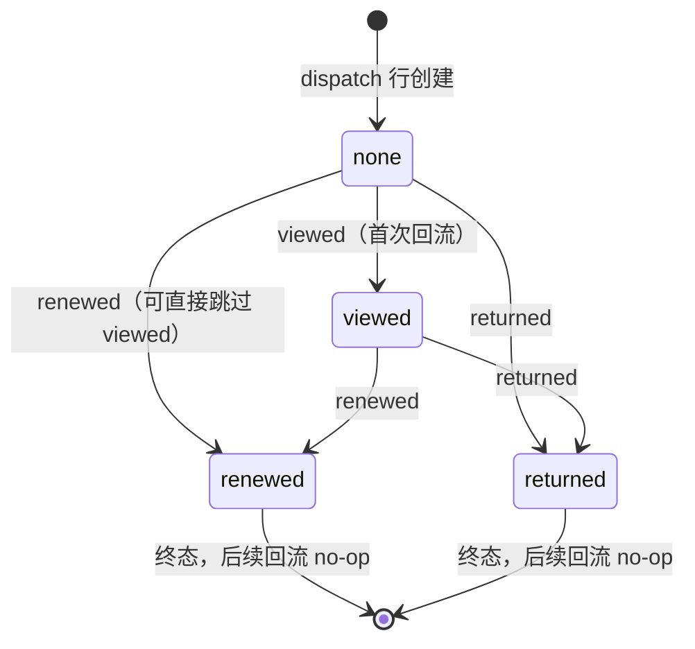

# 15 - 提醒引擎 R5：效果回流设计

> 关联文档：[`09-提醒引擎设计.md`](./09-提醒引擎设计.md) §2.5 F5（回流端点位）｜G6/AC-12（本切片的目标来源）｜[`12-阶段一-技术架构与数据契约.md`](../12-阶段一-技术架构与数据契约.md) §7 L4（身份注入铁律）｜[`07-SSE端点设计.md`](./07-SSE端点设计.md)（鉴权与脱敏日志基建）｜[`14-提醒引擎R4b-四闸全序与下发闭环设计.md`](./14-提醒引擎R4b-四闸全序与下发闭环设计.md)（dispatch 行终态语义）
>
> 版本：v1.2（2026-10-28，R5 全切片收口；更新记录见文末）  
> 交付边界：**本文档 + 实现与测试（R5.1）**。指标统计查询（损失规避率）不在本切片实现，只给出 SQL 形态（§六）。

---

## 一、背景与目标

R4b 闭环后，`reminder_dispatch` 每行都有终态，但系统**不知道提醒是否被看到、是否起了作用**。09 G6 要求：`opened_at`（打开时刻）/ `action_taken`（行为）两个字段可更新，支撑**损失规避率**统计（AC-12）——收到到期提醒的学生中，有多少人真的去续借/归还了。

本切片把这两个字段从"预留"变成"可写"：

```
学生点击/通道回执
      │  POST /agent/reminders/feedback（本切片新增）
      ▼
reminder_dispatch.opened_at / action_taken 单向推进
      │
      ▼ （R5.1+）损失规避率 = Σ(renewed,returned) / Σ(sent)
```

**不是**业务写门禁：续借的 confirmed 三重门禁（13 号文档）保护的是**源系统**（图书馆 ILS）的写路径；本切片写的是**自家观测表**，性质是埋点回流，两者容错策略相反（见 D2）。

## 二、请求契约与状态机

### 2.1 端点

```
POST /agent/reminders/feedback
Authorization: Bearer <学生 JWT>
{"dispatch_id": 123, "action": "viewed" | "renewed" | "returned"}
```

- `dispatch_id`：路径外参数（body 传，与既有端点全 body 风格一致），目标 `reminder_dispatch.id`；
- `action`：Pydantic `Literal` 校验，非法值 → 422（**schema 校验**，不是业务拒绝，与 D2 的宽容语义不冲突）；
- 响应 `200`：`{"dispatch_id": 123, "applied": true|false, "action_taken": "viewed"|...}`——`applied=false` 即幂等 no-op（重复/乱序/不可回流行），调用方无需区分原因。

### 2.2 `action_taken` 单向状态机



- `opened_at`：**任意**首次回流时写入（`renewed` 隐含"已打开"），只写首次——`WHERE opened_at IS NULL` + `COALESCE`；
- `action_taken`：只能沿箭头**向前**走；`renewed → viewed`、`renewed → renewed` 等非法回跳/重复 → 静默 no-op + 200（D2 裁决）；
- 转移合法性在**单条 UPDATE 的 WHERE 子句**内表达（CAS 式，无读-改-写竞态）：

```sql
UPDATE reminder_dispatch
SET opened_at = COALESCE(opened_at, :now),
    action_taken = :action
WHERE id = :id
  AND student_id = :student_id          -- 行归属（D1）
  AND status = 'sent'                   -- 只有已送达行可回流（D4）
  AND ( action_taken IS NULL            -- none → 任意
     OR ( action_taken = 'viewed'       -- viewed → renewed/returned
          AND :action IN ('renewed','returned') ) )
```

`rowcount == 1` → `applied=true`；`rowcount == 0` → 需区分两种情形（§四 D5）：行不存在/不归属 → 404；行存在但转移非法或状态不可回流 → 200 no-op。

## 三、决策点裁决

### D1 调用方与鉴权 —— **采纳建议：学生 JWT + 行归属校验，错配 404**

**裁决**：端点挂 `get_current_student`（security.py，L4 的唯一实现）注入 `student_id`；查询与 UPDATE 均带 `student_id` 条件，`dispatch.student_id ≠ 令牌身份` 时返回 **404**（不是 403）——不向调用方泄露"该 id 存在但属于别人"。阶段二通道回调网关出现时，再扩展服务凭证鉴权路径（独立 dependency，本切片不做）。

**否决：body 带 `student_id` 不鉴权**。理由（全部可追溯到既有铁律）：

1. **直接违反 L4**（12 §7）："`student_id` 只来自 JWT，请求体同名段一律忽略"——这是全项目身份层的架构级约定，07 §L4 行的同一表述已在 SSE 端点执行过一次；
2. `dispatch_id` 是自增整数，**可枚举**：不校验归属，任何持有效令牌的学生可以改写全校任意学生的回流数据，损失规避率统计被系统性污染（比数据丢失更糟——是悄悄地错）；
3. 与 `POST /agent/library/loans` 等既有端点的既有模式不一致：所有学生级端点都走 JWT 注入，开这个口子等于给"参数可填 student_id"开了先例，正是 12 §7 立这条铁律要防的事。

### D2 重复/乱序回流的语义 —— **采纳建议：幂等 no-op + 200，非法回跳静默吞掉**

**裁决**：`opened_at` 只写首次；`action_taken` 单向状态机（§2.2）；一切非法转移、重复回流、不可回流行的反馈 → `applied=false` + 200，服务端记一条 DEBUG 日志（含 trace_id），不打 WARN。

**否决：强拒绝 409/422**。理由：

1. **回流的到达语义是 at-least-once，重复是常态而非异常**。通道回调（阶段二网关）、客户端重试、学生重复点击都会产生同义回流——把常态当错误报，409 会以远高于真实异常率的频率出现；
2. **乱序是分布式的默认值**：`renewed` 回执先于 `viewed` 到达（学生直接从通知跳到续借页）是完全合法的用户路径，状态机已把它定为合法转移；反向回跳（`renewed → viewed`）是迟到报文，吞掉即可，拒绝它改变不了任何事实——第一次 `renewed` 已经生效；
3. **对比续借的 confirmed 门禁**：那是防"源系统不可逆写操作"（L2 红线域），错一次有制度后果，必须强门禁；回流写的是自家观测表，最坏结果是统计口径里少计/多计一次，宽容的代价近乎零，而 409 的代价是**调用方重试风暴 + 客户端错误日志噪音**——错误噪音比宽容更伤。

### D3 端点命名（补充裁决，关闭 12 §D1 命名债）

09 F5 预留路径为单数 `POST /agent/reminder/feedback`，但 R3c 已引入复数 `/agent/reminders/scan`。**裁决：新端点用复数 `/agent/reminders/feedback`**——与 scan 同族；`/agent/reminder/subscribe` 保持单数不动（改名破坏既有客户端与测试，收益为零）。命名债就此**部分关闭**：复数 = reminders 家族（scan/feedback 及后续），单数 = subscribe 一处历史遗留，不再新增单数端点。09 F5 的路径按此勘误。

### D4 可回流行范围（补充裁决）

只有 `status='sent'` 的行接受回流。`failed`（没送达，无可观测对象）、`skipped_quiet` / `skipped_quota`（根本没发）、`claimed`（占坑中）→ 200 no-op（`applied=false`），不报错——与 D2 的宽容哲学一致。`degraded` 是重发标记（`is_degraded` 布尔列），重发行是独立 dispatch 行，回流按行独立生效，互不干扰。

### D5 实现形态（补充裁决）

新建 `app/reminder/feedback.py`（不放 gate.py——门序是扫描侧职责，回流是查询侧职责；不新建 store 包——09 F5 所说"Store 层"由本模块函数承担）：

```python
async def apply_feedback(
    db: AsyncSession, *, dispatch_id: int, student_id: str,
    action: str, now: datetime,
) -> FeedbackResult:   # dataclass: exists, eligible, applied
```

两段式：先 `SELECT id, status`（带 `student_id`）判 **404 vs no-op**，再单条 CAS UPDATE 判 **applied**。两段之间无事务一致性问题：即使两步间隙状态被并发改掉，UPDATE 的 WHERE 仍然兜底（CAS 语义不依赖 SELECT 结果的新鲜度）。REST 端点在 main.py 调用它，日志用 `mask_student_id` 脱敏（对齐 07 §L4 基建）。

### D6 时间语义（补充裁决）

`opened_at` 取**服务端时钟**（`datetime.now(timezone.utc)`），不信任请求体时间戳——回流与 claim/pushed_at 同源 UTC，跨零点偏差沿用 09 D3 已声明的可接受近似。请求体不收时间字段，契约面更小。

## 四、实现规划（R5.1 执行清单）

| 项                          | 内容                                                                                                                 |
| -------------------------- | ------------------------------------------------------------------------------------------------------------------ |
| `app/reminder/feedback.py` | 新增：`FeedbackResult` + `apply_feedback()`（§2.2 SQL + D5 两段式）                                                        |
| `app/main.py`              | 新增 `POST /agent/reminders/feedback`：`get_current_student` → `apply_feedback` → 404 / `{"applied": bool, ...}`；脱敏日志 |
| `app/reminder/__init__.py` | 导出 `apply_feedback`、`FeedbackResult`                                                                               |
| 零 schema 变更                | `opened_at` / `action_taken` 列已存在（orm/models.py L71-72），**无 Alembic 迁移**                                           |
| 零新依赖                       | 沿用现有栈（09 §2.1 P 原则）                                                                                                |

## 五、测试计划（tests/test_api_reminder_feedback.py，R5.1）

| #        | 用例                                        | 断言                                                        |
| -------- | ----------------------------------------- | --------------------------------------------------------- |
| AC-R5.1  | 无令牌                                       | 401，库中行未变（鉴权在业务前，复用 test_api_chat 基建）                     |
| AC-R5.2  | 令牌学生 ≠ 行归属学生                              | 404，库中行未变                                                 |
| AC-R5.3  | 首次 `viewed`（真实引擎造 sent 行）                 | 200 `applied=true`；`opened_at` 非空、`action_taken='viewed'` |
| AC-R5.4  | 重复 `viewed`                               | 200 `applied=false`；`opened_at` 保持首次值                     |
| AC-R5.5  | 合法转移 `viewed → renewed`                   | `applied=true`                                            |
| AC-R5.6  | 非法回跳 `renewed → viewed`、`viewed → viewed` | 200 `applied=false`，终态不变                                  |
| AC-R5.7  | 直跳 `none → renewed`                       | `applied=true` 且 `opened_at` 同步首次写入                       |
| AC-R5.8  | 不可回流行（skipped_quota / claimed / failed）   | 200 `applied=false`                                       |
| AC-R5.9  | `dispatch_id` 不存在                         | 404                                                       |
| AC-R5.10 | body `action` 非法值                         | 422（Pydantic Literal）                                     |

回归底线：全量套件 212 passed, 6 skipped 全绿。

## 六、已知限制与遗留

1. **损失规避率统计**（G6 最终目标）本切片不实现，SQL 形态定版备用：  
   `SELECT SUM(action_taken IN ('renewed','returned'))::float / COUNT(*) FROM reminder_dispatch WHERE status='sent' AND pushed_at >= :since`（分母是否排除 `is_degraded` 重发行 → R5.1 定）；
2. **通道回调网关 + 服务凭证**：阶段二出现企微回调时，新增独立鉴权 dependency（签名校验），复用 `apply_feedback`，不动学生 JWT 路径；
3. **`viewed` 的真实性**：阶段一桩通道没有真实打开事件，`viewed` 由学生端主动上报，存在"未看谎报 viewed"的可能——观测噪音，不设防（防伪需要通道侧回执，登记为阶段二项）；
4. 命名债剩余：`/agent/reminder/subscribe` 单数保留（D3）。

---

## 七、统计口径定版（R5.3，v1.1 追加）

`loss_avoidance_stats(rows) -> dict`（纯函数，`app/reminder/stats.py`）：输入 dispatch 行（鸭子类型，同 `daily_dispatch_count` 先例），输出 `{sent, opened, acted, opened_rate, action_rate}`。

| 字段 | 口径 |
|---|---|
| `sent`（分母） | `status='sent'` **且** `is_degraded=False` |
| `opened` | 分母内 `opened_at IS NOT NULL` 的行数 |
| `acted` | 分母内 `action_taken IN ('renewed','returned')` 的行数 |
| `opened_rate` / `action_rate` | 对应计数 / `sent`；分母为 0 → `0.0`（不抛除零） |

**剔除理由（定版）**：

1. `skipped_quiet` / `skipped_quota` 剔除——那是"**我们决定不打扰**"（静默门/频控门的主动决策），不是"提醒失败"，计入分母会人为压低所有比率；
2. `failed` 剔除——通道确认未送达，学生没收到过任何东西，无"效果"可回流；
3. `degraded` 剔除（含 `status='degraded'` 行与 `is_degraded=True` 的重发行）——前者通道确认未触达；后者与主行是**同一逻辑提醒的两行记录**（R4b D4：重发行 dedup_key 加 `\|ch{N}` 后缀独立成行），计入会**双计分母**。重发行的触达效果经由主行观测（回流按主行上报），主行始终是分母成员。

**近似性声明**：`action_rate` 是损失规避率的**阶段一近似**——严格定义需要业务事件"到期日**之前**完成续借/归还"（需比对源系统业务时间），且需区分"因提醒而行动"与"本来就打算行动"。阶段一只回答"收到提醒的人里有多少人行动了"，事件级归因登记为阶段二。

**调试面**：`GET /agent/reminders/stats`（复用 R3c 先例：学生 JWT 锁入口 ≠ 数据范围，统计是全局对账视图）。SQL 不做语义过滤，全表行交纯函数裁决口径（口径唯一真源在纯函数，SQL 侧无第二份逻辑）；阶段二可加 `since` 参数并下推 SQL。

> 更新记录：v1.1（2026-10-28）追加 §七；§六遗留项 1（分母是否排除重发行）就此关闭。

---

## 更新记录

- **v1.0（2026-10-28，R5.0）**：设计定版。D1（学生 JWT + 行归属 404，否决 body 带 `student_id`——L4 铁律 + id 可枚举）与 D2（幂等 no-op + 200，否决 409/422——回流 at-least-once、乱序合法、埋点与续借 confirmed 门禁性质相反）裁决；补充 D3 命名（复数 `reminders/feedback`，关闭 12 §D1 债）、D4 可回流行（仅 sent）、D5 两段式 CAS 形态、D6 服务端时钟。
- **v1.1（2026-10-28，R5.3）**：追加 §七 统计口径定版（分母 = sent 且非重发行；`action_rate` 为损失规避率阶段一近似）；§六遗留项 1（分母是否排除重发行）关闭。
- **v1.2（2026-10-28，R5.1/R5.2/R5.4/R5.5 收口）**：全切片交付完成——
  - R5.1 契约：`ReminderFeedbackAction`（与 ORM `action_taken` 注释逐字对齐）+ `ReminderFeedbackParams`（无 `student_id`）；契约测试 6 项；
  - R5.2 实现：`app/reminder/feedback.py`（两段式 CAS）+ `POST /agent/reminders/feedback` + 端点与包导出；
  - R5.3 实现：`app/reminder/stats.py` + `GET /agent/reminders/stats`；
  - R5.4 测试：4 组 12 项（归属 404 无写入 / open 幂等首次锚定 / 状态机推进与不回退 / AC-12 口径闭环）。过程修复一处实现缺陷：模块函数须 `await db.commit()`（请求级会话关闭即回滚，rowcount 在未提交事务中仍为 1——端到端测试先红后绿抓到）。另：R4b 交付后用户实测复现并修复 `_billable_rows` 双实体 Row `AttributeError`（频控基数跨批生效缺陷，独立于本切片，勘误见 14 §勘误）；
  - 全量回归 **238 passed, 6 skipped**；README 提醒引擎节勾选收口（本条）。
  - 阶段二遗留不变：通道回调网关 + 服务凭证、viewed 防伪、事件级归因（§六 2/3 与 §七近似性声明）。
